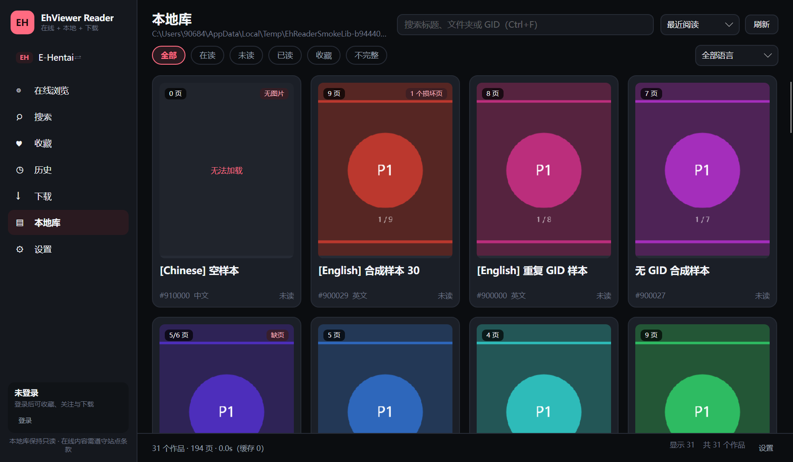
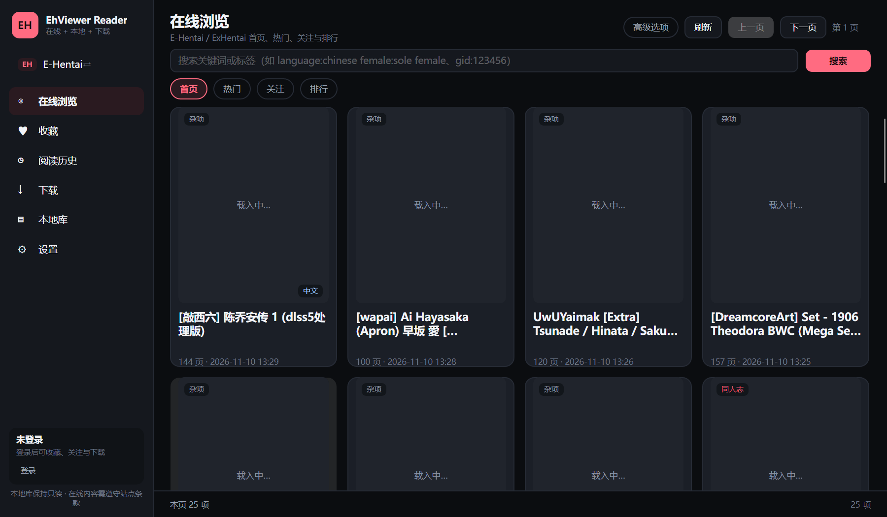
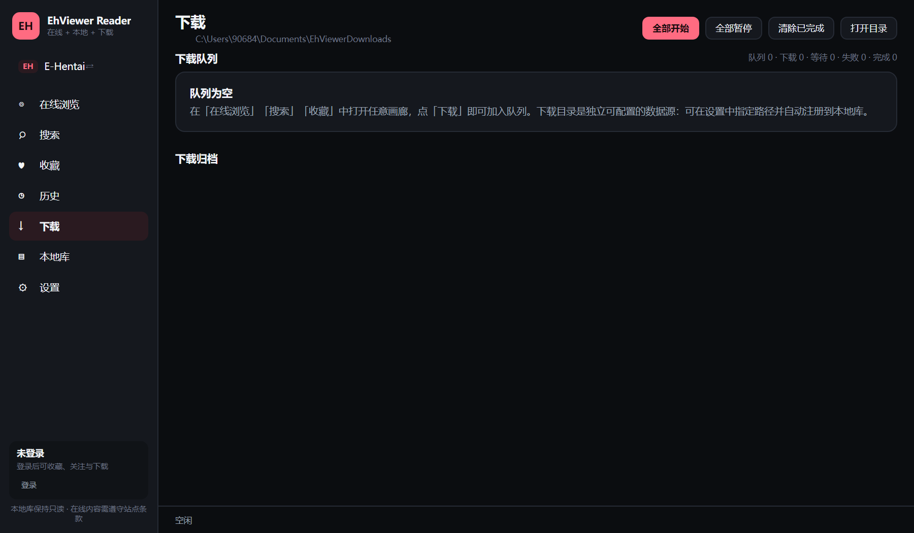
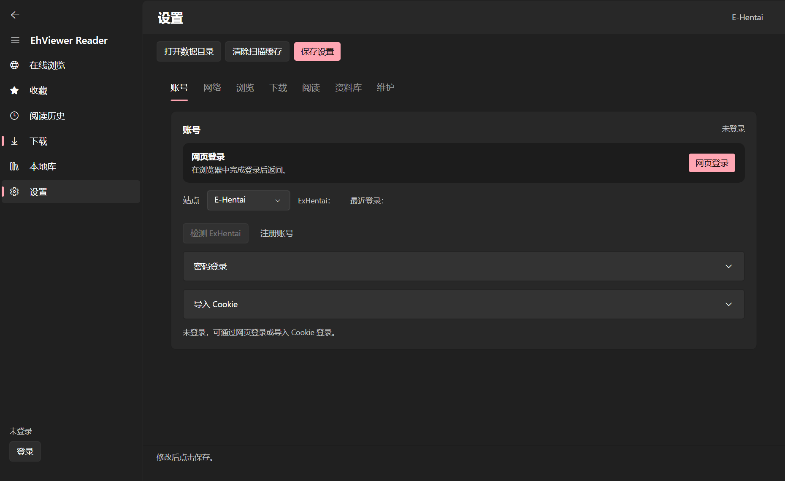

**English** | [**中文**](README.md)

<div align="center">
  

  <h1>EhViewer for PC</h1>

  <h3>Desktop Manga Library and Reader</h3>

  <h4>
    A desktop manga reading tool built with Avalonia 12 and FluentAvaloniaUI<br>
    Bringing your library, download queue and reader into a single window
  </h4>

  <div>
    
    
    
    
  </div>

  <br>

</div>

<br>

> **Scope of use**: This project is for organising and reading content already stored on the user's own machine. It does not provide, host or distribute any site content and ships with no account credentials. Online features access public web pages only according to the user's own configuration; availability and compliance depend on the user's account permissions, network environment and local regulations. Users are responsible for complying with applicable terms of service and laws. This project is not affiliated with the respective sites or upstream applications.

## 📥 Getting and Running

No prebuilt packages are distributed. Build from source before running (see "Building from Source" below).

```powershell
dotnet build src/EhViewerForPc -c Release
dotnet run --project src/EhViewerForPc -c Release
```

Online browsing is available on first launch. To use the local library, point "Local Library → Choose Library" at a directory containing your downloaded galleries. The download root defaults to `Documents\EhViewerDownloads` and can be changed in Settings.

## 🌟 Key Features

- 📚 **Local Library**
  - Source files are no longer subject to a global read-only constraint. Scanning, reading and indexing still leave them unchanged; the self-test compares before/after snapshots of path, size and mtime. Clicking "Continue download" adds missing pages in the selected copy's original folder, preserving existing images and metadata. The local-card context menu and version manager can delete one selected copy after inline confirmation of its full path, moving it to the Windows Recycle Bin while preserving other copies, favorites and reading progress
  - Reads directory layouts produced by EhViewer-style apps: VERSION1 / VERSION2 / CBOR metadata, 8-digit page filenames, `.thumb` covers and `.ehviewer` files containing GID, token and page count
  - Multiple data sources are merged by `WorkId` into one card with a copy-count badge; version management lets you choose a copy and a default, while progress is shared per work
  - Local details link directly to version management. Opening it checks each original folder; individual copies can be checked again, showing missing ranges, zero-byte files and expected totals separately. Checks of the same work preserve copy identities and existing image-index mappings. Unknown totals cannot verify missing trailing pages; offline copies report their own errors
  - Search by title, folder or GID; sorting, language and progress filters, favourites and duplicate-copy flags. Japanese and other common languages are always available. Filtering uses the folder's language tags first and falls back to locally stored work metadata
  - A virtualized grid handles collections in the thousands. Startup loads each source's valid scan cache. Adding a source loads or scans just that source. Refresh the local library manually to pick up external file changes, or run a full rescan under "Settings → Library"
  - Plain image folders with no valid 8-digit page filenames do not require `.ehviewer` / `.thumb`: they use the folder name as title, natural filename order (including `Image00000.jpg`) and the first image as cover. Scanning leaves source files unchanged and does not classify absent metadata as missing pages. Valid 8-digit page names preserve original page numbers and missing slots; extra covers do not enter the page sequence. Schema-3 scan caches are retained; only entries affected by diagnostic changes or misclassified page names need reparsing

- 📖 **Reader (shared by local and online content)**
  - Single page (fit page / width / height / original, 1x–8x zoom, dragging, wheel / click / keyboard paging), vertical continuous and horizontal continuous modes (the whole strip is reversed for RTL); double-page spreads keep their original aspect ratio
  - Progress is stored as "original page number + in-page offset"; online reading and local copies share one progress key, so reading continues after a download
  - Local and downloaded copies retain missing-page slots and the original total; missing pages show a placeholder while later page numbers and progress stay aligned
  - A page file that exists but is corrupt (truncated transfer, an HTML error page saved as an image) is treated exactly like a missing page: the reader draws no blank canvas, reports "page N is corrupt" and offers "Redownload this page", hiding the canvas in single-page mode so the notice never sits on an empty frame
  - The download page, version check and reader share one container-validation rule (header plus tail structure), so "missing here, fine there" cannot happen; the startup library scan skips it to keep large libraries fast and validates per page only when the reader opens or a check is requested
  - The More menu lists both left-to-right and right-to-left options, controlling horizontal continuous layout only and disabled in other modes. Arrow keys, the wheel and single-page click zones keep fixed directions
  - The online page source resolves only the preview pagination block containing the current page; images are downloaded on demand and cached under `online-cache`. Unresolved pages show placeholders that are filled with real dimensions after decoding
  - Load states are visible; a failure affects only that page and offers "Retry this page". Animated GIF / WebP playback, fullscreen and background colour options are available
  - Right-click a loaded page image to copy its original bitmap, save its original file, or reveal the file in Explorer. Online pages reveal their cached files. Copying an animation uses its first frame. Saving preserves the animation and requires a new filename
  - Choose and prepare a Japanese-to-Simplified-Chinese candidate in Settings → Interface and Reading → Manga Translation. The reader supports manual and automatic translation, copyable results, and review of low-confidence OCR. If JMangaTranslator-Fast repeats the same translation for different short utterances in one bubble, it retries them individually when it can identify the boundaries. The reader measures the usable interior of closed bubbles and wraps text there first. If the translation still cannot fit at a readable size at the current zoom, it extends just beyond the bubble where space permits and avoids neighboring text. Bilingual Text also shows the complete translation
  - Local "Retry this page" downloads only the selected page to the original copy folder and refreshes its placeholder and dimensions. Failed transfers preserve the original file; active writers in the same folder finish first. Ordinary folders without an original gallery link/page number reload local files and show the reason; "Continue download" handles the other missing pages
  - The reader opens inside the main window only; immersive mode hides the sidebar and title, and Esc exits it
  - An image memory budget covers raw decode buffers, the current bitmap, prefetch and animation canvases; the online disk cache has configurable size and retention limits with LRU eviction

- ⬇️ **Downloads**
  - A download engine independent of the local library: the queue is persisted in `downloads.json`, resumes from its last state after exit or a crash, and completed tasks appear only under "Completed", leaving the "Gallery downloads" queue
  - When the site answers "This gallery is unavailable", the task moves to the "Gallery unavailable" page and automatic starts and retries stop. Downloaded pages, folders and reading progress are kept; clearing the marker returns the task to the queue for a manual retry
  - Configurable download root and subdirectory rules. With "register download directory as source" and "automatically update local library" enabled, a copy appears as soon as the task is queued and becomes readable when its first image is saved. Online lists queue tasks from available information and the download worker fetches the gallery details. Startup restores cards from the queue, and first-page and terminal updates are saved to the corresponding source cache. Further downloads and reading update the affected copy and work progress
  - Incomplete copies remain readable and reaching the current last page does not mark the whole work as finished; gallery concurrency 1–8, per-gallery page concurrency 1–8, with serialized throttling on pagination requests
  - Local cards, details and version rows offer "Continue download" for the selected copy's exact original folder without changing the global download root; a GID and token are required. Conflicting original files are preserved and reported as failed pages. Repair tasks can be removed from the queue, but cannot delete the original folder
  - Repeated repair requests reuse existing tasks. Unchanged page checks do not rebuild the local lookup or trigger image-index maintenance; pause/running transitions do not rescan unchanged folders
  - A "Start all" request accepted during copy deletion resumes after recycling fails or is cancelled. A later pause remains effective; successful deletion does not start removed tasks or unrelated pending tasks
  - "Fill missing pages" rechecks incomplete copies in the current list against their original folders before enqueueing. Complete copies leave the incomplete category and are skipped; original paths are deduplicated, queued tasks are reused and paused/failed tasks continue. The batch saves once and exposes failures. Empty alternate files beside nonempty pages and outdated page-count warnings no longer classify a copy as missing pages
  - Download rows and local cards show current network speed, with an aggregate on the download page. A roughly two-second moving average updates every 500 ms, excluding cache hits and local file copies; paused and finished tasks report zero
  - Repair tasks include existing valid-page counts immediately: a copy missing only two pages shows `51/53` while waiting. Older zero-progress tasks are reconciled in the background at startup without changing pause state or starting extra downloads
  - Page writes update the affected work while preserving existing card positions, unchanged covers and progress rings. New works are inserted and works that no longer match the filter are removed; explicit refresh/sort actions reorder the list, avoiding transient progress resets and animation replay
  - Completed pages are detected by 8-digit filenames, so retries fetch only missing pages and failures are recorded per page; the output layout and metadata remain readable by similar apps
  - When an original image link is unavailable, the reader falls back to the resized image and shows the quality actually used
  - Changing the download root offers "use the new location for future downloads only" and "move existing downloads and update paths". A move pauses writes, verifies files and synchronises tasks, archives and library paths, with cancellation and interrupted-move recovery

- 🌐 **Online Browsing (optional)**
  - Front, popular, subscriptions and rankings are tabs in Online Browsing; gallery lists, searches and favourites append results near the bottom, retaining loaded items on failure with retry; search and browsing share one page, and `Ctrl+F` focuses the search box
  - Keyword and tag syntax, categories, title / tag / description / torrent-filename scopes, minimum rating, page ranges and language / uploader / tag exclusions; the 15 most recent searches are kept
  - Paste an E-Hentai or ExHentai gallery link into the Online Browsing search box and press `Enter` or click Search to open its details on the linked site. The cover loads from the detail page. Use Copy Link to copy the gallery URL to the clipboard
  - Online image search supports similarity scanning, cover-only results and inclusion of removed galleries; the image is submitted only when "Upload and search" is clicked. Tag lookup queries the local tag database in Chinese or English and inserts canonical namespaced tags
  - Bookmarks open in a dialog without navigating away or expanding advanced search; they store complete search queries with editing, reordering and deletion; the app can import the original app's exported `.db` (read-only `QUICK_SEARCH` access) and JSON bookmarks, and export a `.db` the original app can read
  - Online cards show a separate rating row and an opaque local / incomplete-copy badge below the title, refreshing after library scans; local read buttons have an opaque backing
  - The detail page shows cover, title, category, page count, rating, size, language, uploader, tags and reading progress; clicking a tag searches for it, and the primary button switches to "Read locally" when a local copy exists
  - Detail actions: five-star rating, reading and posting comments, torrent list (save `.torrent` / copy link) and archive download (Original / Resampled); favouriting uses a confirmation dialog, and cancelling sends no request
  - List filters hide or exclusively show items by tag, title or uploader and apply to the front page, search results and favourites; tag translation data can be updated manually
  - Images use resized variants by default, with 780 / 980 / 1280 / 1600 / 2400px or original options; caches are keyed by quality and download tasks record the quality selected when queued

- 🔍 **Local Image Search (optional, off by default)**
  - Enable it under "Settings → Local Library" and save, then open it from the library toolbar and build the index manually; no index is created and no extra page scans run by default
  - Index builds and updates continue in the application background after leaving or closing the search page; reopening shows progress and allows explicit cancellation. Application exit saves processed progress; after an interruption, the next launch resumes from the last committed batch; explicit cancellation preserves progress until manually continued
  - Building shows actual feature-assignment counts, merged partitions, checksum bytes and the current stage percentage. Stages without a known total use an activity indicator; extracted-page counts are not presented as build progress
  - The CPU index pipeline defaults to logical processor count minus 2 (1–32 workers), with a 128–1024 MiB workspace and separate reader/index quotas. On Windows, the app automatically tries ComputeSharp / DirectX 12 for FAST scores and large training Hamming-distance assignments, falling back to CPU if unavailable or failed. Grayscale and blur retain SIMD. CPU and GPU share the original extraction identity; existing indexes do not need rebuilding; area resizing reuses geometric weights while retaining identical pixels
  - Page tasks and completion states are persisted in batches. New jobs resume directly from their pending queue; training/building resumes do not first fall back to a full source-page scan. Before publication, source changes are checked in a separate, checkpointed stage. Source-image reads are serialized and synchronous I/O uses Windows background priority, while decoding and computation remain bounded and parallel. Manual updates read page names, sizes and modification times from directory entries and compare them with the published manifest in batches. A complete match reuses the existing index.
  - Features are stored once per content hash and extraction profile in `features.db`. An automatic index update after a download completes checks only that copy and reuses the published manifest for other copies. Incremental updates share immutable index files and reclaim unused snapshots after publication. Legacy `generations` are migrated without retaining duplicate feature databases
  - Accepts a file picker, drag and drop, clipboard images and rectangle cropping; results show the matched page, source copy and original page number, and "Read from this page" overrides history restoration while the query survives navigation back
  - The backend is pure C#, reusing SkiaSharp and SQLite with no additional runtime; a separate windowless host exists for build and verification. Source galleries are never written to
  - Validated quantizers and bucket tables are reused per immutable generation; file changes or a new publication trigger validation again. Initial loading shows checksum progress before the 30-second search budget starts. Descriptors are decompressed in batches and hit aliases are matched in one pass over legacy manifests, preserving existing index compatibility
  - Queries use CPU block reads and distance comparisons with up to eight readers by default, bounded by logical processor count. Buckets are visited in order, avoiding per-vector iteration, timing and atomic counters. GPU retrieval is omitted by user choice; existing GPU acceleration for index building remains
  - Incremental updates show reused pages separately from newly extracted pages. Unchanged pages merge directly into the manifest in signature windows of up to 4096, without per-page extraction scheduling or repeated source-file access. Only new, changed or failed pages enter extraction; source folders are checked before publication. Progress separates reused, newly extracted and failed pages, preserving checkpoints and existing indexes
  - File and clipboard query previews preserve colour and EXIF orientation. The preview is limited to 2048 pixels on its longest edge, while cropping uses original-image coordinates; grayscale conversion is used only for retrieval
  - Five center-cropped images from a real library have found their original pages using the existing 435,605-page index. Samples, timings and limits are in the [search and repair validation report](docs/实际索引裁剪检索与补页修复-2026-11-14.md); this is not a full-library recall measurement

- ⚙️ **Account, Network and Settings**
  - Sign-in is completed in the system browser; the app reads and persists only session cookies and never stores a password. Pasting a cookie string manually is available as a fallback
  - Proxy Mode under Settings → Network defaults to Automatic (自动). It follows system settings when it detects a Windows VPN or a common TUN adapter and uses Site Direct otherwise. New requests adapt when the VPN changes while the app is running. Existing settings retain their saved mode. You can also choose System, No Proxy, HTTP, SOCKS5 or Site Direct manually. Image proxying can be configured separately
  - Site Direct connects in-app pages and images through a routed physical Ethernet or Wi-Fi interface. For supported site hosts the app can connect to built-in addresses without sending SNI, while still verifying the original hostname and certificate chain. ExHentai content requires an account with access. External browsers use their own network settings
  - While in use, Site Direct automatically checks the Android project's default GitHub branch for updated site IPs. Connections can use local addresses while the check runs. A successful check is valid for 24 hours. A failed check can be retried on use after 30 minutes. Manual hosts take priority. If GitHub is unavailable or the table format changes, the app retains its last valid cache, bundled addresses and DNS fallback
  - Supports custom DNS-over-HTTPS endpoints, hosts entries and a connection test. If resolution fails or returns only fake addresses, Site Direct queries Alibaba Public DNS. It recognizes 198.18.0.0/15 and the paired IPv6 placeholders observed for site and H@H image hosts
  - Settings are grouped into categories and take effect on "Save settings"; saving uses an incremental merge so cached startup values cannot overwrite sources added at runtime

- 🪟 **Interface and Navigation**
  - The Windows tray menu offers "Show window", one-click entries for every page (online browse / favorites / reading history / downloads / local library / settings) plus a separate "Local image search" entry, and "Exit"; any entry brings the window to the front and then switches to that page. Closing the window keeps downloads and image indexing running by default and restores the same reader. Disable this under Settings → Interface and Reading → Keep running after closing the window; tray Exit releases application services
  - FluentAvaloniaUI `FANavigationView` + `FAFrame` history with back, forward and Alt+← / Alt+→
  - System / light / dark themes; the sidebar can collapse and remembers its state, collapses automatically in narrow windows, and list and scroll positions are preserved
  - Online and local details share `GalleryDetailsView`; descriptive text in Settings, details and the status bar can be selected and copied
  - On cold start, the main window opens before the online home page and local library load independently. System proxy lookup, download folder preparation, and library folder checks run in the background so navigation stays available. The online page shows status text during its automatic load and a progress bar for a manual refresh

## 🧩 Feature Matrix

| Module | Capabilities | Implementation |
| :--- | :--- | :--- |
| Local Library | Read-only scanning, multi-source merge, version management, search and filters | Virtualized grid, per-source signature cache, cache-first startup |
| Reader | Single / vertical / horizontal modes, animation, progress, online page source | On-demand pagination, placeholder backfill, shared progress key, image memory budget |
| Manga Translation | Japanese-to-Simplified-Chinese manual and automatic translation and region review | JMangaTranslator-Fast CPU ONNX, plus trial DirectML OCR and Vulkan GGUF models |
| Downloads | Queue, resume, concurrency and throttling, directory relocation | Persisted state, atomic writes, migration journal and rollback |
| Online Browsing | Search, subscriptions, rankings, bookmarks, details, rating and archives | In-house tolerant HTML parser, fixed-structure fixture tests, cookie session |
| Image Search | Indexing, cropped queries, matched-page location | Managed C# backend, SkiaSharp / SQLite, separate windowless host |
| Settings and Network | Proxy, DoH, hosts, cache policy, preference merge | Source-generated JSON contexts, deferred write queue, incremental merge |
| Interface | Navigation history, themes, shared details, selectable text | Compiled bindings, explicit page instances, semantic theme resources |

## 🖼️ Screenshots




Screenshots are generated by `--ui-smoke` with a synthetic library and contain no site content. More captures are in `docs/screenshots/`; the page-by-page review is recorded in [UI review notes](docs/UI-REVIEW-2026-11-12.md).

## 🧱 Architecture

| Path | Responsibility |
| :--- | :--- |
| `src/EhViewerForPc.Core/` | Format parsing, scanning and merging, caches, progress, online client and download engine; no Avalonia dependency |
| `src/EhViewerForPc.ImageSearch/` | Managed backend for local image search (feature extraction, indexing, SQLite, retrieval) |
| `src/EhViewerForPc.ImageSearch.Host/` | Windowless diagnostics entry point (CLI and loopback HTTP) |
| `src/EhViewerForPc/` | Avalonia application: `ViewModels/`, `Views/`, `Controls/`, `Services/`, `Styles/` |
| `packaging/EhViewerForPc.Msix/` | Windows application packaging project (`.wapproj`) |
| `tests/` | Core, image-search backend and windowless UI regression tests |
| `docs/` | Design, implementation and verification notes |

- A single `AppServices` container owns all services and disposes them in order on exit; MVVM uses `CommunityToolkit.Mvvm` source generators
- Compiled bindings are enabled and XAML resolves paths through `x:DataType`; pages and lists share the same controls and style resources
- Every persisted JSON document goes through source-generated contexts (`StorageJsonContext` / `ReaderJsonContext` / `SearchJsonContext`), written via a temporary file plus atomic replacement; no reflection-based serialization exists on runtime paths
- Online HTML is handled by the in-house tolerant parser `HtmlLite`; no third-party parser relying on CSS selectors or dynamic code generation is used
- Platform-specific code sits behind conditional compilation or `OperatingSystem.IsWindows()` guards; files and folders are opened through a platform launcher

## 🛠️ Building from Source

### Prerequisites

- [.NET 11 SDK](https://dotnet.microsoft.com/) 11.0.100 or newer. The repository has no `global.json`, so the CLI and IDE select the highest SDK they resolve
- Framework-dependent builds require the .NET 11 runtime; NativeAOT / MSIX output has no runtime dependency
- Targets Windows 10 / 11 x64 only
- Enabling long path support is recommended; the app also has a `\\?\` path fallback

> The solution `EhViewerForPc.slnx` contains a WAP packaging project (`.wapproj`) that `dotnet build` cannot build. Open the solution in Visual Studio for packaging; use the CLI only to build or run the application project.

### Build Steps

1. Build the application project:
   ```powershell
   dotnet build src/EhViewerForPc -c Release
   ```
2. Run it:
   ```powershell
   dotnet run --project src/EhViewerForPc -c Release
   ```
3. Publish to a dedicated output directory as needed:
   ```powershell
   # Framework-dependent (small, requires the .NET 11 runtime)
   dotnet publish src/EhViewerForPc -c Release -r win-x64 --self-contained false -p:PublishAot=false -o artifacts/win-x64

   # NativeAOT (self-contained, no .NET runtime required)
   dotnet publish src/EhViewerForPc -c Release -r win-x64 -p:PublishAot=true -o artifacts/win-x64-aot
   ```

The Release configuration enables `PublishAot` by default, so framework-dependent managed publishes must pass `-p:PublishAot=false` explicitly.

### NativeAOT and Packaging

- Requires the MSVC linker and Windows SDK import libraries. If only headers are installed, a NuGet package supplies them at build time (and is excluded from the output)
- HTML parsing, JSON persistence and bindings are AOT-compatible. Since Avalonia 12, Dev Tools is a separate product, so no debugger package is referenced; text shaping is provided by `Avalonia.HarfBuzz`
- Before publishing, prepare the native OCR and translation dependencies with `tools/translation/Prepare-NativeAssets.ps1` in PowerShell 7 or point `-p:MangaTranslationNativeDirectory=<prepared-directory>` at existing assets. See the [native translation notes](docs/本地漫画翻译原生后端验证-2026-11-24.md) for archive sources and build steps
- The output includes the native exe, Avalonia libraries, and DirectML, ONNX Runtime, llama.cpp and required C++ runtime libraries in `manga-native/`. The ZIP preserves the directory layout. Model weights are prepared separately on demand
- MSIX packaging: `packaging/EhViewerForPc.Msix` is a Visual Studio Windows application packaging project. It runs an AOT publish into `artifacts/msix/aot` before injecting the payload (`-p:SkipAotPublish=true` reuses the previous output)
- AOT code generation happens only in the publish pipeline, so the packaging project uses the `PublishAotForMsix` / `InjectAotPayload` targets to replace the payload; check these first if packaging breaks after a Visual Studio upgrade
- After the package identity was renamed, existing installations cannot be upgraded in place; uninstall the old package first

## 🖥️ Command Line and Diagnostics

All unattended modes run without dialogs; diagnostics can be written to the path given by `--out`. `StartupOptions.Parse` is the authoritative list of arguments.

| Argument | Description |
| :--- | :--- |
| `--root <path>` | Add a directory as a data source and enable it (existing sources are preserved) |
| `--gallery <gid\|stableId>` | Open the matching local gallery after startup |
| `--data-dir <path>` | Override the application data directory for test isolation |
| `--out <path>` | Output path for reports or screenshots |
| `--self-test` | Library scan / decode / read-only self-test, JSON report, exit code 0/1 |
| `--self-test --skip-snapshot` | Skip the before/after snapshot comparison (faster self-test) |
| `--self-test --deep-probe` | Read all page dimensions to find tall strips and the largest images |
| `--online-probe` | Network check: front page → detail → page list → image URL → thumbnail → torrent → tag database |
| `--login-probe` | Browser sign-in chain check (browser discovery, DevTools, cookie read/write and rejection) |
| `--ui-smoke` | Synthetic library screenshots, progress restore, virtualization stress test and page navigation |
| `--ui-audit` | Generate light/dark and wide/narrow captures for every page in an isolated data directory |
| `--reader-regression` | Reading mode switch regression |
| `--navigation-regression` | Page navigation and back-stack regression |
| `--anim-probe <file> [--dump-frames <dir>]` | Frame count, frame durations, decode timings and playback simulation for one animation |
| `--probe-file <path>` | Diagnose one image: decodable or timing out |
| `--single-instance-probe <out.json>` | Unattended single-instance check: hide the window, signal from a second process, assert it is restored and the gallery id forwarded |
| `--image-search-probe-root <dir> --out <json>` | Windowless check of the application image-search service chain (requires an empty directory) |
| `--bookmark-probe-root <dir> --out <json>` | Windowless check of bookmark import/export compatibility (requires an empty directory) |
| `--manga-translation-worker <PNG> <model-dir> <native-dir> <model-id> <target-language-id>` | Internal windowless reader worker. It supports Japanese-to-Simplified-Chinese candidates. Requests for retired general-purpose models exit with code 3 |
| `--verbose` | More detailed diagnostics |

Examples:

```powershell
# Library self-test (read-only)
dotnet run --project src/EhViewerForPc -c Release -- --self-test --root "<library-root>" --out docs/selftest.json

# Online chain check
EhViewerForPc.exe --online-probe --out "<report-path>"

# UI smoke test (isolated data directory and synthetic library are used automatically)
EhViewerForPc.exe --ui-smoke --out "<output-dir>"
```

## ⌨️ Keyboard Shortcuts

Main window: `Ctrl+F` focuses the current page's search box, `F5` refreshes the current page, and `Esc` clears the local library search term.

| Key | Action |
| :--- | :--- |
| ← / → | Previous / next page, fixed regardless of page arrangement |
| PageUp / PageDown / Space | Page turn |
| Home / End | First / last page |
| + / - / 0 | Zoom in / out / fit page |
| Ctrl + wheel | Zoom around the pointer |
| Double click | Toggle fit page ↔ 100% |
| Wheel | Single page: pan when content overflows, then turn pages at the edge; horizontal mode: scroll horizontally |
| F11 / Esc | Fullscreen / exit fullscreen (press again to close) |
| M / D / B / ? | Mode (single → vertical → horizontal) / horizontal page arrangement / background / shortcut help |

## 🗂️ Data Storage

Application state is written to the system local application data directory (`%LocalAppData%\EhViewerForPc` on Windows) and can be overridden with `--data-dir`. If the new directory does not exist but the legacy `%LocalAppData%\EhViewerReader` does, the app keeps using the legacy directory so settings and progress survive the rename; the single-instance mutex also keeps its old name. A second launch hands "show window / open gallery" to the running instance over a named pipe and exits, so a window hidden in the tray is restored and brought to the foreground instead of doing nothing.

```
settings.json            Settings (session cookies, proxy, online / download / reading preferences, filter rules, sources, search history)
progress.json            Reading progress and favourites (per work ID, shared by online and local)
works.json               Work metadata across online and local sources
downloads.json           Download execution state and completed records
tag-translations.json    Cached tag translation data
upstream-hosts.json      Last validated upstream site address table, ETag and check time for Site Direct
library-cache-<src>.json Per-source scan signature cache
download-move.json       Recovery journal for a directory move (removed after completion)
dimensions/              Page dimension cache for continuous mode
covers/                  Local cover cache
thumbnails/              Online cover cache
online-cache/            Online reader page cache
image-search/            Local image index (configurable location, off by default)
manga-translation/       Default models (backend/models/), model verification records, and temporary page snapshots (input/)
exports/                 Export directory
logs/                    Runtime logs (no tokens or page content)
```

The **download root** defaults to `Documents\EhViewerDownloads` (configurable) and is separate from the data directory. Imported libraries are opened with `FileAccess.Read` only and no write APIs are used; `--self-test` compares path, size and modification-time snapshots before and after.

Inside the image-index directory, `features.db` stores deduplicated features and `build-job.json` stores a pending job and its phase. The job directory’s `build-plan.db` stores candidates, signatures and pending/completed page states, and is reclaimed after publication. `generations/` contains published snapshots and work in progress; `current.json` and `current.previous.json` are primary / backup pointers to the same current snapshot after publication cleanup. Once publication completes and old queries finish, only the current snapshot remains; builds and merges still require temporary space. Recovery, updates or cleanup migrate legacy features before reclaiming unused directories. Do not manually delete an unfinished job directory. A legacy unfinished job requires one enumeration to prepare its page plan on the first resume; extracted features remain reusable, and subsequent resumes read the persisted queue.

### Local Manga Translation Backend

The general-purpose Hy-MT2 1.8B and 7B models are retired. Settings offers JMangaTranslator-Fast v1 on CPU through ONNX, plus two GPU trial options, the Hy-MT2 manga fine-tune and the Qwen2.5 7B subtitle fine-tune. JMangaTranslator-Fast weights are for non-commercial use and downloaded on demand after you accept their license. Select a candidate and Simplified Chinese, then prepare its weights. Existing preferences and model files stay in place. After obtaining access from the publisher, download the Qwen3 4B or 8B weights manually and run `--manga-translation-worker --evaluate <TSV> <model-dir> <native-dir> <model-id>`. See [deployment and commands](docs/MODEL_DEPLOYMENT.md) and the [benchmark report](docs/BENCHMARK_REPORT.md).

## 🧪 Tests and Verification

```powershell
# Core regression (parsing, storage, downloads, settings merge, memory budget, etc.)
dotnet test tests/EhViewerForPc.Core.Tests -c Debug

# Optional: read-only integration tests against a local library
$env:EHVIEWER_TEST_ROOT = '<library-root>'
dotnet test tests/EhViewerForPc.Core.Tests -c Debug

# Image-search backend and windowless UI regression
dotnet test tests/EhViewerForPc.ImageSearch.Tests -c Debug
dotnet test tests/EhViewerForPc.ImageSearch.Ui.Tests -c Debug -p:PublishAot=false
```

For the index CPU / SIMD implementation, see the [implementation report](docs/索引CPU并行与SIMD验证-2026-11-14.md). Later concurrency changes, larger-page benchmarks and validation boundaries are in the [parallel scaling report](docs/索引并行扩容与阶段加速-2026-11-14.md).

ComputeSharp GPU computation and persistent pending-job recovery are integrated into the app. See the [implementation and validation report](docs/ComputeSharp与持久化恢复实现-2026-11-14.md) for measurements, compatibility and device coverage. A hardware DirectX 12 compute device is required; only NVIDIA was tested locally, with AMD / Intel hardware still unverified. GPU training uses comparison-bounded larger batches with combined upload/readback to reduce CPU synchronization waits; see the [training-batch fix report](docs/GPU训练批次与同步开销-2026-11-14.md). GPU handles part of the computation and does not guarantee faster processing for every image or batch. The standalone Host CLI still defaults to CPU. See the [extraction-stage optimization report](docs/页图提取缩放热点优化-2026-11-14.md) for the resizing hotspot and measured fix.

Explicitly run hardware GPU regressions (hardware cases are skipped by default on CI without a device):

```powershell
$env:EHVIEWER_GPU_TESTS = '1'
dotnet test tests/EhViewerForPc.ImageSearch.Tests -c Debug
```

Test projects referencing the main application must run sequentially because Avalonia XAML compilation shares output files. The backend also provides `tools/imsearch/Build-Backend.ps1` and `Test-Backend.ps1`, each verification run using its own isolated directory.

The online parser is covered by fixtures captured from fixed page structures; `--online-probe` helps separate network, account and parsing issues after a site change. A Debug build is not a substitute for actually launching a Release / AOT artifact. See [TEST_REPORT.md](docs/TEST_REPORT.md) for an early-version snapshot, and [remediation notes](docs/REMEDIATION.md), [online parity notes](docs/ONLINE-PARITY-2026-11-13.md) and [image-search status](docs/IMPLEMENTATION-LOCAL-IMAGE-SEARCH-STATUS.md) for current behaviour and verification boundaries. Most documents in this repository are written in Chinese.

## ⚠️ Known Limitations

- Online features depend on the site's page structure; layout changes affect parsing, and some actions require a signed-in session and the relevant account permissions
- Browser sign-in requires Microsoft Edge or Google Chrome; pasting cookies manually is the fallback when neither is installed
- Archive downloads and posting comments require sign-in; archive availability also depends on account allocation. Rating and comment voting are unavailable anonymously
- Tag translation data comes from a third-party community project and must be updated manually on first use
- Original images depend on links exposed on the view page; a resized image is used when the link is absent
- Image access is subject to account and IP quotas. View-page requests are serialized, but bulk downloads can still trigger rate limiting
- Favourite category names are local display labels and are not written back to the account
- Continuous and horizontal modes fit whole pages to the viewport and have no in-page zoom (single-page mode supports 1x–8x)
- Page and cover bitmaps are owned by their controls. Download events update the affected copy, and a manual refresh picks up external file changes
- Recall on a real image library and full-library search performance for local image search are not verified

## 💖 Dependencies and Credits

### Third-Party Components

| Library | Purpose | License |
| :--- | :--- | :--- |
| Avalonia / Avalonia.Desktop / Avalonia.Themes.Fluent | Desktop UI and Fluent theme | MIT |
| FluentAvaloniaUI | Navigation view, Frame and Fluent controls | MIT |
| CommunityToolkit.Mvvm | MVVM source generators | MIT |
| Avalonia.Skia / SkiaSharp / Avalonia.HarfBuzz | Rendering, image decoding and text shaping | MIT |
| Microsoft.Data.Sqlite | Image-search index and bookmark file I/O | MIT |
| ComputeSharp | FAST / training compute on Windows DirectX 12 | MIT |
| xunit / Avalonia.Headless.XUnit | Unit tests and windowless UI regression | See upstream release notes |

Package versions are managed centrally in `Directory.Packages.props`; each component follows its upstream license.

### Data Formats

The local library only reads directory layouts produced by EhViewer-style apps (GPL-3.0) and shares no code with them. Tag translation data comes from a third-party community project and is updated by the user.

## 📄 License and Usage Notes

The code and icon assets in this repository were created independently. No site content or account data is bundled. Online capabilities access only public pages that the user configures and is entitled to access, and the project is not affiliated with the respective sites. No open-source license file is included; please confirm the applicable scope and local legal requirements before use.

---

<div align="center">
  <sub>For local library organisation and reading only</sub>
</div>
