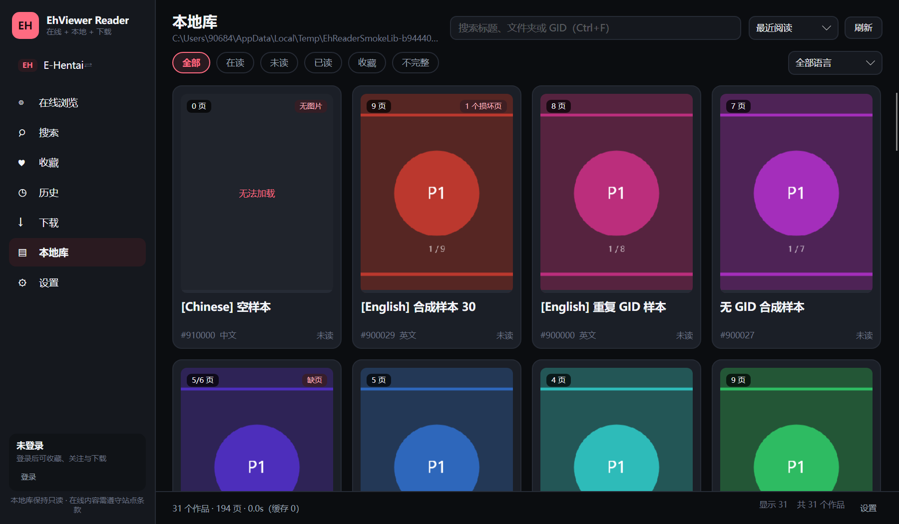
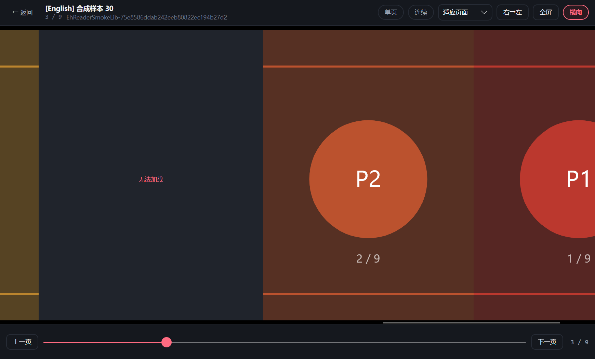
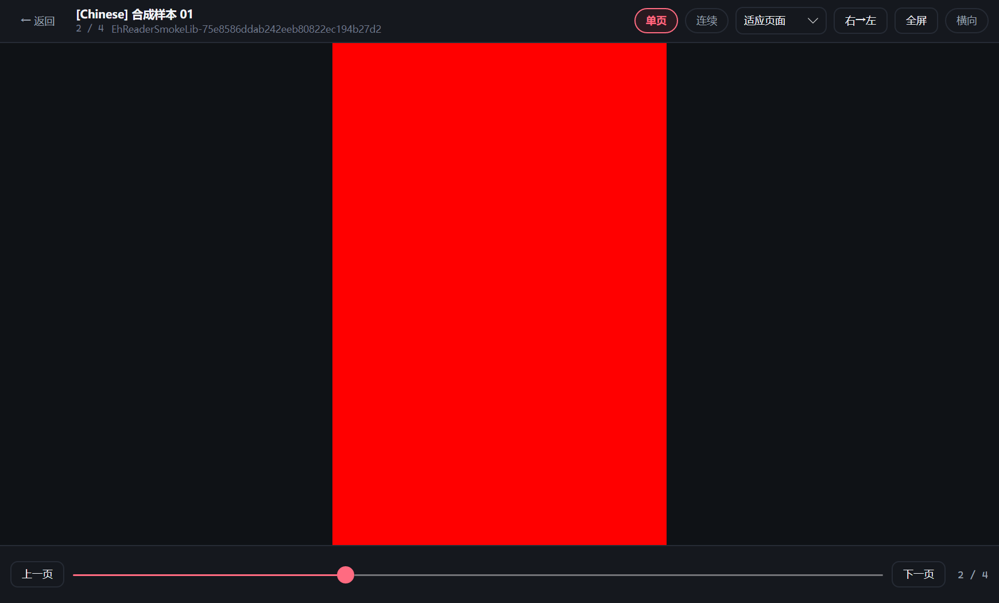

# EhViewer 本地漫画阅读器

面向 Windows 桌面的**纯离线**漫画阅读器：直接读取 EhViewer（含 [Ehviewer_CN_SXJ](https://github.com/xiaojieonly/Ehviewer_CN_SXJ)）的下载目录，以原生速度扫描、以虚拟化网格浏览、以单页或连续模式阅读。**全程不修改资料库中的任何文件。**

- UI：Avalonia 11.3.6 + Fluent（深色 / 浅色）
- 运行时：.NET 10（Windows x64），支持 NativeAOT 原生单文件发布
- 已验证规模：6,327 个画廊 / 245,548 页 / 约 24.4 万张图片（2.8 TB 机械盘，冷扫 81 s，热缓存 0.5 s 内启动）

## 截图

| | |
| --- | --- |
|  |  |
| 资料库网格（多源合并） | 横向连续模式（RTL） |
|  |  |
| 单页阅读（GIF 动图播放） | 版本管理（多副本） |

更多截图：`docs/screenshots/`（另有纵向连续、搜索筛选、详情窗口、设置窗口）。

## 功能

| 模块 | 能力 |
| --- | --- |
| 资料库 | 封面网格（ItemsRepeater 虚拟化，6,000+ 项仅创建约 20 个容器）、标题/文件夹/GID 搜索、排序、筛选、语言筛选、收藏、阅读进度、最近阅读 |
| 多数据源 | 可添加多个下载根目录（多设备备份场景）；同一作品跨源自动合并为一张卡片，角标显示副本数 |
| 版本管理 | 列出同一作品的全部副本（来源、页数、完整性、修改时间），可"用此版本阅读"或"设为默认"；切换副本后阅读进度按作品共享 |
| 阅读器 | 单页（适应页面/宽度/高度/原始、缩放 1x–8x、拖动、滚轮/点击/键盘翻页）、纵向连续条漫、**横向连续**（适应高度逐页横排，双页合并的宽图与长条图按原始比例完整显示）、阅读方向（日漫/美漫，横向模式整条反转）、GIF/WebP 动图循环播放、全屏、背景色；**独立非模态窗口**，阅读时可继续浏览资料库 |
| 进度 | 按"原始页号 + 页内偏移"保存与恢复；缺页时回退到最近存在的页并提示 |
| 详情 | 路径、GID、实际/预期页数、缺页区间、扩展名统计、0 字节文件、`.ehviewer` 解析错误 |
| 设置 | 主题、默认阅读模式/适应/方向、单张解码上限、数据源增删/启停、清除扫描缓存 |
| 无人值守 | `--self-test` 真实库自检 + 只读快照比对；`--ui-smoke` 合成库截图与虚拟化压力测试 |

### 多数据源与版本管理

- **合并规则**：按 `WorkId`（E-Hentai GID，或目录名 + 路径哈希）跨源分组；仅在 ≥2 个不同源之间合并，同一源内的重复 GID 视为不同汉化版本、不隐藏。
- **默认副本**：按「完整性 → 页数 → 有封面 → 修改时间」自动挑选，也可手动指定首选版本。
- **进度共享**：进度按作品而非副本保存，切换副本阅读不丢进度。
- **严格只读**：版本管理只做"选择副本"，不复制/移动/删除任何文件。

## 系统要求

- Windows 10 1607+ / Windows 11（x64）
- 依赖框架构建需 [.NET 10 Desktop Runtime](https://dotnet.microsoft.com/)；NativeAOT / MSIX 构建无运行时依赖
- 建议开启系统"长路径"策略；应用同时内置 `\\?\` 回退

## 构建与运行

```bash
dotnet build src/EhViewerReader -c Release
dotnet run --project src/EhViewerReader -c Release
```

> 注意：解决方案 `EhViewerReader.slnx` 含 WAP 打包工程（wapproj），`dotnet build` 无法构建它——请用 Visual Studio 打开 slnx（生成、F5 调试、打包都在 VS 内完成）；命令行只构建/运行应用工程即可。

首次启动点击"选择资料库"，指向 EhViewer 下载根目录（例如 `D:\BackUp\phoneGT5pro\ehviewer`）。

发布：

```bash
# 依赖框架（体积小，需要 .NET 10 Desktop Runtime）
dotnet publish src/EhViewerReader -c Release -r win-x64 --self-contained false -o artifacts/win-x64

# NativeAOT（自包含原生单文件，无需 .NET 运行时）
dotnet publish src/EhViewerReader -c Release -r win-x64 -p:PublishAot=true -o artifacts/win-x64-aot
```

### NativeAOT 说明

- 需要 VS 2022/2026 的 MSVC 链接器与 Windows SDK **导入库**（`um\x64\*.lib`）。若 SDK 只装了头文件，项目会通过 `Microsoft.Windows.SDK.CPP.x64` NuGet 包补齐（仅构建期使用，`ExcludeAssets="all"`，不进入输出）。
- 所有持久化 JSON 走源生成上下文：`StorageJsonContext`（设置/进度/扫描缓存）与 `ReaderJsonContext`（页面尺寸缓存）；运行路径上没有反射序列化。
- XAML 使用编译绑定；`Avalonia.Diagnostics` 仅在 Debug 构建中引用。
- 输出为约 22.9 MB 原生 exe，另附带 3 个原生库：`libSkiaSharp.dll`、`libHarfBuzzSharp.dll`、`av_libglesv2.dll`。
- AOT 下 `--self-test` / `--ui-smoke` 的 JSON 报告会降级为扁平结构（截图与流程不受影响）。

## MSIX 打包

`packaging/EhViewerReader.Msix` 是 VS 的 **Windows 应用程序打包项目**（`.wapproj`，与 little-fancy-tool-ava 同一套方案）。DesktopBridge 打包流程以**托管自包含**方式构建入口工程（`EhViewerMsixBuild=true` 时 `PublishAot=false` + `SelfContained=true`），因此包内不是 NativeAOT 单文件（NativeAOT 仍可通过 `dotnet publish -p:PublishAot=true` 单独获得）。

VS 中的用法：

- **打包**：右键 `EhViewerReader.Msix` 工程 → 生成；产物在 `packaging/EhViewerReader.Msix/AppPackages/`（`_Test` 侧载目录内，含 `.msix`）。
- **运行打包版**：把 `EhViewerReader.Msix` 设为启动项目，F5 = 部署 MSIX 并启动打包后的应用（首次 F5 需开启系统"开发人员模式"）。
- 解决方案构建时 wapproj 默认不参与打包（`PackageOptionalProjectsInIdeBuilds=False`），保持应用工程的日常构建轻快。

命令行构建 wapproj 必须使用 VS 自带 MSBuild（DesktopBridge targets 只随 VS 安装），`dotnet build` 不适用；纯命令行打 MSIX 请直接在 VS 中操作或调用 VS 的 MSBuild：

```bat
"I:\Program Files\Microsoft Visual Studio\18\Community\MSBuild\Current\Bin\MSBuild.exe" packaging\EhViewerReader.Msix\EhViewerReader.Msix.wapproj /p:Configuration=Release /p:Platform=x64
```

签名：工程默认 `AppxPackageSigningEnabled=False`。分发前在 VS"生成 → 应用程序包"里选证书签名，并把 `Package.appxmanifest` 的 `Publisher` 改成证书 Subject；否则安装时报 `0x800B0109`。清单 Identity：`EhViewerReader.Local`，`runFullTrust`；应用数据仍写入 `%LocalAppData%\EhViewerReader`。

## 命令行

| 参数 | 说明 |
| --- | --- |
| `--root <path>` | 把指定目录加入数据源并启用（不会清空已配置的其他数据源） |
| `--gallery <gid\|stableId>` | 启动后直接打开匹配画廊 |
| `--data-dir <path>` | 覆盖应用数据目录（测试隔离用） |
| `--self-test` | 扫描/解码/只读自检，输出 JSON 报告，退出码 0/1 |
| `--self-test --skip-snapshot` | 跳过快照（快速自检） |
| `--self-test --deep-probe` | 全量读取页面尺寸，寻找长条图/最大图（较慢） |
| `--ui-smoke [--out <dir>]` | 生成合成资料库、截图、进度恢复检查、6,315 项虚拟化压力测试 |
| `--probe-file <path>` | 诊断单个图片：Skia 是否可解析、是否超时（内部诊断用） |

示例：

```bash
dotnet run --project src/EhViewerReader -c Release -- --self-test --root "D:\path\to\ehviewer" --out docs/selftest.json
```

## 快捷键

阅读器：

| 按键 | 动作 |
| --- | --- |
| ← / → | 翻页（随阅读方向自动反转） |
| PageUp / PageDown / 空格 | 翻页 |
| Home / End | 首页 / 末页 |
| + / - / 0 | 放大 / 缩小 / 适应页面 |
| Ctrl + 滚轮 | 以指针为中心缩放 |
| 双击 | 适应页面 ↔ 100% |
| 滚轮 | 单页：内容溢出时平移，到边界后翻页（损坏页同样有效）；横向模式：横向滚动 |
| F11 / Esc | 全屏 / 退出全屏（再按关闭） |
| M / D / B / ? | 模式（单页→纵向→横向）/ 方向 / 背景 / 快捷键帮助 |

库视图：`Ctrl+F` 搜索、`F5` 刷新、`Esc` 清除搜索；右键卡片打开菜单（含"版本管理"）。

阅读器为独立窗口，打开后可继续在库视图搜索、筛选、打开其他画廊；再次点击同一画廊只会激活已打开窗口，不会重复写入进度。关闭阅读器后列表保持原滚动位置，"最近阅读"排序在下次刷新或切换排序时更新，避免列表在阅读返回时跳动。

## 数据目录

所有应用状态写入 `%LocalAppData%\EhViewerReader`：

```
settings.json            设置（含数据源列表、每作品首选副本）
progress.json            阅读进度/收藏（按作品 ID）
library-cache-<源>.json  每个数据源独立的扫描签名缓存（schema 2）
dimensions/              连续模式页面尺寸缓存
logs/app.log             运行日志（不含 token/页面内容）
```

资料库仅以 `FileAccess.Read` 打开；不使用写入 API。`--self-test` 会对资料库做"路径 + 大小 + mtime"快照并比对前后哈希（实测 25.8 万文件前后一致）。

## 测试

```bash
# 单元测试（44 项）
dotnet test tests/EhViewerReader.Core.Tests

# 真实库集成测试（34 项，只读）
EHVIEWER_TEST_ROOT="D:/BackUp/phoneGT5pro/ehviewer" dotnet test tests/EhViewerReader.Core.Tests

# 自检 + 只读快照
src/EhViewerReader/bin/Debug/net10.0/EhViewerReader.exe --self-test --root "D:/BackUp/phoneGT5pro/ehviewer" --out docs/selftest.json

# UI 冒烟与截图（仅合成库）
src/EhViewerReader/bin/Debug/net10.0/EhViewerReader.exe --ui-smoke --out docs/screenshots
```

覆盖范围与实测数据详见 [docs/TEST_REPORT.md](docs/TEST_REPORT.md)：单元测试覆盖 VERSION1/2/CBOR 解析、0 字节/缺页/同页多扩展、缓存签名失效、多源合并、设置迁移等；集成测试断言 ≥6,000 画廊、≥240,000 页、热扫描不慢于冷扫描等。

## 项目结构

```
src/EhViewerReader.Core/        格式解析、扫描、多源合并、缓存、进度（无 Avalonia 依赖）
src/EhViewerReader/             Avalonia 应用：ViewModels、Views、Controls、Services、Assets
packaging/EhViewerReader.Msix/  MSIX 打包项目（WAP wapproj，托管自包含负载）
tests/EhViewerReader.Core.Tests/
docs/                           PLAN.md、PLAN-CONTINUATION.md、FORMAT.md、TEST_REPORT.md、screenshots/
```

## 应用图标

图标为项目自有矢量绘制（SkiaSharp 生成），不含第三方素材（参考项目的 ico 随 GPL 分发，为避免许可风险未使用）：深色圆角底 + 珊瑚色开卷书本。`Assets/icon.ico` 含 16–256 px 九个 32 位帧，小尺寸使用简化几何以保证任务栏可辨识。

## 已知限制

- 纯离线：不登录、不搜索、不下载、不抓取标签。
- "继续阅读"横向定位条未实现（计划中的可选增强）。
- 连续/横向模式为整页适配滚动，不提供页内缩放（单页模式支持 1x–8x）。
- 动图在阅读器内循环播放；库封面只取首帧（避免滚动网格解码风暴）。
- 无全局位图缓存：页面/封面位图由控件独占，只保留当前页与预取页。
- 扫描不做文件系统实时监听；下载完成后点击"刷新"或重启。
- 多数据源按顺序扫描（避免机械盘并发寻道）；源较多时总耗时线性增加。
- 冷盘首次扫描可能较慢（实测 2.8 TB 机械盘 24.5 万页约 81 s）；启动采用缓存优先 + 后台扫描，UI 不阻塞，可随时取消。
- 超长路径依赖 Windows LongPaths 策略；未开启时部分 >260 字符路径可能无法读取。

## 许可

本项目自身的代码与图标资源独立创作。仅支持读取 EhViewer 类应用（如 [Ehviewer_CN_SXJ](https://github.com/xiaojieonly/Ehviewer_CN_SXJ)，GPL-3.0）产生的本地下载数据，与其无代码耦合；使用本项目产生的数据请自行遵守相关条款，本项目不对内容来源负责。
