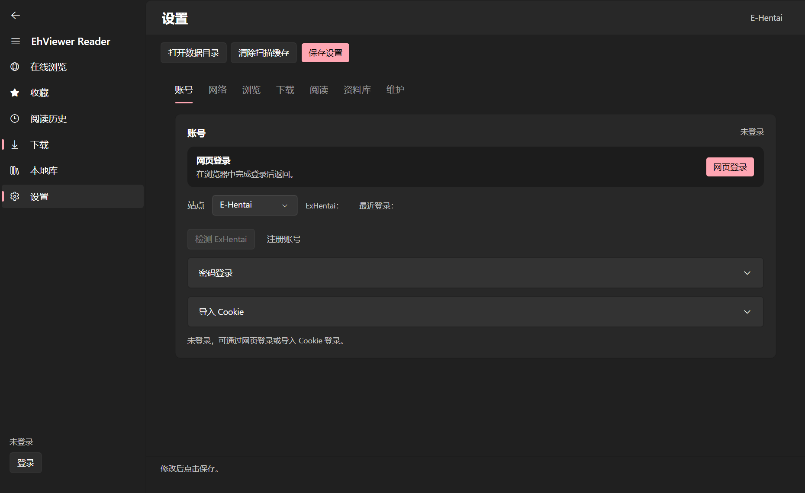
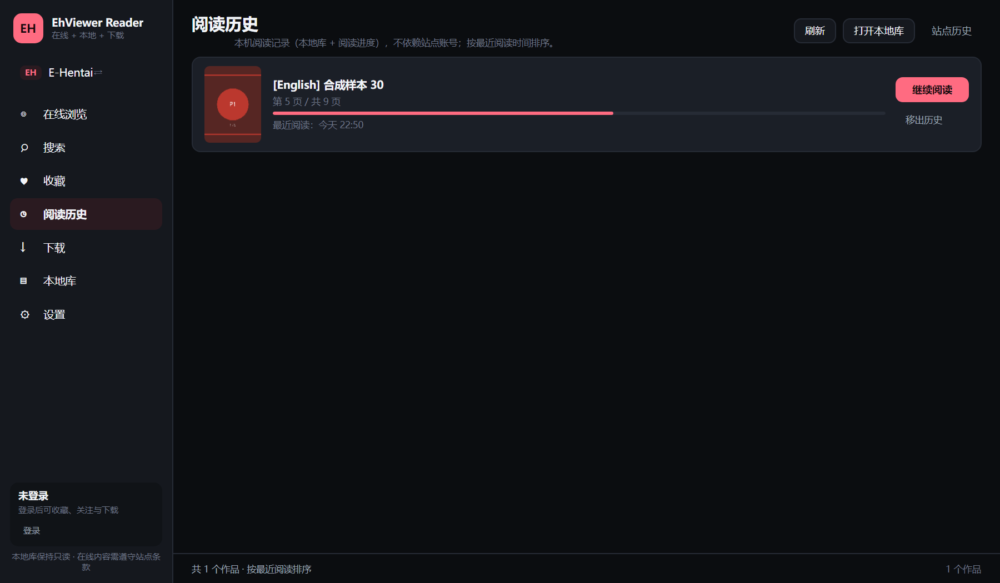
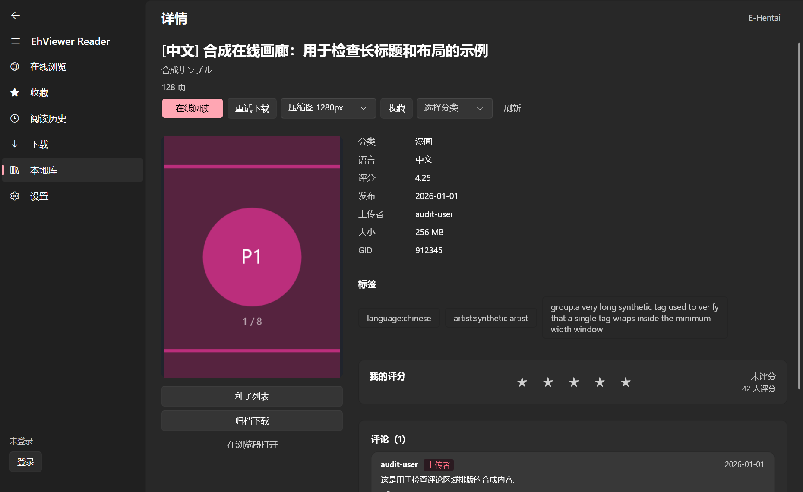
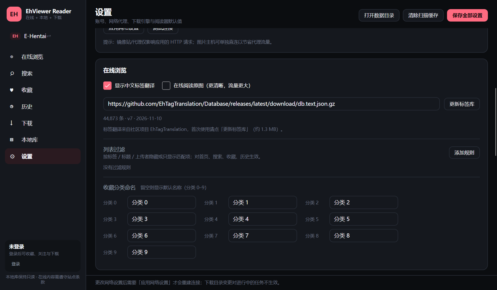
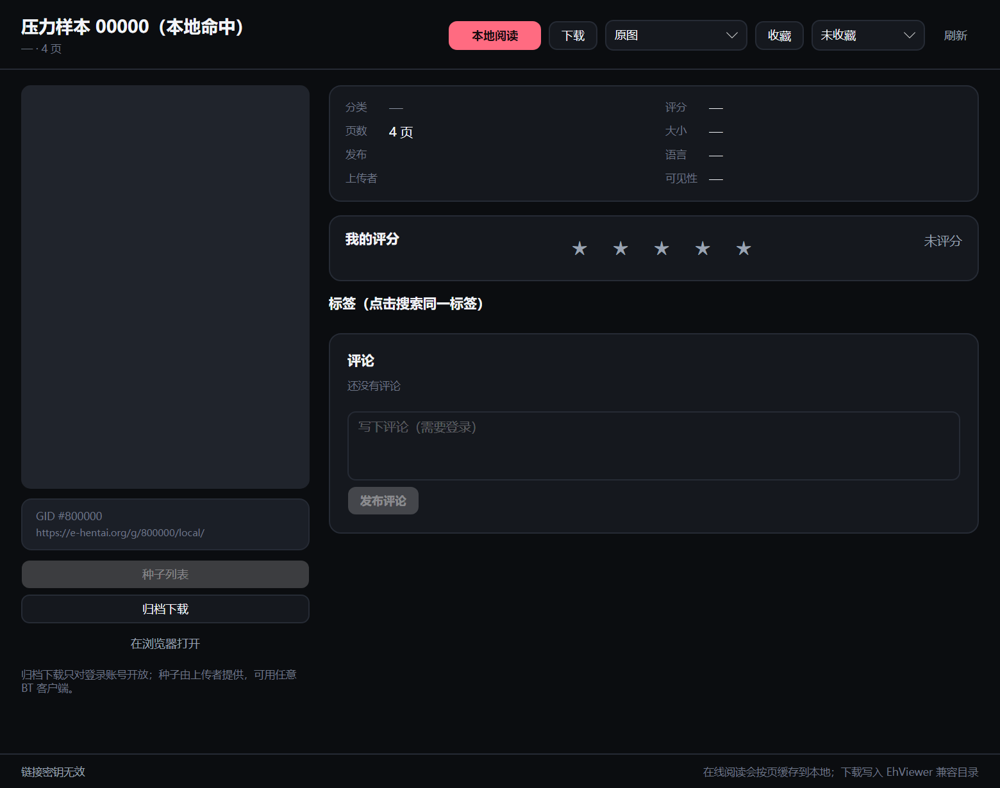
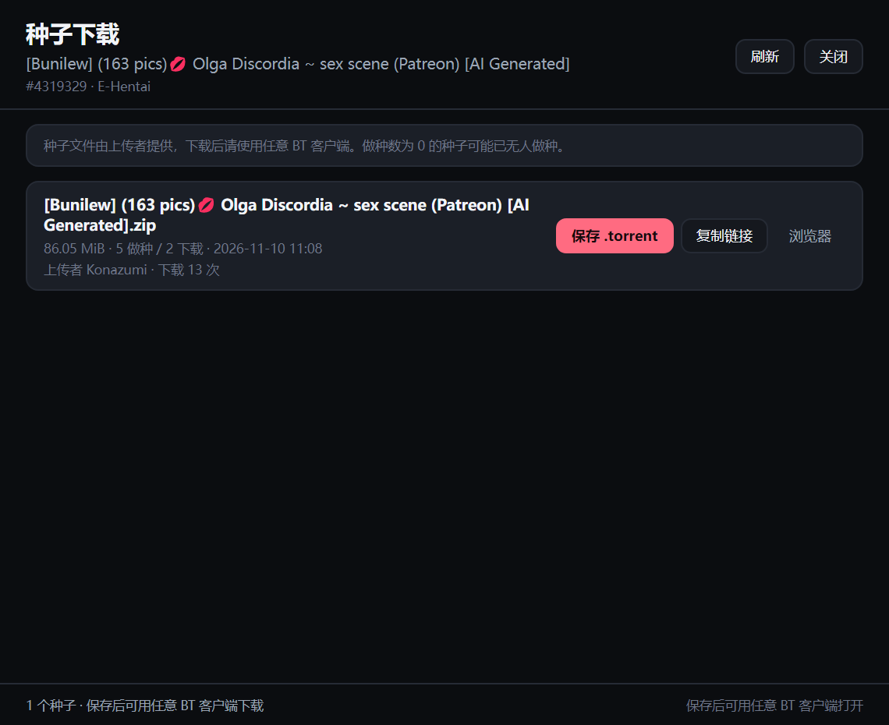
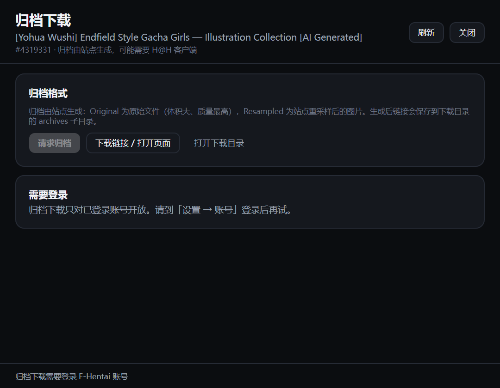
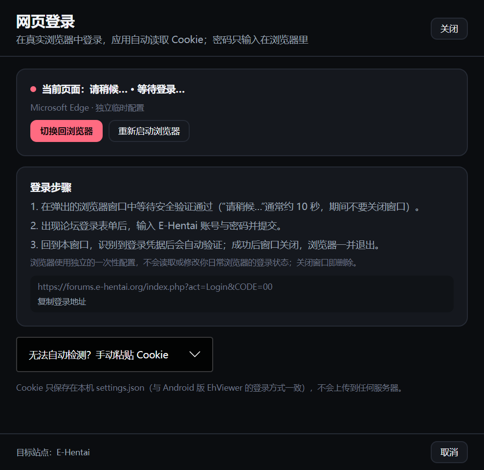

# EhViewer Reader — 在线 + 本地漫画客户端

面向桌面的 E-Hentai / ExHentai 客户端与本地阅读器：在线浏览、搜索、账号登录、代理、下载队列，与原有的 **只读本地资料库**（EhViewer 下载目录）统一在左侧导航中。

- UI：Avalonia 12.1.6 + FluentAvaloniaUI 3.0.2（深色 / 浅色）
- 运行时：.NET 11；Windows / Linux / macOS 使用 Avalonia.Desktop 后端，Windows x64 支持 NativeAOT 发布
- 本地库已验证规模：6,327 个画廊 / 245,548 页（2.8 TB 机械盘，冷扫 81 s，热缓存 0.5 s 内启动）
- 在线解析已对齐 2026-11 的站点结构（`#gdd` 元数据行、`#taglist` 命名空间单元格、sprite 缩略图、`/s/{hash}/{gid}-{page}` 视图 URL）

## 截图

| | |
| --- | --- |
|  |  |
| 本地库（左侧导航 + 虚拟化网格） | 在线浏览 + 搜索（同一页：搜索栏 / 分类 / 页数 / 语言 / 范围） |
|  |  |
| 下载队列（首张图片保存后即可入库） | 设置（账号 / 代理 / 下载 / 阅读） |
|  |  |
| 阅读历史（在线与本地 / 继续阅读） | 在线详情（评分 / 评论 / 标签翻译 / 种子 / 归档） |
|  |  |
| 设置（标签翻译 / 图片尺寸 / 列表过滤 / 收藏分类命名） | 本地已有该作品时，详情主按钮变为「本地阅读」 |
|  |  |
| 种子列表（保存 .torrent / 复制链接） | 归档下载（Original / Resampled，H@H 检测） |
|  |  |
| 网页登录（真实浏览器 + 自动读取 Cookie） | 设置（账号 / 网页登录入口） |

更多截图：`docs/screenshots/`（在线浏览+搜索 `online.png` / `online-search.png`、阅读器单页/连续/横向、版本管理、收藏夹搜索）。截图由 `--ui-smoke` 用合成资料库生成，不含站点内容。

Fluent 迁移后的逐页检查、修复与覆盖范围见 [UI 检查记录](docs/UI-REVIEW-2026-11-12.md)。`--ui-audit` 可在隔离数据目录中生成所有页面的深浅主题和宽窄窗口截图。

## 界面结构

侧栏使用 FluentAvalonia 的 `FANavigationView`，页面历史由 `FAFrame` 管理，支持返回、前进和 Alt+← / Alt+→。侧栏可收拢并记住选择；窄窗口自动收拢。主页面保留列表和滚动位置：

| 入口 | 内容 |
| --- | --- |
| **在线浏览** | 首页 / 热门 / 关注 / 排行（昨日、本月、今年、全部）+ 搜索：关键词与标签语法、分类、页数范围、语言、搜索范围、最近搜索、保存的搜索；共用同一结果网格与分页 |
| **收藏** | E-Hentai 收藏分类 0–9 与「全部」、分类自定义命名、收藏夹内搜索，登录后可用 |
| **阅读历史** | **本机**阅读记录：在线 + 本地，共享阅读进度，按最近阅读时间排序，可继续阅读或移出历史（站点历史另有按钮跳浏览器） |
| **下载** | 队列（进度/暂停/继续/重试/移除/阅读/打开目录）、下载归档、并发与目录设置；「阅读」直接读取任务目录中已落盘的有效页，不依赖本地库入库状态 |
| **本地库** | 原有离线资料库：封面网格（点击卡片看详情，点「阅读」直接阅读）、搜索排序筛选（含「重复」标签）、多数据源合并、版本管理、阅读进度、下载中的封面遮罩与进度；全量重新扫描在设置 → 资料库，工具栏与 F5 不再触发全库扫描 |
| **设置** | 账号、网络与代理、在线浏览（标签翻译 / 过滤 / 收藏命名）、下载引擎、阅读器默认值、本地数据源、缓存维护 |

侧栏常驻站点切换（E-Hentai ⇄ ExHentai）与账号状态；点击「登录」直接打开**网页登录**页（与 Android 版 EhViewer 的登录方式一致）。

设置、详情、状态栏等说明性文本支持拖选复制（`Ctrl+C`、`Ctrl+A`）；卡片和按钮内的文字仍保持普通文本，避免抢占点击。

## 功能

### 在线浏览与详情

- 首页、热门、关注、排行榜四个信息流，均支持翻页（跟随站点自身的 next 链接，避免猜测页码语义）。
- 画廊卡片显示分类（本地化名称与站点配色）、页数、评分、发布时间与阅读进度；封面走本地缩略图缓存。
- 详情页：封面、日文标题、分类、页数、评分（含评分人数）、大小、语言、上传者、可见性、收藏数、完整标签列表；点击标签即按该标签搜索。
- 标签翻译：接入社区项目 [EhTagTranslation](https://github.com/EhTagTranslation/Database)，一键更新（约 1.3 MB），标签与命名空间显示中文，悬停显示原始标签；可在设置中关闭。
- 列表过滤：按标签 / 标题 / 上传者配置「隐藏」或「仅显示」规则，对首页、搜索、收藏同时生效，列表状态栏显示已过滤数量。
- 列表卡片直接显示**语言**（中文 / 日文 / 英文 …，来自 `language:*` 标签）。
- 详情主按钮随本地库状态变化：本地已有该作品时显示「本地阅读」并直接打开本地副本，否则为「在线阅读」；不再额外叠加本地标识。
- 图片默认使用 **1280px 压缩图**；设置 → 浏览可选 780/980/1280/1600/2400px，或切换原图。详情页也可切换尺寸，新下载记录会保存入队时的尺寸；缓存按尺寸隔离，高分辨率的实际可用性取决于站点账号权限。
- 收藏改为确认弹框：详情加载完成后「收藏」即可点击，未登录时点击会提示先登录（不再显示为灰色不可用）；点击后打开分类选择，取消或关闭不发请求；确认后提交并读取服务器状态核验（成功 / 拒绝 / 结果未知），结果未知时保留「重新检查收藏」入口。收藏状态以详情页 `#favoritelink` 为准（"Add to Favorites" 之外即已收藏），槽位名从 `addfav` 弹窗解析；取消收藏走 `favcat=favdel`，与站点表单一致；改分类时保留站点备注。
- 详情操作：五星评分（站点 API）、评论（读取全部、发布、赞成/反对）、种子列表（保存 `.torrent`、复制链接）、归档下载（Original / Resampled，H@H 缺失检测）。
- 右键卡片：在线阅读 / 下载 / 在浏览器打开 / 搜索该 GID。
- 搜索与在线浏览合并为一页：搜索框常驻页头，「高级选项」展开分类/页数/语言/范围，结果与信息流共用卡片网格、翻页栈与状态栏；`Ctrl+F` 直接聚焦该搜索框。

### 搜索（在线浏览页内）

- 关键词 + 标签语法（`female:sole female`、`language:chinese`、`gid:123456`）。
- 分类勾选（按 `f_cats` 取反掩码提交）、页数区间（`f_spf` / `f_spt`）、语言过滤、搜索范围（标题/标签/描述）、仅含种子。
- 最近 15 条搜索与自定义保存的搜索（含分类掩码、页数、语言），一键复用或删除。

### 评论、评分、种子与归档

| 能力 | 说明 |
| --- | --- |
| 评论 | 详情页内直接展示（含上传者标记、分数、投票明细）；「加载全部」走 `?hc=1`；发布评论走详情页表单；赞成/反对走 `api.php` 的 `votecomment` |
| 评分 | 五颗星提交 `api.php` 的 `rategallery`（1–5 星 → 2–10 分），成功后刷新平均分与人数；匿名页面没有 `apiuid` 时禁用并提示登录 |
| 种子 | 解析 `gallerytorrents.php` 的每个表单：名称、大小、做种/下载、上传者；保存 `.torrent` 或复制直链 |
| 归档 | 解析 `archiver.php` 的 `or` 令牌与格式列表，POST `hathdl_xres` 请求归档；直接返回 `.zip` 时下载到下载目录的 `archives` 子目录，站点提示缺少 H@H 客户端时给出说明与入口 |

### 账号与网页登录

`forums.e-hentai.org` 的登录表单被 Cloudflare 托管挑战保护，普通 HTTP 客户端（包括本应用的密码登录）只会拿到 `403` + “Just a moment…”，无法用任何请求头绕过。因此登录走**真实浏览器**，这也是 Android 版 EhViewer 用 WebView 的原因：

1. 应用启动 Edge（或 Chrome）的一次性配置窗口，打开论坛登录页；
2. Cloudflare 校验约 10 秒自动通过，用户输入账号密码（密码只输入在浏览器里，应用不读取、不保存）；
3. 应用通过 DevTools 协议读取 `.e-hentai.org` 的 `ipb_member_id` / `ipb_pass_hash`，导入 Cookie 罐；
4. 请求 `home.php` 验证会话（匿名会被弹到 `bounce_login.php`），顺带取得 `igneous`，再探测 ExHentai 权限；
5. 成功后关闭窗口并结束浏览器进程，删除临时配置目录。

失败兜底：没有 Edge/Chrome、企业策略禁用调试端口时，可在同一登录页展开「手动粘贴 Cookie」，支持 `a=b; c=d`、`Cookie:` 头、DevTools 的 `Copy as cURL`、JSON 以及 DevTools 表格复制格式；导入后同样会向站点验证，不合法会被拒绝。

设置页保留「密码登录」入口（万一某个网络环境没有被挑战），失败时会提示原因并自动转为网页登录。登出、ExHentai 权限复检、站点切换照旧；**只持久化 Cookie，不保存密码**。

### 网络与代理

| 能力 | 说明 |
| --- | --- |
| 代理模式 | 不使用 / 跟随系统 / HTTP / SOCKS5（支持用户名密码） |
| 图片分流 | 「图片也走代理」可单独关闭，页面走代理、图床直连 |
| DNS over HTTPS | 自定义端点（默认 Cloudflare），通过 `ConnectCallback` 在 TLS 之前解析 |
| 自定义 hosts | 每行 `host ip` 或 `ip host`，优先于 DoH 与系统 DNS |
| 连接测试 | 一键拉取首页并显示耗时与条数 |

### 下载与本地库

- **独立引擎**：与本地库解耦，队列持久化（`downloads.json`），崩溃或退出后按状态恢复；已完成任务写入「下载归档」。
- **可配置数据源**：下载根目录可指向任意磁盘，可设置默认子目录（标签）；启用下载目录入库和「自动更新本地库」后，首张图片保存后即增量登记该画廊，后续更新按秒合并，无需重扫其他资料库。缺页副本可阅读，读到当前末页不会将整本标为读完。
- **并发**：画廊并发 1–8、单画廊页面并发 1–8；分页请求按站点配额串行限速（260 ms 间隔）。
- **断点续传**：以 8 位页文件名判断已完成页，重试只补缺失页；失败页单独记录。
- **兼容目录**：`{gid}-{标题}/{00000001.ext}`、`.thumb` 封面、VERSION2 文本 `.ehviewer`（含 gid/token/页数）；Android 端 EhViewer 可直接读取，本应用也能作为普通数据源扫描。
- **原图**：解析视图页的 `fullimg.php` 原图链接；`nl` 仅用于图床重试。原图不可用时回退到压缩图，并显示实际画质。

### 阅读器（本地与在线共用）

- 单页（适应页面/宽度/高度/原始、1x–8x 缩放、拖动、滚轮/点击/键盘翻页）、纵向连续、横向连续（RTL 整条反转）、双页合并宽图按原始比例完整显示。
- GIF/WebP 动图循环播放、全屏、背景色；阅读器仅在主窗口内打开，支持返回与沉浸模式；沉浸模式隐藏侧栏和标题，按 Esc 退出。
- 进度按「原始页号 + 页内偏移」保存；在线阅读与本地副本共用同一个 GID 进度键，下载后可以接着读。
- **在线页面源**：点击阅读先进入阅读器，再按页号解析预览分页（只取当前页所在分页），页面图片按需下载并缓存到本地（`online-cache`）；未解析页显示占位，连续模式先用缩略图比例占位，页面解码后回填真实尺寸。图片加载显示解析 / 下载（有 Content-Length 时为真实百分比）/ 解码状态，失败只影响该页并提供「重试本页」。
- **在线磁盘缓存**：设置 → 浏览可调上限（默认 512 MiB）与保留时间（默认 0 = 不限制，仅在超出上限时按 LRU 淘汰），命中即更新最近使用时间；正式下载文件、阅读进度和历史记录不受清理影响。

### 本地库（原有能力，保持只读）

- 在线与本地详情共用 `GalleryDetailsView`。标签支持翻译与在线搜索，返回恢复来源详情；元数据保存到本机作品缓存。旧 EhViewer 目录从 `.ehviewer` 中读取 GID/token，缺失标签时在线补充，无法联网时保留缓存和本地推断标签。
- ItemsRepeater 虚拟化网格（6,000+ 项仅约 20 个容器）、标题/文件夹/GID 搜索、排序、筛选、语言筛选、收藏、阅读进度。
- 多数据源（设备备份）按 `WorkId` 合并为一张卡片，角标显示副本数；版本管理可选择副本、设置默认，进度按作品共享。
- 严格只读：资料库仅以 `FileAccess.Read` 打开，自检会对「路径+大小+mtime」做前后快照比对。

## 系统要求

- Windows 10 / Windows 11（x64）已验证；Linux x64 已通过托管发布检查，macOS 后端已接入，Linux/macOS 实机验证仍需在对应系统进行
- 依赖框架构建需 [.NET 11 运行时](https://dotnet.microsoft.com/)（`runtimeconfig.json` 仅引用 `Microsoft.NETCore.App 11.0.0`，不依赖 WindowsDesktop.App）；NativeAOT / MSIX 构建无运行时依赖
- 构建使用 .NET 11 SDK（11.0.100 或更高）；项目不再通过 `global.json` 锁定 SDK 版本，命令行与 IDE 会选用其解析到的最高版本 SDK
- 建议开启系统「长路径」策略；应用同时内置 `\\?\` 回退


## 本轮修复与验证

详见 [修复记录](docs/REMEDIATION.md)。详情、阅读器、版本、种子、归档和登录统一为页内导航；设置使用分类页，修改后点击「保存设置」生效。下载归档传输由会话持有，离开页面后仍可从下载中心管理。

- 在线阅读与下载共用按 GID / 页号 / 画质索引的图片文件，避免重复拉取。
- 下载会验证预期页数、页号覆盖、响应长度和图片容器；损坏内容不会作为断点跳过。
- 图像内存预算包含原始解码缓冲、当前位图、预读和动画画布。无法在预算内缩小的图片会停止解码，可改用压缩图或提高预算；显卡纹理和框架本身的开销不在此像素预算内。
- 导入的资料库保持只读；“删除下载文件”需要在行内再次确认，且等待进行中的写入结束。
- `--reader-regression --data-dir <隔离目录> --out <输出目录>` 运行阅读模式切换回归；`--ui-smoke` 使用合成资料库并阻断站点访问。

## 构建与运行

```bash
dotnet build src/EhViewerReader -c Release
dotnet run --project src/EhViewerReader -c Release
```

> 解决方案 `EhViewerReader.slnx` 含 WAP 打包工程（wapproj），`dotnet build` 无法构建它——请用 Visual Studio 打开 slnx（生成、F5 调试、打包都在 VS 内完成）；命令行只构建/运行应用工程即可。

首次启动可直接使用「在线浏览」。本地库在「本地库 → 选择资料库」中指向 EhViewer 下载根目录（例如 `D:\BackUp\phoneGT5pro\ehviewer`）；下载目录默认是 `文档\EhViewerDownloads`，可在设置中修改。

发布：

```bash
# 依赖框架（体积小，需要 .NET 11 运行时）
dotnet publish src/EhViewerReader -c Release -r win-x64 --self-contained false -o artifacts/win-x64

# NativeAOT（自包含原生单文件，无需 .NET 运行时）
dotnet publish src/EhViewerReader -c Release -r win-x64 -p:PublishAot=true -o artifacts/win-x64-aot
```

### NativeAOT 说明

- 需要 VS 2022/2026 的 MSVC 链接器与 Windows SDK **导入库**（`um\x64\*.lib`）。若 SDK 只装了头文件，项目会通过 `Microsoft.Windows.SDK.CPP.x64` NuGet 包补齐（仅构建期使用，`ExcludeAssets="all"`，不进入输出）。
- 所有持久化 JSON 走源生成上下文：`StorageJsonContext`（设置/进度/扫描缓存/下载队列）与 `ReaderJsonContext`（页面尺寸缓存）；运行路径上没有反射序列化。
- HTML 解析使用自研容错解析器（`HtmlLite`），不引入依赖 CSS 选择器/动态代码的第三方库，AOT 与裁剪友好。
- XAML 使用编译绑定；Avalonia 12 起 `Avalonia.Diagnostics` 包已移除（Dev Tools 改为独立产品），项目不引用调试器包，文本整形由 `Avalonia.HarfBuzz` 提供。
- 输出约 30 MB 原生 exe，另附带 3 个原生库：`libSkiaSharp.dll`、`libHarfBuzzSharp.dll`、`av_libglesv2.dll`。

## MSIX 打包

`packaging/EhViewerReader.Msix` 是 VS 的 **Windows 应用程序打包项目**（`.wapproj`），负载为 NativeAOT 发布产物：打包前自动执行 AOT 发布到 `artifacts/msix/aot`，再注入包负载。NativeAOT 必须走 publish（AOT 代码生成不在 Build 管线中），因此工程里有两个自定义 target（`PublishAotForMsix` / `InjectAotPayload`）在 `_ConvertItems` 前后完成替换——这是对 DesktopBridge 内部条目的非官方用法，VS 升级后如打包异常优先回归这里。

VS 中的用法：

- **打包**：右键 `EhViewerReader.Msix` 工程 → 生成；每次打包都会先跑一遍 AOT 发布（1–3 分钟，可用 `-p:SkipAotPublish=true` 复用上次产物）。产物在 `packaging/EhViewerReader.Msix/AppPackages/`。
- **运行打包版**：把 `EhViewerReader.Msix` 设为启动项目，F5 = 部署 MSIX 并启动（首次 F5 需开启系统「开发人员模式」）。
- 解决方案构建时 wapproj 默认不参与打包（`PackageOptionalProjectsInIdeBuilds=False`）。

签名：工程已配置测试证书（`PackageCertificateThumbprint`）。正式分发时用代码签名证书替换，并把 `Package.appxmanifest` 的 `Publisher` 改成证书 Subject；否则安装报 `0x800B0109`。清单 Identity：`EhViewerReader.Local`，`runFullTrust`；应用数据仍写入 `%LocalAppData%\EhViewerReader`。

## 命令行

| 参数 | 说明 |
| --- | --- |
| `--online-probe [--out <json>]` | 无人值守网络自检：首页 → 详情（评分/评论/种子/归档入口）→ 页面列表 → 图片地址 → 缩略图 → 种子文件 → 标签翻译库，输出 JSON（用于验证登录、代理与站点结构变化） |
| `--login-probe [--out <json>]` | 浏览器登录链路自检：查找 Edge/Chrome → 无头启动 → 连接 DevTools → 读取 Cookie → 注入测试 Cookie 再读回 → 用假 Cookie 确认站点会拒绝，输出 JSON |
| `--root <path>` | 把指定目录加入数据源并启用（不会清空已配置的其他数据源） |
| `--gallery <gid\|stableId>` | 启动后直接打开匹配的本地画廊 |
| `--data-dir <path>` | 覆盖应用数据目录（测试隔离用） |
| `--self-test` | 本地库扫描/解码/只读自检，输出 JSON 报告，退出码 0/1 |
| `--self-test --skip-snapshot` | 跳过快照（快速自检） |
| `--self-test --deep-probe` | 全量读取页面尺寸，寻找长条图/最大图（较慢） |
| `--ui-smoke [--out <dir>]` | 合成资料库、截图、进度恢复、6,315 项虚拟化压力测试，并逐页截图导航与在线详情 |
| `--probe-file <path>` | 诊断单个图片：Skia 是否可解析、是否超时 |
| `--anim-probe <file> [--out <json>] [--dump-frames <dir>]` | 诊断单个动图：帧数/帧时长、逐帧解码耗时、逐像素比对、5 秒播放模拟 |

示例：

```bash
# 在线链路自检（不需要登录）
src/EhViewerReader/bin/Debug/net11.0/EhViewerReader.exe --online-probe --out docs/online-probe.json

# 本地库自检
dotnet run --project src/EhViewerReader -c Release -- --self-test --root "D:\path\to\ehviewer" --out docs/selftest.json
```

## 快捷键

阅读器：

| 按键 | 动作 |
| --- | --- |
| ← / → | 翻页（随阅读方向自动反转） |
| PageUp / PageDown / 空格 | 翻页 |
| Home / End | 首页 / 末页 |
| + / - / 0 | 放大 / 缩小 / 适应页面 |
| Ctrl + 滚轮 | 以指针为中心缩放 |
| 双击 | 适应页面 ↔ 100% |
| 滚轮 | 单页：内容溢出时平移，到边界后翻页；横向模式：横向滚动 |
| F11 / Esc | 全屏 / 退出全屏（再按关闭） |
| M / D / B / ? | 模式（单页→纵向→横向）/ 方向 / 背景 / 快捷键帮助 |

主窗口：`Ctrl+F`（macOS 为 `Cmd+F`）聚焦当前页面搜索框、`F5` 刷新当前页、`Esc` 清除本地库搜索词。

## 数据目录

应用状态写入系统的本地应用数据目录（Windows 为 `%LocalAppData%\EhViewerReader`），可用 `--data-dir` 指定：

```
settings.json            设置（账号 Cookie、代理、在线/下载/阅读偏好、过滤规则、收藏分类名、数据源、搜索历史）
progress.json            阅读进度/收藏（按作品 ID，在线与本地共用）
downloads.json           下载执行状态与已完成记录
works.json               跨在线/本地的作品元数据（独立于进度与收藏）
tag-translations.json    标签翻译库（EhTagTranslation 精简版，约 45,000 条）
library-cache-<源>.json  每个数据源独立的扫描签名缓存（schema 2）
download-move.json       目录搬迁中的恢复记录（正常完成后移除）
dimensions/              连续模式页面尺寸缓存
thumbnails/              在线封面缓存（LRU 上限 512 MB / 默认不限保留时间）
online-cache/            在线阅读页面缓存（同上）
logs/app.log             运行日志（不含 token/页面内容）
```

**下载根目录**默认 `文档\EhViewerDownloads`（可配置），与数据目录分离，重装不丢文件。

资料库仅以 `FileAccess.Read` 打开；不使用写入 API。`--self-test` 会对资料库做「路径 + 大小 + mtime」快照并比对前后哈希（实测 25.8 万文件前后一致）。

## 测试

```bash
# 自动测试（112 项，含解析、设置合并、下载并发与完整性、共享缓存、历史和内存预算回归）
dotnet test tests/EhViewerReader.Core.Tests

# 真实库集成测试（34 项，只读）
EHVIEWER_TEST_ROOT="D:/BackUp/phoneGT5pro/ehviewer" dotnet test tests/EhViewerReader.Core.Tests

# 在线链路自检（前端 → 详情 → 页面列表 → 图片 URL）
src/EhViewerReader/bin/Debug/net11.0/EhViewerReader.exe --online-probe --out docs/online-probe.json

# UI 冒烟与逐页截图（合成库 + 在线详情）
src/EhViewerReader/bin/Debug/net11.0/EhViewerReader.exe --ui-smoke --out docs/screenshots
```

覆盖范围与实测数据详见 [docs/TEST_REPORT.md](docs/TEST_REPORT.md)：在线解析器使用从真实页面截取的 fixture 做回归（列表行、`#gdd` 元数据、命名空间标签、sprite 预览、`nl` 键、gid 在前的视图 URL、分类掩码）；本地部分覆盖 VERSION1/2/CBOR、0 字节/缺页、多源合并、设置迁移等。

## 更改下载目录

在「设置 → 下载」选择目录，并选择变更方式：

- **仅更改后续下载位置（默认）**：点击「保存设置（不搬迁）」。新目录可以已有文件；后续任务使用新位置，旧文件和旧任务保持原路径。开启「注册为本地库数据源」后，新目录加入本地库，旧数据源保留；有内容或任务的旧默认下载数据源显示为「旧下载目录」；空的默认旧源只移除登记，物理目录保留。
- **搬迁已有下载并同步路径**：选择空目标目录，点击「保存并搬迁下载」。应用先暂停任务并等待写入退出，同盘优先重命名移动；跨盘复制后以 SHA-256 校验，再同步任务、下载归档和本地库路径。原先运行的任务恢复，已暂停的任务继续保持暂停。

迁移不会覆盖新目录已有文件，也不再删除用户事先创建的空目标文件夹；同盘移动到已有空文件夹时按条目移动并记录回滚信息。取消会保留原有目标文件夹，只清理本次迁移的产物，用户后来加入的其他文件会保留。复制阶段可以取消，保存失败会回滚或保留可恢复记录；程序异常退出后会自动恢复未完成的文件/路径同步。旧目录中被占用或改变的文件会保留并提示。迁移时的读写与进度在后台执行，资料库仅重建受影响的数据源索引。

## 项目结构

```
src/EhViewerReader.Core/           格式解析、扫描、多源合并、缓存、进度（无 Avalonia 依赖）
  Online/                          E-Hentai 客户端：HtmlLite、解析器、URL、Cookie/HTTP/DoH、EhClient
  Download/                        下载引擎：任务模型、队列/并发/续传、EhViewer 兼容目录
src/EhViewerReader/                Avalonia 应用
  ViewModels/                      Shell、在线信息流、搜索、下载、设置、阅读器、在线详情
  Views/                           MainWindow 导航壳 + LibraryPage/OnlineFeedPage/SearchPage/DownloadsPage/SettingsPage
                                   + ReaderPage/GalleryDetailsPage/VersionsPage/OnlineGalleryPage 等文档页
  Services/                        图片管线、在线图片缓存、阅读器页面源（本地/在线）、自检与冒烟
packaging/EhViewerReader.Msix/     MSIX 打包项目（WAP wapproj，托管自包含负载）
tests/EhViewerReader.Core.Tests/
docs/                              PLAN.md、FORMAT.md、TEST_REPORT.md、screenshots/
```

## 应用图标

图标为项目自有矢量绘制（SkiaSharp 生成），不含第三方素材（参考项目的 ico 随 GPL 分发，为避免许可风险未使用）：深色圆角底 + 珊瑚色开卷书本。`Assets/icon.ico` 含 16–256 px 九个 32 位帧。

## 已知限制

- 在线功能依赖站点网页结构；站点改版会影响解析，`--online-probe` 可快速定位是网络、账号还是解析问题。
- 网页登录需要本机安装 Microsoft Edge 或 Google Chrome；两者都没有时可手动粘贴 Cookie。Cloudflare 挑战本身无法绕过，只能由真实浏览器完成。
- 归档下载与评论发布需要登录；归档是否可用还取决于账号的 H@H 客户端分配（应用会识别并提示）。
- 评论投票与评分使用详情页内嵌的 `apiuid` / `apikey`；匿名访问时这些操作禁用。
- 标签翻译库来自第三方社区项目，首次使用需手动「更新标签库」。
- 原图下载依赖视图页的 `fullimg.php` 链接；取不到时回退为站点提供的重采样图，并提示实际画质。
- 图片配额受账号/IP 限制；应用已串行化视图页请求，但大量下载仍可能触发站点限流。
- 收藏分类名称是本地的显示名（设置 → 收藏分类命名），不会写回站点账号配置。
- 连续/横向模式为整页适配滚动，不提供页内缩放（单页模式支持 1x–8x）。
- 动图在阅读器内循环播放；库封面只取首帧。
- 无全局位图缓存：页面/封面位图由控件独占，只保留当前页与预取页。
- 扫描不做文件系统实时监听；下载完成后按设置自动刷新，或手动「刷新」。
- 冷盘首次扫描可能较慢（实测 2.8 TB 机械盘 24.5 万页约 81 s）；启动采用缓存优先 + 后台扫描。

## 许可

本项目自身的代码与图标资源独立创作。在线功能通过 E-Hentai / ExHentai 的公开网页接口访问用户本人有权访问的内容，与站点无隶属关系；请遵守站点条款与当地法律。仅支持读取 EhViewer 类应用（如 [Ehviewer_CN_SXJ](https://github.com/xiaojieonly/Ehviewer_CN_SXJ)，GPL-3.0）产生的本地下载数据，与其无代码耦合。
