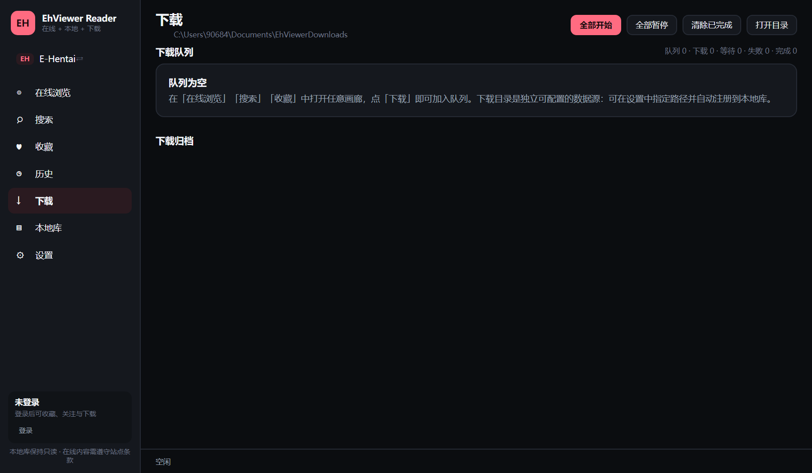

[**English**](README.en.md) | **简体中文**

<div align="center">
  

  <h1>EhViewer for PC</h1>

  <h3>桌面漫画资料库与阅读器</h3>

  <h4>
    基于 Avalonia 12 与 FluentAvaloniaUI 的桌面漫画阅读工具<br>
    把资料库、下载队列与阅读器收进同一个窗口
  </h4>

  <div>
    
    
    
    
  </div>

  <br>

</div>

<br>

> **使用范围**：本项目用于整理与阅读使用者本机已保存的内容，不提供、不分发任何站点内容，也不内置账号。在线功能按使用者自身配置访问公开网页，其可用性与合规性取决于使用者的账号权限、网络环境与所在地规定；请自行遵守相关服务条款与适用法律。项目与相关站点及上游应用无隶属关系。

## 📥 获取与运行

本项目不提供预编译分发包，请从源码构建后运行（见下方「从源码构建」）。

```powershell
dotnet build src/EhViewerForPc -c Release
dotnet run --project src/EhViewerForPc -c Release
```

首次启动可直接使用「在线浏览」。本地资料库在「本地库 → 选择资料库」中指向本机的下载根目录；下载目录默认为 `文档\EhViewerDownloads`，可在设置中修改。

## 🌟 核心功能

- 📚 **本地资料库**
  - 严格只读：仅以 `FileAccess.Read` 打开，不使用任何写入 API；自检会对「路径 + 大小 + mtime」做前后快照比对
  - 兼容 EhViewer 类应用产生的目录格式：VERSION1 / VERSION2 / CBOR 元数据、8 位页文件名、`.thumb` 封面、`.ehviewer` 中的 GID / token / 页数
  - 多数据源按 `WorkId` 合并为一张卡片，角标显示副本数；版本管理可选择副本与默认版本，进度按作品共享
  - 标题 / 文件夹 / GID 搜索，排序、语言与进度筛选、收藏、重复副本标记
  - 虚拟化网格适用于数千项规模；启动采用缓存优先与后台扫描，全量重扫入口位于「设置 → 资料库」

- 📖 **阅读器（本地与在线共用）**
  - 单页（适应页面 / 宽度 / 高度 / 原始、1x–8x 缩放、拖动、滚轮 / 点击 / 键盘翻页）、纵向连续、横向连续（RTL 整条反转）；双页合并宽图按原始比例显示
  - 进度按「原始页号 + 页内偏移」保存，在线阅读与本地副本共用同一进度键，下载后可接着阅读
  - 本地与下载副本按原始总页数保留缺页位置；浏览到缺页时显示该页占位，后续页号和进度保持一致
  - 在线页面源按需解析当前页所在的预览分页，图片按需下载并缓存到 `online-cache`；未解析页显示占位，解码后回填真实尺寸
  - 加载状态可见，失败只影响该页并提供「重试本页」；GIF / WebP 动图循环播放、全屏、背景色切换
  - 阅读器仅在主窗口内打开，沉浸模式隐藏侧栏与标题，按 Esc 退出
  - 图像内存预算覆盖原始解码缓冲、当前位图、预读与动画画布；在线磁盘缓存可设置容量上限与保留时间并按 LRU 淘汰

- ⬇️ **下载**
  - 独立于本地库的下载引擎：队列持久化于 `downloads.json`，退出或崩溃后按状态恢复，已完成任务进入下载归档
  - 可配置下载根目录与子目录规则；启用「下载目录入库」与自动更新后，首张图片落盘即可增量登记，无需重扫其他数据源
  - 缺页副本可阅读，读到当前末页不标记为读完；画廊并发 1–8、单画廊页面并发 1–8，分页请求按固定间隔串行限速
  - 以 8 位页文件名判断已完成页，重试只补缺失页，失败页单独记录；输出目录与元数据可被同类应用直接读取
  - 原图链接不可用时回退到压缩图并展示实际画质
  - 更改下载目录提供「仅更改后续下载位置」与「搬迁已有下载并同步路径」两种方式；搬迁会暂停写入、校验文件并同步任务 / 归档 / 数据源路径，支持取消与中断恢复

- 🌐 **在线浏览（可选）**
  - 在线浏览页内以「首页 / 热门 / 订阅 / 排行」标签切换；画廊列表、搜索与收藏滚动到底部时追加加载，失败保留内容并可重试；搜索与在线浏览合并为一页，`Ctrl+F` 直接聚焦搜索框
  - 搜索支持关键词与标签语法、分类、标题 / 标签 / 描述 / 种子文件名范围、最低评分、页数区间及语言 / 上传者 / 标签排除项；最近搜索保留 15 条
  - 「在线图片搜索」支持相似度扫描、仅搜索封面与包含已删除画廊，点击「上传并搜索」才提交图片；「标签检索」在本地标签库中按中文或英文查询并插入规范标签
  - 书签栏以对话框打开，不切换页面或自动展开高级搜索；可保存完整搜索条件，支持编辑、排序、删除；可导入原版导出的 `.db`（只读读取 `QUICK_SEARCH`）与 JSON 书签，并导出为原版可读取的 `.db`
  - 在线列表卡片在标题下单独显示评分，以及不透明底色的「已在本地 / 本地缺页」标识，扫描更新后同步状态；本地库阅读按钮使用不透明底板
  - 详情页展示封面、标题、分类、页数、评分、大小、语言、上传者、标签列表与阅读进度；点击标签按该标签搜索，本地已有该作品时主按钮切换为「本地阅读」
  - 详情操作：五星评分、评论读取与发布、种子列表（保存 `.torrent` / 复制链接）、归档下载（Original / Resampled）；收藏改为确认弹框，取消或关闭不发出请求
  - 列表过滤按标签 / 标题 / 上传者配置「隐藏」或「仅显示」规则，对首页、搜索与收藏同时生效；标签翻译数据可手动更新
  - 图片默认使用压缩图，可选 780 / 980 / 1280 / 1600 / 2400px 或原图；缓存按画质隔离，下载任务记录入队时的画质

- 🔍 **本地以图搜图（可选，默认关闭）**
  - 在「设置 → 本地库」启用并保存后，从本地库工具栏进入并手动建立索引；默认不创建索引，也不额外遍历页图
  - 建立 / 更新索引在应用后台持续执行，离开或关闭搜索页面不停止；重新进入可查看进度并主动取消；正常退出保存已处理进度，异常中断后再次启动从最近已提交批次接续，主动取消则保留进度等待手动继续
  - 索引 CPU 管线默认按逻辑处理器数减 2 使用 1–32 个 worker，工作区为 128–1024 MiB，并与阅读器分别限额。Windows 自动尝试 ComputeSharp / DirectX 12 加速 FAST 评分与大批量训练的哈明距离，设备不可用或失败时回退 CPU；灰度 / 模糊保留 SIMD。GPU 与 CPU 共用原提取身份，已有索引无需重建；面积缩放复用几何权重，逐像素保持兼容
  - 页任务与完成状态批量持久化；新任务恢复时直接读取待办队列，训练 / 构建阶段不先回退为全量页扫描。发布前单独分块核对源目录变更，核对中断后接续已提交分块。源图读取限为一路，同步 I/O 使用 Windows 后台优先级，解码与计算保持有界并行；无变化更新跳过快照与提取
  - 特征按内容哈希与提取配置存入单份 `features.db`；增量更新共享不可变索引文件，发布后回收未使用旧快照。兼容迁移旧 `generations`，不重复保存整份特征库
  - 支持选择文件、拖入、剪贴板图片与矩形裁剪；结果展示命中页、来源副本与原始页号，「从此页阅读」会覆盖历史恢复位置，返回保留查询与结果
  - 后端为纯 C# 实现，复用 SkiaSharp 与 SQLite，无需额外运行时；独立的无窗口 Host 用于构建与验证，原图库始终只读
  - 合成集、无窗口流程与页号导航已有自动化验证；真实图库的召回率与全库检索性能尚未验证

- ⚙️ **账号、网络与设置**
  - 账号登录在系统浏览器中完成，应用只读取并持久化会话 Cookie，不保存密码；另提供手动粘贴 Cookie 的兜底方式
  - 代理模式：不使用 / 跟随系统 / HTTP / SOCKS5；图片请求可单独设置是否走代理
  - DNS over HTTPS 自定义端点、自定义 hosts、连接测试
  - 设置按分类页展示，修改后点击「保存设置」生效；保存采用增量合并，不会用启动时的缓存值覆盖运行时新增的数据源

- 🪟 **界面与导航**
  - FluentAvaloniaUI 的 `FANavigationView` + `FAFrame` 页面历史，支持返回、前进和 Alt+← / Alt+→
  - 跟随系统 / 浅色 / 深色三套主题；侧栏可收拢并记住选择，窄窗口自动收拢；主页面保留列表与滚动位置
  - 在线与本地详情共用 `GalleryDetailsView`；设置、详情与状态栏中的说明性文本支持拖选复制

## 🧩 功能矩阵

| 模块 | 主要能力 | 实现要点 |
| :--- | :--- | :--- |
| 本地资料库 | 只读扫描、多源合并、版本管理、搜索筛选 | 虚拟化网格、按源隔离的签名缓存、缓存优先启动 |
| 阅读器 | 单页 / 纵向 / 横向、动图、进度、在线页面源 | 按需解析分页、占位回填、共享进度键、图像内存预算 |
| 下载 | 队列、断点续传、并发与限速、目录搬迁 | 持久化状态、原子写入、迁移日志与回滚 |
| 在线浏览 | 搜索、订阅、排行榜、书签、详情、评分与归档 | 自研容错 HTML 解析、固定结构夹具回归、Cookie 会话 |
| 以图搜图 | 索引、裁剪检索、命中页定位 | 托管 C# 后端、SkiaSharp / SQLite、独立无窗口 Host |
| 设置与网络 | 代理、DoH、hosts、缓存策略、偏好合并 | 源生成 JSON 上下文、延迟写队列、增量合并 |
| 界面 | 导航历史、主题、共享详情、可复制说明文本 | 编译绑定、显式页面实例、语义主题资源 |

## 🖼️ 软件截图




截图由 `--ui-smoke` 使用合成资料库生成，不含站点内容。更多页面截图位于 `docs/screenshots/`，逐页检查记录见 [UI 检查记录](docs/UI-REVIEW-2026-11-12.md)。

## 🧱 技术架构

| 路径 | 职责 |
| :--- | :--- |
| `src/EhViewerForPc.Core/` | 格式解析、扫描与多源合并、缓存、进度、在线客户端与下载引擎；无 Avalonia 依赖 |
| `src/EhViewerForPc.ImageSearch/` | 本地以图搜图的托管后端（特征提取、索引、SQLite、检索） |
| `src/EhViewerForPc.ImageSearch.Host/` | 无窗口诊断入口（命令行与回环 HTTP） |
| `src/EhViewerForPc/` | Avalonia 应用：`ViewModels/`、`Views/`、`Controls/`、`Services/`、`Styles/` |
| `packaging/EhViewerForPc.Msix/` | Windows 应用程序打包项目（`.wapproj`） |
| `tests/` | 核心、以图搜图后端与无窗口界面回归 |
| `docs/` | 设计、执行与验证记录 |

- 全局服务由 `AppServices` 单一持有并在退出时按序释放；MVVM 使用 `CommunityToolkit.Mvvm` 源生成
- 开启编译绑定，XAML 通过 `x:DataType` 解析绑定路径；页面与列表复用同一套控件和样式资源
- 所有持久化 JSON 走源生成上下文（`StorageJsonContext` / `ReaderJsonContext` / `SearchJsonContext`），写入为临时文件 + 原子替换，运行路径不依赖反射序列化
- 在线 HTML 使用自研容错解析器 `HtmlLite`，不引入依赖 CSS 选择器或动态代码的第三方解析库
- 平台专属代码置于条件编译或 `OperatingSystem.IsWindows()` 守卫内；文件与目录打开统一走平台启动器

## 🛠️ 从源码构建

### 前置条件

- [.NET 11 SDK](https://dotnet.microsoft.com/)（11.0.100 或更高）。仓库不提供 `global.json`，命令行与 IDE 会选用其解析到的最高版本 SDK
- 依赖框架的发布需要 .NET 11 运行时；NativeAOT / MSIX 产物无运行时依赖
- 仅面向 Windows 10 / 11 x64
- 建议开启系统长路径支持；应用内置 `\\?\` 路径回退

> 解决方案 `EhViewerForPc.slnx` 含 WAP 打包工程（`.wapproj`），`dotnet build` 无法构建它；请在 Visual Studio 中打开解决方案完成打包，命令行只构建或运行应用工程。

### 构建步骤

1. 构建应用工程：
   ```powershell
   dotnet build src/EhViewerForPc -c Release
   ```
2. 启动调试运行：
   ```powershell
   dotnet run --project src/EhViewerForPc -c Release
   ```
3. 按需发布到独立输出目录：
   ```powershell
   # 依赖框架（体积小，需要 .NET 11 运行时）
   dotnet publish src/EhViewerForPc -c Release -r win-x64 --self-contained false -p:PublishAot=false -o artifacts/win-x64

   # NativeAOT（自包含原生单文件，无需 .NET 运行时）
   dotnet publish src/EhViewerForPc -c Release -r win-x64 -p:PublishAot=true -o artifacts/win-x64-aot
   ```

Release 配置默认启用 `PublishAot`，依赖框架的托管发布需显式指定 `-p:PublishAot=false`。

### NativeAOT 与打包

- 需要 MSVC 链接器与 Windows SDK 导入库；若本机 SDK 只装了头文件，构建期会通过 NuGet 包补齐（不进入输出）
- HTML 解析、JSON 持久化与绑定均为 AOT 兼容实现；Avalonia 12 起 Dev Tools 为独立产品，项目不引用调试器包，文本整形由 `Avalonia.HarfBuzz` 提供
- 输出为原生 exe 与少量原生库（`libSkiaSharp.dll`、`libHarfBuzzSharp.dll`、`av_libglesv2.dll`）
- MSIX 打包：`packaging/EhViewerForPc.Msix` 是 Visual Studio 的 Windows 应用程序打包项目，打包前自动执行 AOT 发布到 `artifacts/msix/aot` 再注入负载（可用 `-p:SkipAotPublish=true` 复用上次产物）
- AOT 代码生成只在 publish 管线发生，因此打包工程通过 `PublishAotForMsix` / `InjectAotPayload` 两个 target 完成替换；VS 升级后如打包异常，优先回归这里
- 包标识更名后旧包无法就地升级，需先卸载旧版本

## 🖥️ 命令行与自检

所有无人值守模式均不弹窗；诊断输出可写入 `--out` 指定的路径。参数以 `StartupOptions.Parse` 为准。

| 参数 | 说明 |
| :--- | :--- |
| `--root <path>` | 把指定目录加入数据源并启用（不清空已配置的其他数据源） |
| `--gallery <gid\|stableId>` | 启动后直接打开匹配的本地画廊 |
| `--data-dir <path>` | 覆盖应用数据目录，用于测试隔离 |
| `--out <path>` | 指定报告或截图输出路径 |
| `--self-test` | 本地库扫描 / 解码 / 只读自检，输出 JSON 报告，退出码 0/1 |
| `--self-test --skip-snapshot` | 跳过前后快照比对（快速自检） |
| `--self-test --deep-probe` | 全量读取页面尺寸，寻找长条图与最大图 |
| `--online-probe` | 网络自检：首页 → 详情 → 页面列表 → 图片地址 → 缩略图 → 种子 → 标签库 |
| `--login-probe` | 浏览器登录链路自检（浏览器查找、DevTools、Cookie 读写与拒绝校验） |
| `--ui-smoke` | 合成资料库截图、进度恢复、虚拟化压力测试与逐页导航 |
| `--ui-audit` | 在隔离数据目录中生成各页面深浅主题与宽窄窗口截图 |
| `--reader-regression` | 阅读模式切换回归 |
| `--navigation-regression` | 页面导航与返回栈回归 |
| `--anim-probe <file> [--dump-frames <dir>]` | 单个动图的帧数、帧时长、解码耗时与播放模拟 |
| `--probe-file <path>` | 诊断单个图片：是否可解析、是否超时 |
| `--image-search-probe-root <dir> --out <json>` | 无窗口验证以图搜图的应用服务链路（需空目录） |
| `--bookmark-probe-root <dir> --out <json>` | 无窗口验证书签导入导出兼容性（需空目录） |
| `--verbose` | 输出更详细的诊断信息 |

示例：

```powershell
# 本地库自检（资料库只读）
dotnet run --project src/EhViewerForPc -c Release -- --self-test --root "<本地资料库目录>" --out docs/selftest.json

# 在线链路自检
EhViewerForPc.exe --online-probe --out "<报告路径>"

# UI 冒烟（自动使用隔离数据目录与合成资料库）
EhViewerForPc.exe --ui-smoke --out "<输出目录>"
```

## ⌨️ 快捷键

主窗口：`Ctrl+F` 聚焦当前页面搜索框、`F5` 刷新当前页、`Esc` 清除本地库搜索词。

| 按键 | 动作 |
| :--- | :--- |
| ← / → | 翻页（随阅读方向自动反转） |
| PageUp / PageDown / 空格 | 翻页 |
| Home / End | 首页 / 末页 |
| + / - / 0 | 放大 / 缩小 / 适应页面 |
| Ctrl + 滚轮 | 以指针为中心缩放 |
| 双击 | 适应页面 ↔ 100% |
| 滚轮 | 单页：内容溢出时平移，到边界后翻页；横向模式：横向滚动 |
| F11 / Esc | 全屏 / 退出全屏（再按关闭） |
| M / D / B / ? | 模式（单页 → 纵向 → 横向）/ 方向 / 背景 / 快捷键帮助 |

## 🗂️ 数据存储

应用状态写入系统本地应用数据目录（Windows 为 `%LocalAppData%\EhViewerForPc`），可用 `--data-dir` 覆盖。若新目录不存在而旧目录 `%LocalAppData%\EhViewerReader` 存在，应用会继续沿用旧目录，避免更名导致设置与进度丢失；单实例互斥锁也保留旧名称。

```
settings.json            设置（会话 Cookie、代理、在线 / 下载 / 阅读偏好、过滤规则、数据源、搜索历史）
progress.json            阅读进度与收藏（按作品 ID，在线与本地共用）
works.json               跨在线 / 本地的作品元数据
downloads.json           下载执行状态与已完成记录
tag-translations.json    标签翻译库（本地缓存）
library-cache-<源>.json  每个数据源独立的扫描签名缓存
download-move.json       目录搬迁中的恢复记录（正常完成后移除）
dimensions/              连续模式页面尺寸缓存
covers/                  本地封面缓存
thumbnails/              在线封面缓存
online-cache/            在线阅读页面缓存
image-search/            可配置位置的本地图片索引（默认关闭）
exports/                 导出文件目录
logs/                    运行日志（不含 token 与页面内容）
```

**下载根目录**默认为 `文档\EhViewerDownloads`（可配置），与数据目录分离。导入的资料库仅以 `FileAccess.Read` 打开，不使用写入 API；`--self-test` 会对资料库做路径、大小与修改时间的前后快照比对。

图片索引目录中，`features.db` 保存去重特征，`build-job.json` 保存未完成任务与阶段，任务目录中的 `build-plan.db` 保存页候选 / 签名、待办和完成状态，发布后回收；`generations/` 保存发布快照与在途任务，`current.json` / `current.previous.json` 在发布清理后为指向同一当前快照的主 / 备指针。正常完成且旧查询结束后只保留当前快照，建库及合并时仍需临时空间。旧缓存会在恢复 / 更新或清理时先迁移特征，再回收未使用目录；不要手动删除未完成任务目录。旧版未完成任务首次接续需要一次枚举以补齐页计划，已提取特征仍可复用，后续接续读取持久化待办。

## 🧪 测试与验证

```powershell
# 核心回归（解析、存储、下载、设置合并、内存预算等）
dotnet test tests/EhViewerForPc.Core.Tests -c Debug

# 可选：以本机资料库运行只读集成测试
$env:EHVIEWER_TEST_ROOT = '<本地资料库目录>'
dotnet test tests/EhViewerForPc.Core.Tests -c Debug

# 以图搜图后端与无窗口界面回归
dotnet test tests/EhViewerForPc.ImageSearch.Tests -c Debug
dotnet test tests/EhViewerForPc.ImageSearch.Ui.Tests -c Debug -p:PublishAot=false
```

索引 CPU / SIMD 的实现见[实施记录](docs/索引CPU并行与SIMD验证-2026-11-14.md)，后续并行扩容、较大页面性能对照及验证边界见[并行扩容记录](docs/索引并行扩容与阶段加速-2026-11-14.md)。

ComputeSharp GPU 与持久化待办恢复已接入应用，实测、兼容性与设备验证边界见[实施与验证报告](docs/ComputeSharp与持久化恢复实现-2026-11-14.md)。需要支持计算的硬件 DirectX 12 设备；本机只验证 NVIDIA，AMD / Intel 尚未实机验证。GPU 训练按比较量组织较大批次并合并上传 / 回读，减少 CPU 同步等待，诊断与对照见[训练批次修复记录](docs/GPU训练批次与同步开销-2026-11-14.md)。GPU 只接管部分计算，不能保证所有页图与批次都更快；独立 Host CLI 默认仍使用 CPU。页图提取的缩放热点与修复实测见[提取阶段优化记录](docs/页图提取缩放热点优化-2026-11-14.md)。

显式运行硬件 GPU 回归（无设备的 CI 默认跳过硬件用例）：

```powershell
$env:EHVIEWER_GPU_TESTS = '1'
dotnet test tests/EhViewerForPc.ImageSearch.Tests -c Debug
```

引用主程序的测试工程需串行运行（Avalonia XAML 编译共享输出文件）。后端另提供 `tools/imsearch/Build-Backend.ps1` 与 `Test-Backend.ps1`，每次验证使用独立的隔离目录。

在线解析器使用固定的页面结构夹具做回归；站点改版可先用 `--online-probe` 区分网络、账号与解析问题。Debug 通过不能替代 Release / AOT 产物的实际启动验证。历史测试报告见 [TEST_REPORT.md](docs/TEST_REPORT.md)（对应早期版本），当前行为与验证边界见 [修复记录](docs/REMEDIATION.md)、[在线功能补齐记录](docs/ONLINE-PARITY-2026-11-13.md) 与 [以图搜图执行记录](docs/IMPLEMENTATION-LOCAL-IMAGE-SEARCH-STATUS.md)。

## ⚠️ 已知限制

- 在线功能依赖站点网页结构；改版会影响解析，部分操作需要登录态与相应账号权限
- 网页登录需要本机安装 Microsoft Edge 或 Google Chrome；两者都没有时可手动粘贴 Cookie
- 归档下载与评论发布需要登录，归档是否可用还取决于账号分配；匿名访问时评分与评论投票不可用
- 标签翻译库来自第三方社区数据，首次使用需手动更新
- 原图依赖视图页提供的链接，取不到时回退为站点提供的压缩图
- 图片访问受账号与 IP 配额限制，应用已串行化视图页请求，但批量下载仍可能触发限流
- 收藏分类名称是本地显示名，不写回站点账号配置
- 连续 / 横向模式为整页适配滚动，不提供页内缩放（单页模式支持 1x–8x）
- 无全局位图缓存，页面与封面位图由控件独占；扫描不做文件系统实时监听，下载完成后按设置自动刷新或手动刷新
- 本地以图搜图的真实图库召回率与全库检索性能未验证

## 💖 依赖与致谢

### 第三方组件

| 库 | 用途 | 许可 |
| :--- | :--- | :--- |
| Avalonia / Avalonia.Desktop / Avalonia.Themes.Fluent | 桌面 UI 与 Fluent 主题 | MIT |
| FluentAvaloniaUI | 导航视图、Frame 与 Fluent 控件 | MIT |
| CommunityToolkit.Mvvm | MVVM 源生成 | MIT |
| Avalonia.Skia / SkiaSharp / Avalonia.HarfBuzz | 图像渲染、解码与文本整形 | MIT |
| Microsoft.Data.Sqlite | 以图搜图索引与书签文件读写 | MIT |
| ComputeSharp | Windows DirectX 12 的 FAST / 训练计算 | MIT |
| xunit / Avalonia.Headless.XUnit | 单元测试与无窗口界面回归 | 见各上游发行说明 |

包版本由 `Directory.Packages.props` 集中管理；各组件遵循其上游许可证。

### 数据格式

本地资料库只读取 EhViewer 类应用（GPL-3.0）产生的目录格式，与其无代码耦合；标签翻译数据来自第三方社区项目，需由使用者自行更新。

## 📄 许可与使用说明

本项目自身的代码与图标资源独立创作，未附带任何站点内容或账号数据。在线能力仅访问使用者自行配置、且有权访问的公开页面，与相关站点无隶属关系。仓库未附带开源许可证文件，使用前请自行确认适用范围与当地法律要求。

---

<div align="center">
  <sub>仅供本机资料整理与阅读使用</sub>
</div>
