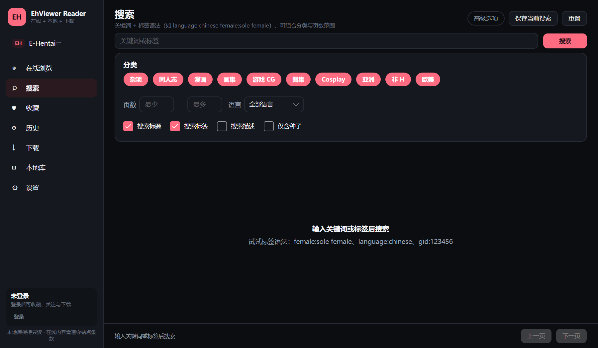

# EhViewer Reader — 在线 + 本地漫画客户端

面向 Windows 桌面的 E-Hentai / ExHentai 客户端与本地阅读器：在线浏览、搜索、账号登录、代理、下载队列，与原有的 **只读本地资料库**（EhViewer 下载目录）统一在左侧导航中。

- UI：Avalonia 12.1.6 + Fluent（深色 / 浅色）
- 运行时：.NET 10（Windows x64），支持 NativeAOT 原生单文件发布
- 本地库已验证规模：6,327 个画廊 / 245,548 页（2.8 TB 机械盘，冷扫 81 s，热缓存 0.5 s 内启动）
- 在线解析已对齐 2026-11 的站点结构（`#gdd` 元数据行、`#taglist` 命名空间单元格、sprite 缩略图、`/s/{hash}/{gid}-{page}` 视图 URL）

## 截图

| | |
| --- | --- |
|  |  |
| 本地库（左侧导航 + 虚拟化网格） | 搜索（分类/页数/语言/范围） |
|  |  |
| 下载队列（独立数据源） | 设置（账号 / 代理 / 下载 / 阅读） |

更多截图：`docs/screenshots/`（阅读器单页/连续/横向、版本管理、详情）。截图由 `--ui-smoke` 用合成资料库生成，不含站点内容。

## 界面结构

左侧导航固定为七个入口，切换页面不重建列表（视图按 ViewModel 缓存，滚动位置保留）：

| 入口 | 内容 |
| --- | --- |
| **在线浏览** | 首页 / 热门 / 关注 / 排行（昨日、本月、今年、全部），分页、刷新 |
| **搜索** | 关键词与标签语法、分类、页数范围、语言、搜索范围、最近搜索、保存的搜索 |
| **收藏** | E-Hentai 收藏分类 0–9 与「全部」，登录后可用 |
| **历史** | 账号在站点上的浏览记录 |
| **下载** | 队列（进度/暂停/继续/重试/移除/打开目录）、下载归档、并发与目录设置 |
| **本地库** | 原有离线资料库：封面网格、搜索排序筛选、多数据源合并、版本管理、阅读进度 |
| **设置** | 账号、网络与代理、下载引擎、阅读器默认值、本地数据源、缓存维护 |

底部常驻站点切换（E-Hentai ⇄ ExHentai）与账号状态；登录入口直达设置页。

## 功能

### 在线浏览与详情

- 首页、热门、关注、排行榜四个信息流，均支持翻页（跟随站点自身的 next 链接，避免猜测页码语义）。
- 画廊卡片显示分类（本地化名称与站点配色）、页数、评分、发布时间与阅读进度；封面走本地缩略图缓存。
- 详情窗口：封面、日文标题、分类、页数、评分、大小、语言、上传者、可见性、完整标签列表；点击标签即按该标签搜索。
- 右键卡片：在线阅读 / 下载 / 在浏览器打开 / 搜索该 GID。

### 搜索

- 关键词 + 标签语法（`female:sole female`、`language:chinese`、`gid:123456`）。
- 分类勾选（按 `f_cats` 取反掩码提交）、页数区间（`f_spf` / `f_spt`）、语言过滤、搜索范围（标题/标签/描述）、仅含种子。
- 最近 15 条搜索与自定义保存的搜索（含分类掩码、页数、语言），一键复用或删除。

### 账号

- 用户名 / 密码登录（`forums.e-hentai.org` 表单），登录后自动预热 `igneous` Cookie 并探测 ExHentai 访问权限。
- Cookie 登录：粘贴浏览器 Cookie（至少 `ipb_member_id` + `ipb_pass_hash`），同时安装到 `e-hentai.org` 与 `exhentai.org`。
- 登出、ExHentai 权限复检、站点切换；只持久化 Cookie，**不保存密码**。

### 网络与代理

| 能力 | 说明 |
| --- | --- |
| 代理模式 | 不使用 / 跟随系统 / HTTP / SOCKS5（支持用户名密码） |
| 图片分流 | 「图片也走代理」可单独关闭，页面走代理、图床直连 |
| DNS over HTTPS | 自定义端点（默认 Cloudflare），通过 `ConnectCallback` 在 TLS 之前解析 |
| 自定义 hosts | 每行 `host ip` 或 `ip host`，优先于 DoH 与系统 DNS |
| 连接测试 | 一键拉取首页并显示耗时与条数 |

### 下载（独立可配置的数据源）

- **独立引擎**：与本地库解耦，队列持久化（`downloads.json`），崩溃或退出后按状态恢复；已完成任务写入「下载归档」。
- **可配置数据源**：下载根目录可指向任意磁盘，可设置默认子目录（标签）；勾选「注册为本地库数据源」后自动加入本地库，下载完成后可自动刷新。
- **并发**：画廊并发 1–8、单画廊页面并发 1–8；分页请求按站点配额串行限速（260 ms 间隔）。
- **断点续传**：以 8 位页文件名判断已完成页，重试只补缺失页；失败页单独记录。
- **兼容目录**：`{gid}-{标题}/{00000001.ext}`、`.thumb` 封面、VERSION2 文本 `.ehviewer`（含 gid/token/页数）；Android 端 EhViewer 可直接读取，本应用也能作为普通数据源扫描。
- **原图**：优先通过视图页的 `nl('keystamp')` 取原图；站点未提供时回退到重采样图。

### 阅读器（本地与在线共用）

- 单页（适应页面/宽度/高度/原始、1x–8x 缩放、拖动、滚轮/点击/键盘翻页）、纵向连续、横向连续（RTL 整条反转）、双页合并宽图按原始比例完整显示。
- GIF/WebP 动图循环播放、全屏、背景色；独立非模态窗口，阅读时可继续浏览。
- 进度按「原始页号 + 页内偏移」保存；在线阅读与本地副本共用同一个 GID 进度键，下载后可以接着读。
- **在线页面源**：按需下载并缓存到本地（`online-cache`），首次显示后复用；连续模式先用缩略图比例占位，页面解码后回填真实尺寸。

### 本地库（原有能力，保持只读）

- ItemsRepeater 虚拟化网格（6,000+ 项仅约 20 个容器）、标题/文件夹/GID 搜索、排序、筛选、语言筛选、收藏、阅读进度。
- 多数据源（设备备份）按 `WorkId` 合并为一张卡片，角标显示副本数；版本管理可选择副本、设置默认，进度按作品共享。
- 严格只读：资料库仅以 `FileAccess.Read` 打开，自检会对「路径+大小+mtime」做前后快照比对。

## 系统要求

- Windows 10 1607+ / Windows 11（x64）
- 依赖框架构建需 [.NET 10 Desktop Runtime](https://dotnet.microsoft.com/)；NativeAOT / MSIX 构建无运行时依赖
- 建议开启系统「长路径」策略；应用同时内置 `\\?\` 回退

## 构建与运行

```bash
dotnet build src/EhViewerReader -c Release
dotnet run --project src/EhViewerReader -c Release
```

> 解决方案 `EhViewerReader.slnx` 含 WAP 打包工程（wapproj），`dotnet build` 无法构建它——请用 Visual Studio 打开 slnx（生成、F5 调试、打包都在 VS 内完成）；命令行只构建/运行应用工程即可。

首次启动可直接使用「在线浏览」。本地库在「本地库 → 选择资料库」中指向 EhViewer 下载根目录（例如 `D:\BackUp\phoneGT5pro\ehviewer`）；下载目录默认是 `文档\EhViewerDownloads`，可在设置中修改。

发布：

```bash
# 依赖框架（体积小，需要 .NET 10 Desktop Runtime）
dotnet publish src/EhViewerReader -c Release -r win-x64 --self-contained false -o artifacts/win-x64

# NativeAOT（自包含原生单文件，无需 .NET 运行时）
dotnet publish src/EhViewerReader -c Release -r win-x64 -p:PublishAot=true -o artifacts/win-x64-aot
```

### NativeAOT 说明

- 需要 VS 2022/2026 的 MSVC 链接器与 Windows SDK **导入库**（`um\x64\*.lib`）。若 SDK 只装了头文件，项目会通过 `Microsoft.Windows.SDK.CPP.x64` NuGet 包补齐（仅构建期使用，`ExcludeAssets="all"`，不进入输出）。
- 所有持久化 JSON 走源生成上下文：`StorageJsonContext`（设置/进度/扫描缓存/下载队列）与 `ReaderJsonContext`（页面尺寸缓存）；运行路径上没有反射序列化。
- HTML 解析使用自研容错解析器（`HtmlLite`），不引入依赖 CSS 选择器/动态代码的第三方库，AOT 与裁剪友好。
- XAML 使用编译绑定；Avalonia 12 起 `Avalonia.Diagnostics` 包已移除（Dev Tools 改为独立产品），项目不引用调试器包，文本整形由 `Avalonia.HarfBuzz` 提供。
- 输出约 23 MB 原生 exe，另附带 3 个原生库：`libSkiaSharp.dll`、`libHarfBuzzSharp.dll`、`av_libglesv2.dll`。

## MSIX 打包

`packaging/EhViewerReader.Msix` 是 VS 的 **Windows 应用程序打包项目**（`.wapproj`），负载为 NativeAOT 发布产物：打包前自动执行 AOT 发布到 `artifacts/msix/aot`，再注入包负载。NativeAOT 必须走 publish（AOT 代码生成不在 Build 管线中），因此工程里有两个自定义 target（`PublishAotForMsix` / `InjectAotPayload`）在 `_ConvertItems` 前后完成替换——这是对 DesktopBridge 内部条目的非官方用法，VS 升级后如打包异常优先回归这里。

VS 中的用法：

- **打包**：右键 `EhViewerReader.Msix` 工程 → 生成；每次打包都会先跑一遍 AOT 发布（1–3 分钟，可用 `-p:SkipAotPublish=true` 复用上次产物）。产物在 `packaging/EhViewerReader.Msix/AppPackages/`。
- **运行打包版**：把 `EhViewerReader.Msix` 设为启动项目，F5 = 部署 MSIX 并启动（首次 F5 需开启系统「开发人员模式」）。
- 解决方案构建时 wapproj 默认不参与打包（`PackageOptionalProjectsInIdeBuilds=False`）。

签名：工程已配置测试证书（`PackageCertificateThumbprint`）。正式分发时用代码签名证书替换，并把 `Package.appxmanifest` 的 `Publisher` 改成证书 Subject；否则安装报 `0x800B0109`。清单 Identity：`EhViewerReader.Local`，`runFullTrust`；应用数据仍写入 `%LocalAppData%\EhViewerReader`。

## 命令行

| 参数 | 说明 |
| --- | --- |
| `--online-probe [--out <json>]` | 无人值守网络自检：首页 → 详情 → 页面列表 → 图片地址 → 缩略图，输出 JSON（`--online-probe` 用于验证登录、代理与站点结构变化） |
| `--root <path>` | 把指定目录加入数据源并启用（不会清空已配置的其他数据源） |
| `--gallery <gid\|stableId>` | 启动后直接打开匹配的本地画廊 |
| `--data-dir <path>` | 覆盖应用数据目录（测试隔离用） |
| `--self-test` | 本地库扫描/解码/只读自检，输出 JSON 报告，退出码 0/1 |
| `--self-test --skip-snapshot` | 跳过快照（快速自检） |
| `--self-test --deep-probe` | 全量读取页面尺寸，寻找长条图/最大图（较慢） |
| `--ui-smoke [--out <dir>]` | 合成资料库、截图、进度恢复、6,315 项虚拟化压力测试，并逐页截图导航与在线详情 |
| `--probe-file <path>` | 诊断单个图片：Skia 是否可解析、是否超时 |
| `--anim-probe <file> [--out <json>] [--dump-frames <dir>]` | 诊断单个动图：帧数/帧时长、逐帧解码耗时、逐像素比对、5 秒播放模拟 |

示例：

```bash
# 在线链路自检（不需要登录）
src/EhViewerReader/bin/Debug/net10.0/EhViewerReader.exe --online-probe --out docs/online-probe.json

# 本地库自检
dotnet run --project src/EhViewerReader -c Release -- --self-test --root "D:\path\to\ehviewer" --out docs/selftest.json
```

## 快捷键

阅读器：

| 按键 | 动作 |
| --- | --- |
| ← / → | 翻页（随阅读方向自动反转） |
| PageUp / PageDown / 空格 | 翻页 |
| Home / End | 首页 / 末页 |
| + / - / 0 | 放大 / 缩小 / 适应页面 |
| Ctrl + 滚轮 | 以指针为中心缩放 |
| 双击 | 适应页面 ↔ 100% |
| 滚轮 | 单页：内容溢出时平移，到边界后翻页；横向模式：横向滚动 |
| F11 / Esc | 全屏 / 退出全屏（再按关闭） |
| M / D / B / ? | 模式（单页→纵向→横向）/ 方向 / 背景 / 快捷键帮助 |

主窗口：`Ctrl+F` 打开搜索页、`F5` 刷新当前页、`Esc` 清除本地库搜索词。

## 数据目录

所有应用状态写入 `%LocalAppData%\EhViewerReader`：

```
settings.json            设置（账号 Cookie、代理、下载、数据源、每作品首选副本、搜索历史）
progress.json            阅读进度/收藏（按作品 ID，在线与本地共用）
downloads.json           下载队列与归档（独立于本地库）
library-cache-<源>.json  每个数据源独立的扫描签名缓存（schema 2）
dimensions/              连续模式页面尺寸缓存
thumbnails/              在线封面缓存（LRU 上限 2 GB / 14 天）
online-cache/            在线阅读页面缓存（同上）
logs/app.log             运行日志（不含 token/页面内容）
```

**下载根目录**默认 `文档\EhViewerDownloads`（可配置），与数据目录分离，重装不丢文件。

资料库仅以 `FileAccess.Read` 打开；不使用写入 API。`--self-test` 会对资料库做「路径 + 大小 + mtime」快照并比对前后哈希（实测 25.8 万文件前后一致）。

## 测试

```bash
# 单元测试（60 项，含在线 HTML 解析与下载持久化回归）
dotnet test tests/EhViewerReader.Core.Tests

# 真实库集成测试（34 项，只读）
EHVIEWER_TEST_ROOT="D:/BackUp/phoneGT5pro/ehviewer" dotnet test tests/EhViewerReader.Core.Tests

# 在线链路自检（前端 → 详情 → 页面列表 → 图片 URL）
src/EhViewerReader/bin/Debug/net10.0/EhViewerReader.exe --online-probe --out docs/online-probe.json

# UI 冒烟与逐页截图（合成库 + 在线详情）
src/EhViewerReader/bin/Debug/net10.0/EhViewerReader.exe --ui-smoke --out docs/screenshots
```

覆盖范围与实测数据详见 [docs/TEST_REPORT.md](docs/TEST_REPORT.md)：在线解析器使用从真实页面截取的 fixture 做回归（列表行、`#gdd` 元数据、命名空间标签、sprite 预览、`nl` 键、gid 在前的视图 URL、分类掩码）；本地部分覆盖 VERSION1/2/CBOR、0 字节/缺页、多源合并、设置迁移等。

## 项目结构

```
src/EhViewerReader.Core/           格式解析、扫描、多源合并、缓存、进度（无 Avalonia 依赖）
  Online/                          E-Hentai 客户端：HtmlLite、解析器、URL、Cookie/HTTP/DoH、EhClient
  Download/                        下载引擎：任务模型、队列/并发/续传、EhViewer 兼容目录
src/EhViewerReader/                Avalonia 应用
  ViewModels/                      Shell、在线信息流、搜索、下载、设置、阅读器、在线详情
  Views/                           MainWindow 导航壳 + LibraryPage/OnlineFeedPage/SearchPage/DownloadsPage/SettingsPage
                                   + ReaderWindow/GalleryDetailsWindow/VersionsWindow/OnlineGalleryWindow
  Services/                        图片管线、在线图片缓存、阅读器页面源（本地/在线）、自检与冒烟
packaging/EhViewerReader.Msix/     MSIX 打包项目（WAP wapproj，托管自包含负载）
tests/EhViewerReader.Core.Tests/
docs/                              PLAN.md、FORMAT.md、TEST_REPORT.md、screenshots/
```

## 应用图标

图标为项目自有矢量绘制（SkiaSharp 生成），不含第三方素材（参考项目的 ico 随 GPL 分发，为避免许可风险未使用）：深色圆角底 + 珊瑚色开卷书本。`Assets/icon.ico` 含 16–256 px 九个 32 位帧。

## 已知限制

- 在线功能依赖站点网页结构；站点改版会影响解析，`--online-probe` 可快速定位是网络、账号还是解析问题。
- 未实现：种子下载、评论、标签翻译、站点归档（archiver）下载、H@H 客户端设置。
- 原图下载依赖视图页的 `nl` 钩子；取不到时回退为站点提供的重采样图（长边约 1280 px）。
- 图片配额受账号/IP 限制；应用已串行化视图页请求，但大量下载仍可能触发站点限流。
- 收藏分类名称固定为「分类 0–9」，不读取自定义名称。
- 连续/横向模式为整页适配滚动，不提供页内缩放（单页模式支持 1x–8x）。
- 动图在阅读器内循环播放；库封面只取首帧。
- 无全局位图缓存：页面/封面位图由控件独占，只保留当前页与预取页。
- 扫描不做文件系统实时监听；下载完成后按设置自动刷新，或手动「刷新」。
- 冷盘首次扫描可能较慢（实测 2.8 TB 机械盘 24.5 万页约 81 s）；启动采用缓存优先 + 后台扫描。

## 许可

本项目自身的代码与图标资源独立创作。在线功能通过 E-Hentai / ExHentai 的公开网页接口访问用户本人有权访问的内容，与站点无隶属关系；请遵守站点条款与当地法律。仅支持读取 EhViewer 类应用（如 [Ehviewer_CN_SXJ](https://github.com/xiaojieonly/Ehviewer_CN_SXJ)，GPL-3.0）产生的本地下载数据，与其无代码耦合。
