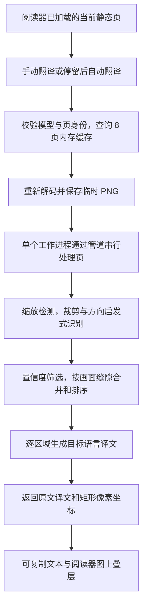

# 漫画 OCR、翻译与图上显示架构审计

审计基线为 `de758cf`。本报告对应任务书第一阶段，末节保留先前停用旧模型的回归记录。当前候选与质量改动见[实现报告](IMPLEMENTATION_REPORT.md)和[基准与验收矩阵](BENCHMARK_REPORT.md)。

## 实际调用链

- `ReaderPage.axaml.cs` 负责当前页就绪与自动任务调度，`ReaderViewModel.Translation.cs` 负责译文、覆盖层和翻页取消。暂无整卷批处理、断点恢复和译图导出入口。
- `MangaTranslationService.cs` 按页身份、资源签名和目标语复用结果，缓存上限 8 页。缓存未命中时重新打开源文件只读解码，在应用数据目录写临时 PNG。工作进程最多处理一页在途请求，同一会话复用模型，空闲约 30 秒退出。取消经管道送达，无法确认收尾时结束工作进程。日志保留异常类型与可选分段计时，避开原文。
- `MangaOcr.cs` 重新解码 PNG 为 BGRA，检测最长边约 1536，识别输入高度为 48，通过旋转、直立字形重排和低置信竖列分拆产生候选。检测和识别预处理分别构造 CPU 浮点输入，`MangaOcrOrt.cs` 在同步调用期间固定输入数组，DirectML 仍需设备传输。推理数据通路没有实测分配归因。
- `MangaOcrGeometry.cs` 将检测多边形投回解码坐标，按方向、间距和视觉边界合并相邻文本，再按上下和右到左排序。返回结构只有文字与轴对齐矩形。
- `MangaTranslationWorker.cs` 调用原生翻译器逐区域推理。`MangaTranslationConnection.cs` 与服务核验响应协议、像素尺寸和模型偏好。阅读器在同一个解码方向下把矩形映射进当前图片，可单独切回原图。

## 模型与设备基线

| 用途 | 审计时的版本与权重 | 运行方式 |
| --- | --- | --- |
| 文字检测 | RapidOCR v3.10.0 的 PP-OCRv5 mobile det，约 4.82 MB | ONNX Runtime 1.23.0 与 DirectML 1.15.4，会话常驻工作进程 |
| 文字识别 | 同版 PP-OCRv5 mobile rec，约 16.63 MB，配套 74,012 字节字典 | CTC 解码，动态会话加最多 8 个固定宽度会话 |
| 逐区翻译 | 腾讯 Hy-MT2 1.8B 与 7B Q4_K_M，约 1.13 GB 和 4.62 GB | llama.cpp b12650 C ABI，Vulkan，2048 上下文与 256 输出令牌 |

`tools/translation/backend-assets.tsv` 固定权重的字节数和 SHA-256，仓库无受 Git 跟踪的 GGUF。旧发行版从清单按需准备权重。目标语菜单提供 18 个选择，模型提示采用目标语名，代码未建立已验证的源语言和目标语言矩阵。PP-OCRv5 与 Hy-MT2 的名称和版本不足以判断漫画领域的替换效果。

[2026-11-25 的 DirectML 实测](漫画翻译DirectML会话复用验证-2026-11-25.md)记录了 Windows 11、RTX 5070 Ti 16,303 MiB、驱动 617.14 的整卡峰值，1.8B 优化版单轮 5,748 MiB，7B 优化版三轮最高 9,017 MiB。采样间隔 250 毫秒，含桌面和其他进程，不能拆分为权重、KV、DirectML 与驱动占用，也不能外推至 8 GB 设备。本次设备查询为同型号 16 GB，本轮未重新执行候选实测。

## 按严重性排列的现状问题

1. **P1｜复杂背景上覆盖线稿。** `Controls/MangaTranslationOverlay.cs:79` 为每块译文填充不透明白色矩形。触发条件是气泡外文字、拟声词、深色背景或与线稿重叠，矩形范围内的图像细节会在译文模式被遮挡。先保留多边形和字形掩膜，再以同页对照评估低成本气泡修复与复杂背景修复。当前版只在阅读器叠层显示，未提供修复后的图片导出。
2. **P1｜识别候选被永久丢弃。** `Services/Translation/MangaOcr.cs:63` 在置信度低于 0.50 时跳过，裁剪后的四边形、置信度和其他识别候选未跨 IPC 保留。没有检测框时在第 50 行返回空页。有检测框时先尝试低置信度竖列恢复，再在第 63 行丢弃仍低于阈值或为空的结果。手写、拟声词、小字或多语言漏识别可能因此与真正无字页表现相同。保留原始区域 ID、多边形、方向、置信度及候选，按检测和识别分别评估漏字。最长边缩放风险需要小字标注样本量化。
3. **P1｜区域级独立推理，单一区域输出失败使全页失效。** `Services/Translation/HyMtTranslator.cs:179` 每区清理 KV，`MangaTranslationWorker.cs:242` 只对输入超限保留原文，生成达到 256 令牌或完全空白会抛异常并返回页失败。服务只缓存整页成功结果。建立稳定 ID 与区域级结果状态，隔离失败区域。通过同一批样本比较单区、整页和跨页上下文与人物称谓。
4. **P2｜缺少语言方向与排版类别。** 目标语设置没有源语识别或人工源语选择，识别启发式偏向假名，未给拟声词、注音和旁白独立分类。图上布局使用同一套居中横排文字流，并以字符数和可用空间裁剪。窄竖气泡、长译文、冷门字和混排需加入视觉样本及字形覆盖检查。
5. **P2｜原生会话叠加，8 GB 可用性未知。** `Services/Translation/MangaOcr.cs:106` 的动态识别加最多 8 个固定形状会话可在翻译会话启用时同时驻留。固定形状失败会释放专用会话，但翻译按 Vulkan 可用层加载，缺少统一显存预算、峰值归因和显存不足后的按阶段卸载策略。使用 8 GB 实机记录单页和长批次，分别记录 P50、P95、空闲及峰值；以取消后第二页和失败重试检验恢复。
6. **P2｜像素往返带来额外 I/O 与原生内存峰值。** `Services/MangaTranslationService.cs:146` 在阅读器已显示图片时从源文件重解码再编码临时 PNG，工作进程随后重新解码并生成检测及识别浮点输入。此边界保留了进程隔离和定向坐标，改动前需要量化 PNG 读写、解码、浮点预处理和 GPU 上传各自开销，并保留源文件只读与取消收尾。

审计优先落点是区域保真与可追溯、上下文与区域级恢复、图像擦除及排版、8 GB 资源调度。模型候选和语言能力只在取得同源样本对照、许可核验与可复现的 C# 推理记录后定级。

## 停用现有模型后的回归验证

- `dotnet test tests/EhViewerForPc.ImageSearch.Ui.Tests -c Debug --no-build --no-restore --filter 'FullyQualifiedName~MangaTranslation|FullyQualifiedName~ReaderAutoTranslation|FullyQualifiedName~MangaOcr'`，40 项通过。覆盖旧模型偏好、禁用下载、工作进程参数和协议、取消与续页、OCR 气泡分组和图上排版。OCR 测试采用合成图文几何和识别结果。
- 用 `tools/translation/Prepare-NativeAssets.ps1 -Destination .qa/translation-retirement-native-20261126` 准备新资产。用 `dotnet publish src/EhViewerForPc -c Release -r win-x64 -p:PublishAot=true -p:MangaTranslationNativeDirectory=<新资产绝对路径> --no-restore -o .qa/translation-retirement-aot-20261126-r3` 发布。新产物的原生资产为 ONNX Runtime、DirectML、C++ 运行库和校验信息。分别用 `--manga-translation-worker --session <本机目录> <新产物内的 manga-native> hy-mt2-1.8b zh-CN` 和相同的 7B 请求验证最终产物，退出码均为 3。
- Windows 11 桌面实际启动新产物，用隔离设置写入旧 7B 模型 ID。使用 lvt 导航至漫画翻译设置，确认模型选择和下载按钮禁用，显示「当前版本没有可用的本地翻译模型」，检查资源时未创建模型目录。覆盖深色 1200 × 700、740 × 650 和浅色 920 × 650、640 × 650、540 × 420 DIP。证据在 `.qa/translation-retirement-desktop-20261126/`。最小窗口的状态与下载区位于可滚动区域底部。
- 原翻译模型权重、保存的目录和旧模型 ID 继续保存在用户原位置。译文缓存本来就只存于运行进程，退出即释放。新的模型目录选择、读取和资源准备不使用已移除的权重。本轮没有运行真实漫画候选基准、8 GB 显存测试或 Windows 10 / 其他 GPU 测试。
