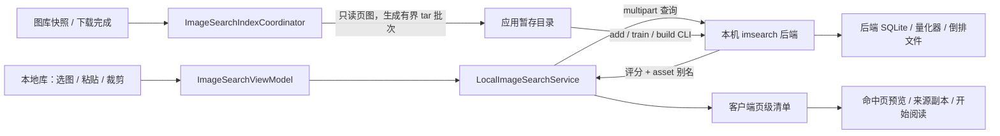

# 本地库局部图片搜索接入执行手册：基于 imsearch

日期：2026-11-12。文档版本：2。状态：已完成静态调研与执行拆解；尚未实现本功能、编译或运行检索后端。

## 0. 执行 agent 先读这里

本文件是供另一名 agent 按步骤实施的任务书。**阅读文件或更新文件本身不代表用户已经要求本轮开始写功能代码；本次交付只完善文档。** 后续明确收到“执行此手册”时，按下述顺序实施。

- 第 1–10 节保留调研事实、约束与设计理由；第 11–23 节是具体执行规格。前半部分的“建议”“可选”若与后半部分有不同，按后半部分已固定的首版决策执行。
- 默认目标：实现可选、完全本机处理的 **ManagedDocker MVP**，包括建库、选图/粘贴/裁剪、结果页、命中副本与页号阅读、下载完成后更新，以及可恢复的索引发布。
- Windows 原生后端、跨机器服务器、语义搜索、区域高亮、分片和逐页实时更新属于后续范围，不是默认完工条件。不要一边实现 MVP，一边自行扩大到这些项目。
- 先完成 E00，再按依赖表执行 E01–E12。真实效果门槛 E07 未通过时，不做 E08/E09 的正式产品 UI；可以继续协议、存储、故障恢复和模拟后端验证。
- 只在依赖缺失且没有替代进展、真实效果不达标、或需要改变已固定架构时记录阻塞。不要因为普通命名、布局或代码组织问题反复请求确认；按本文件执行。
- 所有任务状态初始为 `pending`。本文件里的示例 JSON、评分、耗时、镜像 Id 结构和参数均不代表已测结果。
- 不自动提交、推送、打包分发、修改系统配置、安装 Docker/WSL 或扫描全量真实图库。开发验证使用隔离目录，真实样本按 E07 的明确范围只读抽样。
- 保留当前工作区的全部既有修改。禁止 `git reset --hard`、`git clean`、整体覆盖现有 XAML/设置/阅读器文件，或为减少冲突恢复旧版本界面。

建议交给下一名 agent 的完整启动指令：

> 执行 `docs/PLAN-LOCAL-IMAGE-SEARCH-2026-11-12.md` 第 11–23 节的 ManagedDocker MVP。先记录 E00 基线，再按依赖实现，每项写明产物、命令、实际结果和未解决问题。保留既有工作区改动；不要实现范围外增强；真实后端/样本缺失时完成不依赖它们的工作并准确记录阻塞，不能用 mock 结果宣称真实检索已通过。最终按第 23 节交付。

## 1. 结论

**可以接入。建议把 imsearch 作为可选的本机检索服务，由本程序管理页级索引与结果导航。先验证漫画局部截图的召回效果，再决定是否投入 Windows 原生后端移植。**

当前程序尚无 imsearch、ORB 或以图搜图实现；本地库搜索仍是标题、文件夹、GID 等元数据过滤。这里提出的是新增功能，并非启用已有开关。

接入后的目标流程：

> 在“本地库”选择或粘贴一张截图 → 可选裁剪 → 搜索已建立索引的本地页图 → 显示命中页、画廊及副本 → 直接从命中页开始阅读。

判断与边界：

| 项目 | 结论 |
| --- | --- |
| 局部截图寻找来源整页 | 与 imsearch 的设计目的吻合，值得做 PoC |
| 本地库接入 | 现有数据源、副本、页号、阅读器可以复用，但需要新增页级映射和索引管理 |
| 直接在 .NET 内引用 | 不建议首版采用；它是 Rust/C++/OpenCV/Faiss 工具，不是现成的 .NET 库 |
| Windows 开箱即用 | 当前源码不满足；有未经条件编译隔离的 Unix 文件 API 和 GNU 链接配置 |
| 第一阶段运行方式 | 本机 Linux 容器后端；Avalonia 通过 loopback HTTP 查询，通过 CLI 建库 |
| 正式桌面发行 | Windows 原生 sidecar 移植验证通过后再内置；容器模式可保留为高级选项 |
| 语义相似搜索 | 不属于本方案；不能据此承诺“相同角色、画风、构图”搜索 |
| 裁剪定位框 | 上游接口不提供；首版只定位来源页，后续才做几何验证与区域高亮 |

本方案依据静态源码核查。**没有测得召回率、索引体积、耗时或 Windows 运行结果，后文容量是估算，验收指标是拟定目标。**

## 2. 核查基线与上游实际能力

上游：[lolishinshi/imsearch](https://github.com/lolishinshi/imsearch)。实际临时克隆核查的提交为 [`2bf2546822ca2b9b1522d868eb9f21ba441f20d2`](https://github.com/lolishinshi/imsearch/commit/2bf2546822ca2b9b1522d868eb9f21ba441f20d2)，提交时间为 2026-11-12 01:16:45 +08:00；`Cargo.toml` 版本字段为 `3.0.2`。**这里指该提交，不等同于承诺所有 3.0.2 镜像具有相同接口。**

### 2.1 算法链路

```text
图片解码、灰度化、尺寸调整
    → ORB-SLAM3 特征提取，每个描述符 32 字节
    → 二进制 KModes 训练聚类中心
    → Faiss HNSW 量化器选择倒排桶
    → 自定义 IVF 搜索，按汉明距离找特征匹配
    → 按图片聚合，使用 Wilson 或匹配计数评分
    → 返回评分和图片路径
```

源码入口：[ORB 提取](https://github.com/lolishinshi/imsearch/blob/2bf2546822ca2b9b1522d868eb9f21ba441f20d2/src/orb.rs)、[训练](https://github.com/lolishinshi/imsearch/blob/2bf2546822ca2b9b1522d868eb9f21ba441f20d2/src/cli/train.rs)、[IVF 实现](https://github.com/lolishinshi/imsearch/blob/2bf2546822ca2b9b1522d868eb9f21ba441f20d2/src/ivf/mod.rs)、[结果聚合](https://github.com/lolishinshi/imsearch/blob/2bf2546822ca2b9b1522d868eb9f21ba441f20d2/src/imdb.rs)。

适用性推断：保留足够线条、角点和纹理的裁剪，经过一定缩放、压缩后，仍可能匹配来源整页。纯白区域、仅对白文字、重复网点、小面积裁剪、镜像及重绘可能造成漏检或误检，必须用本地图书样本验证。该链路没有现成的几何一致性验证结果，评分不能显示为“找到原图的概率”。

### 2.2 需要按当前源码适配的差异

| 核查项 | 当前提交事实 | 对接要求 |
| --- | --- | --- |
| HTTP 路由 | `/search`、`/metrics`、`/docs` 和 OpenAPI 文档；没有 `/add`、`/build`、`/reload` | 索引管理走 CLI；更新后重启服务。不能照旧版 CHANGELOG 设计热更新 |
| 上传请求 | multipart 的 `file`，可选 `orb_nfeatures`、`orb_scale_factor`、`nprobe` | 使用 multipart，客户端不假定 JSON 请求；首版固定提取配置 |
| HTTP 返回 | `{"time":毫秒,"result":[[评分,"路径"],...]}` | 新增适配层；评分不按百分比展示 |
| 结果数量 | `count` 在服务启动参数中，默认 10；当前请求结构没有 `count` | 启动时扩大候选数，再由客户端过滤、去重 |
| 文档与结构差异 | `SearchForm` 列有 `ef_search`，实际 `SearchRequest` 没有该字段 | 以处理器与请求结构为准，不发送未落实的参数 |
| 添加格式 | 源码默认 `jpg,png,webp`；README 仍写 jpg/png | 显式传后缀；额外支持 jpeg；GIF/动图采用统一静态帧策略 |
| 低特征页 | 默认 `min_keypoints=250`，实现跳过特征数 `<=` 阈值的图片 | 漫画线稿可能被大量跳过；降低阈值做对照，记录覆盖率 |
| 相同内容多路径 | BLAKE3 去重；`--append` 把别名以 U+001E 拼入路径字段 | 客户端拆分别名并映射回所有有效副本 |
| 清理命令 | `clean` 清理描述符缓存，不等于删除失效图片或重建索引 | 删除、替换用客户端失效标记，定期新建索引代际 |
| 索引读取 | 当前倒排文件按需读取、解压；读取器打开索引需要读写权限 | 后端数据目录可写；原图库仍只读。不要使用 README 的旧 `--no-mmap` 参数 |

对应源码：[路由](https://github.com/lolishinshi/imsearch/blob/2bf2546822ca2b9b1522d868eb9f21ba441f20d2/src/server/mod.rs)、[请求与响应](https://github.com/lolishinshi/imsearch/blob/2bf2546822ca2b9b1522d868eb9f21ba441f20d2/src/server/types.rs)、[查询处理](https://github.com/lolishinshi/imsearch/blob/2bf2546822ca2b9b1522d868eb9f21ba441f20d2/src/server/api.rs)、[服务启动](https://github.com/lolishinshi/imsearch/blob/2bf2546822ca2b9b1522d868eb9f21ba441f20d2/src/cli/server.rs)、[添加参数](https://github.com/lolishinshi/imsearch/blob/2bf2546822ca2b9b1522d868eb9f21ba441f20d2/src/cli/add/mod.rs)、[添加逻辑](https://github.com/lolishinshi/imsearch/blob/2bf2546822ca2b9b1522d868eb9f21ba441f20d2/src/cli/add/tasks.rs)、[路径别名](https://github.com/lolishinshi/imsearch/blob/2bf2546822ca2b9b1522d868eb9f21ba441f20d2/src/db/crud.rs)、[倒排读取器](https://github.com/lolishinshi/imsearch/blob/2bf2546822ca2b9b1522d868eb9f21ba441f20d2/src/ivf/invlists/ondisk_invlists.rs)。

### 2.3 产品接入前应修补的问题

1. **空结果处理。** `search_handler` 用 `result[0].0` 记录指标，没有空数组检查；无匹配时存在越界 panic 路径。修为安全取首项，正常返回 `result: []`。客户端同时区分空结果、HTTP 失败和后端断连。
2. **鉴权尚未落实。** 有 token 参数、状态字段和 OpenAPI 安全定义，但当前搜索处理器及路由没有看到实际校验。不能把设置 `--token` 当成已经鉴权。产品版补认证中间件，并验证错误 token 返回拒绝结果。
3. **导入完成状态不可靠。** 添加命令忽略 `tokio::try_join!` 的结果；部分后台失败可能不能由退出码完整反映。修补错误传播，增加每批成功、跳过、失败及 asset 标识的结构化报告；导入完成后才推进检查点。
4. **资源边界。** 导入计算阶段有无界结果通道，并按 CPU 核数创建工作线程；HTTP 的 50 MiB 限制只约束压缩体积。产品版需有界队列、可配置工作线程和解码像素上限。客户端的取消请求也不保证已启动的后端 CPU 工作立即停止。

以上来自[查询处理器](https://github.com/lolishinshi/imsearch/blob/2bf2546822ca2b9b1522d868eb9f21ba441f20d2/src/server/api.rs)、[添加命令](https://github.com/lolishinshi/imsearch/blob/2bf2546822ca2b9b1522d868eb9f21ba441f20d2/src/cli/add/mod.rs)和[任务流水线](https://github.com/lolishinshi/imsearch/blob/2bf2546822ca2b9b1522d868eb9f21ba441f20d2/src/cli/add/tasks.rs)的静态检查，尚未动态复现。建议维护小范围后端补丁，保留来源提交和补丁版本。

## 3. 与本程序的接入点

本程序是 Avalonia 12 / .NET 10 应用，已有 NativeAOT 发布路径。Core 负责格式、扫描和持久化，应用层负责解码、UI、导航及服务组装。

| 现有位置 | 已有能力 | 本方案使用方式 |
| --- | --- | --- |
| [`LibrarySource`](../src/EhViewerReader.Core/Models/LibrarySource.cs) | 数据源 Id、根目录、启用状态 | 明确选择索引范围；只处理已配置且启用的数据源 |
| [`GalleryInfo`](../src/EhViewerReader.Core/Models/GalleryInfo.cs) | `SourceId`、`StableId`、`WorkId`、目录、GID | 保存命中页所属副本和作品，不能只保存 GID |
| [`PageFileParser`](../src/EhViewerReader.Core/Format/PageFileParser.cs) | 识别 8 位页文件名、扩展名、长度、mtime，同页多个候选 | 枚举合法页图；排除 `.thumb`、`.ehviewer`、临时下载文件等 |
| [`LibraryScanner`](../src/EhViewerReader.Core/Scanning/LibraryScanner.cs) / [`LibraryCache`](../src/EhViewerReader.Core/Models/LibraryCache.cs) | 画廊扫描、统计和热启动缓存 | 沿用画廊发现；另建页级索引清单，不把大量特征塞进 JSON 扫描缓存 |
| [`LibraryMerger`](../src/EhViewerReader.Core/Scanning/LibraryMerger.cs) | 跨源副本合并；单一来源内同 GID 目录仍可独立显示 | 默认结果按具体副本、页号去重，保留版本展开 |
| [`MainViewModel`](../src/EhViewerReader/ViewModels/MainViewModel.cs) | `SnapshotAllWorks()`、各条目的 `Versions`、`LocalIndexChanged` | 在 UI 线程取全库快照并展平副本；事件只做差异同步触发，不能当成页文件变更流 |
| [`DownloadManager`](../src/EhViewerReader.Core/Download/DownloadManager.cs) | `TaskChanged`、`TaskCompleted`、`Changed` | 首版在下载完成后更新对应目录；后续新增“页文件完成落盘”事件 |
| [`LocalReaderSource`](../src/EhViewerReader/Services/ReaderSources.cs) | 给定 `GalleryInfo` 打开实际页集合 | 打开实际命中的副本，按 `GalleryPage.Number` 找页 |
| [`ReaderViewModel`](../src/EhViewerReader/ViewModels/ReaderViewModel.cs) | 当前按历史恢复，有 `GoToIndex` | 扩展显式页号入口，让搜索定位覆盖历史恢复 |
| [`MainWindow`](../src/EhViewerReader/Views/MainWindow.axaml.cs) | Frame 导航；当前本地阅读请求主要传画廊条目 | 增加带副本、页号的阅读请求；处理“同作品已经打开”仍需跳页的情况 |
| [`AppServices`](../src/EhViewerReader/Services/AppServices.cs) / [`AppPaths`](../src/EhViewerReader.Core/Storage/AppPaths.cs) | 服务生命周期、自定义 `--data-dir` | 统一持有检索服务；所有生成数据写应用数据目录或显式配置的索引目录 |

注意：`SnapshotAllWorks()` 返回合并后的条目，不能只取每个条目的默认 `Info`，否则会漏掉其他副本。`WorkId` 对无 GID 画廊可能来自目录路径，目录搬迁后必须重新核对身份。

## 4. 推荐架构与部署选择



| 选择 | 优点 | 代价 | 建议 |
| --- | --- | --- | --- |
| 本机容器服务 | 贴近上游 Linux 构建环境；尽快验证算法 | Windows 需容器运行环境；进程、磁盘及端口管理更复杂 | PoC 和开发首选，产品中作为可选模式 |
| Windows 原生 sidecar | 无容器依赖；可随桌面应用安装 | 需移植文件读取和构建链，分发 OpenCV、Faiss 等原生依赖 | PoC 通过后再投入，作为正式桌面体验方向 |
| Rust/C ABI + P/Invoke | 直接进程内调用 | 需要新 FFI、内存所有权与 ABI；原生崩溃直接影响阅读器 | 首版不选 |
| 自行重写 ORB 检索 | 全部自主控制 | 仍需特征提取与索引实现；普通 OpenCV ORB 不保证兼容上游描述符 | 不作为本轮接入方案 |

原生 Windows 的具体阻碍：倒排读取器直接引用 `std::os::unix::fs::FileExt` 并使用 `read_exact_at`；`orb-slam3-sys/build.rs` 硬编码 `gomp`、`stdc++`、`blas`、`lapack` 链接。至少要增加 Windows 对应的定位读取实现、平台条件构建和 DLL 分发验证，不能只更换 Rust target。参见[读取器](https://github.com/lolishinshi/imsearch/blob/2bf2546822ca2b9b1522d868eb9f21ba441f20d2/src/ivf/invlists/ondisk_invlists.rs)、[构建脚本](https://github.com/lolishinshi/imsearch/blob/2bf2546822ca2b9b1522d868eb9f21ba441f20d2/orb-slam3-sys/build.rs)、[依赖](https://github.com/lolishinshi/imsearch/blob/2bf2546822ca2b9b1522d868eb9f21ba441f20d2/Cargo.toml)。

服务运行约束：

- 功能默认关闭，首次手动启用并建库；未启用时不启动后端、不遍历页图。
- 桌面端只连接本机地址，使用独立 `HttpClient`，关闭系统/站点代理，不复用站点 Cookie、DoH 和账号配置。
- Docker 的宿主端口仅发布到 `127.0.0.1`；容器内可监听 `0.0.0.0`，宿主与容器的绑定范围应区分。
- 只给容器挂载应用索引和暂存目录，后端无需挂载原图库。查询及建库在本机处理，不上传外部服务。
- 固定源码提交与构建镜像 digest；产品中不自动拉取 `latest`。NativeAOT 主程序继续通过 HTTP/进程边界工作。
- 外部连接模式由用户管理进程；自管理模式只关闭本程序创建的进程/容器，不结束用户已有服务。

上游标注 GPL-3.0，包含 ORB-SLAM3 衍生实现。分发前明确本程序及后端依赖的许可安排，保留许可证、修改说明并落实相应源码提供要求；独立进程本身不能作为免除义务的依据。本仓库当前未发现顶层 LICENSE，不能据此假定许可兼容。许可依据：[上游 LICENSE](https://github.com/lolishinshi/imsearch/blob/2bf2546822ca2b9b1522d868eb9f21ba441f20d2/LICENSE)。

## 5. 页级清单与跨平台路径映射

### 5.1 数据目录

建议新增可配置 `ImageSearchDirectory`，默认位于 `AppPaths.BaseDirectory/image-search`，大库建议选择 SSD：

```text
image-search/
  current.json                         # 已发布代际、参数指纹、后端构建版本
  generations/<generation-id>/
    manifest.db                        # 本程序页级清单与映射
    backend/
      imsearch.db                      # 上游元数据与特征缓存
      quantizer.bin
      invlists.bin
      ...                              # 上游分段索引等文件
    validation.json
  staging/<job-id>/batch-0001.tar       # 有界、可回收的输入批次
```

本地库、下载目录与上述生成目录分别管理；“清理在线缓存”不删除检索索引，重建检索索引不改动图库文件。

客户端清单采用 SQLite，第 12 节固定依赖与 schema，第 13 节固定 AOT 验证方式；不再让执行 agent 自行选 ORM。运行期 JSON DTO 继续使用源生成上下文。后端数据库视为私有格式，**不由 C# 直接修改其 image/vector 表**。根目录另有 `catalog.db` 存最新位置与任务，代际内 `manifest.db` 保存该次构建快照，二者职责见第 12 节。

### 5.2 逻辑模型

| 实体 | 建议字段与职责 |
| --- | --- |
| `IndexedAsset` | `AssetId`、规范化输入哈希、原文件哈希（可选）、提取配置版本、后端别名、导入/建索引状态 |
| `PageLocation` | `SourceId`、`GalleryStableId`、`WorkId`、`PageNumber`、相对页路径、长度、mtime、`AssetId`、有效状态 |
| `IndexGeneration` | 代际 Id、库快照版本、后端提交/补丁版本、特征配置指纹、训练样本、聚类数、统计及发布时间 |
| `IndexJob` | 批次与检查点、待处理数、成功数、低特征跳过数、损坏数、失败原因、重试状态 |

位置键应包含数据源、副本标识、原始页号与候选相对路径；`WorkId + PageNumber` 不能唯一标识物理页图。多个位置可以指向同一个内容资产。

### 5.3 推荐使用 tar 内逻辑别名

不把 Windows 绝对路径直接交给 Linux 后端，再靠字符串替换猜回来源。使用上游已有的 tar 导入能力：

1. 本程序通过 `PageFileParser` 枚举候选，只用 `FileAccess.Read` 读取有效页图。
2. 在受控暂存目录创建有界 tar；条目名形如 `pages/<AssetId>.jpg`。条目只使用程序生成的 ASCII 标识，不含原路径、标题或 `..`。
3. **执行版首版统一使用第 14 节的静态首帧、方向修正、白底灰度 PNG 规范化**，tar 条目固定为 `.png`。此处收紧早期“静态图透传、特殊图转换”的建议，减少 Windows/容器解码和别名格式差异；其额外解码成本必须计入 E07 测量。
4. CLI 导入 tar 后保存的是条目名，搜索会返回该逻辑别名；客户端通过清单恢复到当前 `SourceId → RootPath → RelativePath`。
5. `--append` 返回的路径字段可能含 U+001E，先拆分别名；每个别名只允许匹配清单中的已知资产。首版也保留此兼容处理，即使客户端已合并完全相同的输入。

tar 只是建库传输批次，不是长期复制整个图库。使用 .NET `System.Formats.Tar` 流式写入，按 128 MiB 或 500 页任一上限封包，待消费批次最多两个。低特征跳过及失败必须有报告，不能把“已打包”记为“已可搜索”。

首版每个页号优先处理可解码的首选候选，首选损坏则回退；若以后索引同页多个画质候选，结果仍按副本与页号归并。同内容跨源副本复用资产，不能复用后丢失副本位置。

打开结果前再次验证数据源仍启用、映射仍有效、路径在对应源内且文件存在。源目录离线时标为暂不可用，不据此批量删除记录；源明确移除或重新扫描确认文件消失后才失效。目录迁移要重做位置映射；不根据文件名或 GID 自动认定内容相同。

## 6. 建库、增量更新与恢复

### 6.1 初次建库

1. 从全库快照展平 `Versions`；选择指定数据源，枚举页图。整个任务在后台运行，进度与 UI 列表过滤相互独立。
2. 用长度和 mtime 快速发现变化；实际读文件时计算内容哈希。文件读取前后检查状态，变化中的文件延后处理；相同长度和时间不能视为严格的内容相同证明，可提供主动完整校验。
3. 分批生成 tar 并执行 `add`，记录低特征、格式不支持及损坏；提取配置在同一代际固定。
4. 从多个源、画廊、画风、黑白/彩色及页位置中分层抽样训练，避免只拿封面或单一来源。当前 `train --images` 本身不能替代客户端的分层抽样策略，可先向新代际导入抽样集训练，再追加剩余页。
5. 执行 `train` 生成量化器，再分批 `build`。已导入不等于已进入可查询索引。
6. 校验数据库、索引、清单和已知查询样本；成功后发布新代际并启动服务。失败保留旧代际和任务检查点。

以下仅解释未打补丁的上游 CLI 调用顺序，不代表本次已执行，**不得作为执行手册的实际运行命令**。实施时使用第 15 节包含报告、身份和凭据的补丁契约；训练参数按第 16 节计算。`/state` 是容器内应用索引目录：

```sh
imsearch --conf-dir /state/generations/poc/backend add /state/staging/sample.tar \
  --suffix jpg,jpeg,png,webp --hash blake3 --append --min-keypoints 30

imsearch --conf-dir /state/generations/poc/backend train --centers 8192 --images 1000

imsearch --conf-dir /state/generations/poc/backend build --batch-size 2000

imsearch --conf-dir /state/generations/poc/backend server \
  --addr 0.0.0.0:8000 --count 100 --nprobe 16 --threads 2
```

`min-keypoints=30`、聚类 8192、`nprobe=16` 都是样本实验起点。正式值通过召回、延迟和资源曲线确定，不能当成上游推荐或实测最优。接入版应补认证，并采用后端参数/凭据约定；原版的 token 参数不足以提供保护。

### 6.2 增量策略

| 变化 | 首版处理 |
| --- | --- |
| 下载完成 | 订阅 `TaskCompleted`，对该画廊重新枚举有效页并排队；只有启用的入库范围才建索引 |
| 下载进行中 | 首版不保证新页即时可搜；后续在正式文件验证、原子落盘后发新增事件，禁止按每次进度通知触发构建 |
| 扫描、源切换 | 合并触发信号，对图库快照和清单做差异对账；离线源不做破坏性同步 |
| 新文件 | 添加到待发布代际，`add → build → 重启并发布` 后才显示可搜 |
| 同路径内容替换 | 创建新资产，旧位置失效；不靠 `--overwrite` 更新特征，该参数主要更新重复内容的路径 |
| 文件/数据源移除 | 清单立即过滤失效位置；后端旧向量暂存，定期重建压缩 |
| 路径搬迁 | 核实新位置与内容关系后更新位置映射；无 GID 的身份变化需要显式迁移 |
| 特征参数或解码策略变化 | 创建新代际，重新提取及训练，不能混用旧量化器和新描述符配置 |

追加页可复用当前量化器，但图库规模、分布明显变化后要评估重新训练。禁止直接在后端 SQLite 删除 image 行：当前向量映射存在累计计数及连续 Id 假设，随意删除可能破坏结果映射。物理清除旧内容采用全新代际重建。源码依据：[向量映射和索引构建](https://github.com/lolishinshi/imsearch/blob/2bf2546822ca2b9b1522d868eb9f21ba441f20d2/src/imdb.rs)、[数据库操作](https://github.com/lolishinshi/imsearch/blob/2bf2546822ca2b9b1522d868eb9f21ba441f20d2/src/db/crud.rs)。

### 6.3 代际发布与故障恢复

- 任何时刻只允许一个索引写任务；搜索服务不读取正在合并、替换的代际。
- 增量任务如复用旧数据，先干净关闭旧服务并完成 SQLite checkpoint/连接关闭，再复制一致的后端文件和清单到新代际；不能直接复制活动 WAL 数据库的一部分。
- 复制完成后可恢复旧代际查询，在新代际构建。低内存设备选择空闲维护并暂停搜索，不能承诺同时构建和查询没有资源成本。
- 新代际完成完整性检查和已知样本查询后，短暂停止旧服务，原子替换 `current.json` 并启动新服务；就绪探测失败恢复旧指针和旧服务。
- 每个请求绑定代际版本；返回期间若代际变更，使用对应代际清单或丢弃重查，不得用新清单解释旧响应。
- 磁盘不足、进程退出和取消只影响未发布任务；恢复时核查批次实际状态，幂等重放。旧代际在确认新代际可用后才回收。
- 不直接使用 `clean --all` 作为重建前置操作；训练和迁移可能仍需描述符。保留/清理策略必须与重建成本一起显示。

## 7. 查询、展示与命中页阅读

### 7.1 查询协议

客户端发送 multipart：

```text
POST http://127.0.0.1:<port>/search
file = 裁剪后按约定规范化的 PNG/JPEG 字节
nprobe = 经过测量选择的搜索档位
```

原版响应示意：

```json
{
  "time": 123,
  "result": [
    [82.5, "pages/asset-a.jpg"],
    [69.1, "pages/asset-b.png\u001epages/asset-c.png"]
  ]
}
```

分值与时间仅为结构示意。HTTP JSON 的结果项是异构二元数组；.NET 端写明确的解析器/转换器，校验项长度、有限数值和字符串，并使用源生成 JSON 元数据。不能把它直接当成带 `score/path` 属性的对象数组。

结果处理顺序：解析并拆分别名 → 查对应代际清单 → 过滤失效/未启用/当前不可访问的位置 → 按实际副本、页号归并 → 保留原始评分排序 → 加载少量页缩略图。

后端默认只给 10 个候选，过滤后可能不足。因此自管理服务先用 `--count 100` 做实验；仍不足时提示索引覆盖情况，后续才扩展请求级 `count`、分页或过滤能力。前端筛选不能等价于“在指定子库内重新检索”，需要明确这一差别。

### 7.2 用户入口

- “本地库”工具栏增加“以图搜图”，进入现有 Frame 的子页面，不增加顶层常驻导航。
- 首版支持文件选择、拖入、剪贴板粘贴；显示查询图，允许矩形裁剪后搜索。取消或返回后忽略晚到结果。
- 结果卡片以命中页缩略图为主，显示画廊标题、原始页号、来源、匹配分及“从此页阅读”。同作品其他副本可展开，不能用封面替代命中页图。
- 显示“已索引页数 / 可索引页数”，并区分未建库、正在建库、源离线、无匹配、后端不可用。后端运行细节放设置和诊断，不占据主要操作区。
- 设置 → 本地库增加图片索引管理：范围、存储位置、进度、暂停/继续、更新、重建及清理；容量和预计剩余时间只在有测量依据时显示。
- 维持项目 Fluent 控件、深浅主题和窄窗口布局规范；详细 UI 设计留在实施阶段。

### 7.3 明确定位到命中副本和页号

新增概念模型（名称可在实施时调整）：

```csharp
public sealed record ImageSearchHit(
    string GenerationId,
    string AssetId,
    string SourceId,
    string GalleryStableId,
    string WorkId,
    int PageNumber,
    float RawScore);

public sealed record LocalPageReadRequest(
    GalleryInfo Gallery,
    int PageNumber);
```

导航实现必须同时满足：

1. 解析具体 `GalleryInfo`，不通过 `TryGetLocalCopy(gid)` 随意选择默认副本；无 GID 画廊也要可打开。
2. 创建 `LocalReaderSource` 后用 `Pages` 中的 `Number` 查找实际位置，不能使用 `PageNumber - 1`，因为库里可能缺页。
3. 显式命中页覆盖历史恢复；优先增加可选初始页号，或在阅读器初始化后调用正确的定位逻辑，不为导航先改写历史文件。
4. 若同一作品已经打开，仍需定位到目标页；若命中的是其他副本，则切换或重新创建对应源。当前按 `ProgressKey == WorkId` 提前返回的逻辑需调整。
5. 文件失效时提示并允许选择有效副本；不能静默跳到别页却显示原命中页号。单页、纵向连续和横向模式都要验证。

### 7.4 不把区域高亮纳入首版承诺

上游没有返回匹配坐标，当前持久化的主要是描述符，而非完整关键点几何信息。若以后需要在来源整页画出截图区域，应对 Top-N 候选重新提取关键点、匹配并做 RANSAC/仿射或单应性验证，再返回变换与内点统计；同时处理缩放、方向和裁剪坐标映射。该阶段也可降低重复网点和对白文字导致的误检，但属于新增后端能力。

## 8. 规模与资源估算

本仓库 README 记录的既有本地库基线是 **6,327 个画廊 / 245,548 页**。这不是本次读取真实磁盘得出的统计，也未确认这些页当前都存在、唯一且可提取特征。

**聚类规模应按索引图片/页数估算，不能把画廊数当成图片数。** 上游 README 对 200K–2M 张图片给出 `K=1,048,576` 的参考值，前提为每图约 500 个特征点；这只是全库实验候选，不应照搬为默认。参见[上游规模建议](https://github.com/lolishinshi/imsearch/blob/2bf2546822ca2b9b1522d868eb9f21ba441f20d2/README.md)。

以每页恰好 500 个 32 字节描述符计算：

| 项目 | 计算 | 量级 |
| --- | --- | --- |
| 特征向量数量 | 245,548 × 500 | 122,774,000 |
| 原始描述符 | 向量数 × 32 字节 | 约 3.66 GiB |
| 若每向量带一个 8 字节 Id | 向量数 × (32 + 8) | 约 4.57 GiB |
| 构建批次 2,000 页的向量与 Id | 2,000 × 500 × 40 | 约 38 MiB，未计对象及多份缓冲 |
| 上游默认构建批次 100,000 页 | 100,000 × 500 × 40 | 约 1.86 GiB，仅基础数据 |

这些值不是压缩后的索引大小，也不是常驻内存需求。实际还有 SQLite 特征副本、量化器/HNSW、索引元数据、解码画布、工作线程缓冲、合并临时文件和操作系统文件缓存；索引压缩能节省多少必须测量，不能从原图 2.8 TB 的容量直接推出。

资源策略：

- 索引与 tar 暂存优先放 SSD，原图库留在原盘；对机械盘尽量顺序读取，同盘一个读取队列。
- 首版从构建批次 2,000 页、查询读取线程 2 起测，导入 worker 数在后端补丁中限额；通过峰值测量调整。
- 首次建库必须读图片字节并解码，不能期待沿用热扫描缓存的亚秒启动体验；正常启动只加载现成清单，不自动重提取。
- 以真实试验统计每千页的吞吐、磁盘增量和峰值内存，再估算整库时间与空间；构建前预算至少覆盖新旧代际、数据库、合并临时文件和有界 tar，不能只检查最终索引体积。
- 若 245K 页规模在目标机器上资源不可接受，先支持指定数据源/画廊子集，再评估分片；首版不直接引入每画廊一个索引或多路查询。

## 9. 实施拆分与验收

### 阶段 A：算法与运行环境 PoC

从分层抽样的约 2,000–5,000 页建立试验库；包括黑白、彩色、稀疏线稿、重复网点、跨源重复页和部分损坏文件。另准备至少 200 条已知来源查询，按 10% / 25% / 50% 面积裁剪、缩放、JPEG 压缩、截图边框及少量旋转分组；镜像、重绘、纯文字和低纹理单列，不混入基础成功率。

先修空结果处理；PoC 的原版服务只在本机受控环境运行。记录：

- 入库覆盖率、每类跳过原因；不能只计算成功入库样本的召回率。
- 页级 Recall@1、Recall@10，以及相同内容有效副本命中的定义。
- 至少 100 条无来源/低纹理负样本的结果分布，避免总给出高分无关页。
- 冷/热查询的端到端 P50/P95、建库吞吐、峰值 RSS、临时及最终空间。
- `min-keypoints`、`nprobe`、聚类大小与特征数的质量/性能对照。

拟定进入下一阶段的门槛：常规 25%–50% 裁剪 Recall@10 ≥ 90%，并提供包含未入库页的整体命中率；在指定测试硬件上温热查询端到端 P95 ≤ 3 秒。10% 裁剪及负样本单独报告。未达标先定位覆盖率、提取或索引问题，不先做完整 UI。以上为项目目标，非上游性能承诺。

### 阶段 B：应用 MVP

完成客户端清单、tar 导入、CLI 协调、HTTP 适配、进度与失败展示、文件/粘贴查询、命中页预览及页号导航；下载完成后增量更新。支持手动连接本机后端；后端缺失时其余功能正常。

### 阶段 C：可靠更新与发布

补齐后端认证、资源上限和结构化导入报告，完成代际切换、断点恢复、失效过滤与重建；随后验证 Windows sidecar 移植、NativeAOT 调用和 MSIX 分发。在没有完成 Windows 原生验证前，不宣称安装应用后即可无依赖使用本功能。

### 阶段 D：可选增强

阅读器中裁剪当前页并搜索、候选几何重排和匹配区域高亮；基于测量决定是否增加分片和更细的实时增量。

建议验收用例：

| 范围 | 必须验证 |
| --- | --- |
| 页号 | 第 1 页、中间缺页、同页多扩展名；命中页不同于历史页；三种阅读模式 |
| 副本 | 跨源相同文件、同 GID 不同版本、同源同 GID 多目录、无 GID、非默认副本命中 |
| 路径 | 中文/空格/长路径、源目录搬迁、Windows→容器逻辑映射、未登记别名拒绝 |
| 更新 | 新下载完成、读取过程中替换、删页、禁用源、外接盘离线与重新连接 |
| 后端 | 空结果、损坏查询、超大像素图、错误 token、响应格式异常、服务崩溃和重复启动 |
| 一致性 | add/build 中断、低空间、活动 WAL 快照、切换失败回滚、旧请求晚到、批次重复执行 |
| 只读 | 建库、查询、取消前后比对源文件路径/长度/mtime；无索引、临时图或 sidecar 文件写入源目录 |
| 发行 | 功能关闭时无后台扫描；NativeAOT DTO 解析；托管版/AOT 版行为一致；MSIX 子进程与数据目录 |

全库性能验证在阶段 A 通过后进行，单独记录硬件、唯一有效图片数、参数、后端提交、冷/热状态及结果。小样本达标不等于 245K 页已达标。

## 10. 建议代码落点

以下均是待新增或扩展项，本次没有创建实现：

| 位置 | 职责 |
| --- | --- |
| `EhViewerReader.Core/ImageSearch/` | 查询/命中/任务模型、参数指纹、别名解析和候选归并逻辑 |
| `EhViewerReader.Core/Storage/ImageSearchManifestStore.cs` | 页级 SQLite 清单、位置失效、任务检查点及代际元数据 |
| `EhViewerReader/Services/ImsearchClient.cs` | multipart、异构数组解析、取消与超时、协议错误处理 |
| `EhViewerReader/Services/ImsearchBackendHost.cs` | 用户连接/自管理模式、进程或容器生命周期、就绪与版本检查 |
| `EhViewerReader/Services/ImageSearchIndexCoordinator.cs` | 全库快照、tar 批次、CLI、进度、下载事件及代际发布 |
| `EhViewerReader/Services/ImageSearchInputNormalizer.cs` | 查询/特殊页的静态帧、裁剪、方向及像素预算 |
| `ViewModels/ImageSearchViewModel.cs`、`Views/ImageSearchPage.axaml` | 查询图、结果、取消、状态及阅读请求 |
| `MainViewModel`、`ShellViewModel`、`MainWindow`、`ReaderViewModel` | 进入搜索页面、取全副本快照、明确副本/页号导航 |
| `AppSettings`、`AppPaths`、`StorageJsonContext`、`AppServices`、设置页 | 可选功能配置、索引路径、持久化和释放 |
| `tests/` | 映射/协议/增量一致性测试、合成图片集、后端集成回归和导航验证 |

建议先执行阶段 A，提交“样本效果与资源报告 + 可复现后端构建”，再实现应用 MVP。若漫画局部截图召回合格，本程序现有模型足以承载接入；主要新增工作集中在页级索引管理、后端产品化及明确页号导航。

## 11. 固定首版决策与任务依赖

### 11.1 不再交给执行者选择的事项

| 决策 | 固定规格 |
| --- | --- |
| 默认运行模式 | `Disabled` / `ManagedDocker` 两种；首版不实现任意 URL 连接或远程图库服务 |
| 查询后端 | 上游固定提交 + 本仓库维护的小补丁，协议版本 `ehreader-imsearch/1` |
| 后端管理 | Docker CLI 作为唯一容器适配；独立进程执行，不调用命令解释器拼接命令 |
| 原图库访问 | 只有 .NET 读取；容器只挂载检索专用目录 |
| 输入 | 所有目标页与查询统一规范化为灰度 PNG；动画只用第 0 帧 |
| 资产 Id | 规范化 PNG 内容哈希加规范化版本生成，详见第 14 节 |
| .NET 持久化 | `Microsoft.Data.Sqlite` 10.0.12、参数化 SQL、无 ORM；JSON 使用源生成 |
| .NET 代码位置 | 通用模型/解析/SQLite 放 Core，Skia、Docker、UI 和协调器放应用工程 |
| 查询排序 | 保持后端原始降序；副本页去重时取最大分，不相加；展示最多 30 个页结果 |
| 后端候选数 | 启动 `count=100`；查询 `k=3`、汉明距离阈值 64；质量调参须写进校准报告 |
| 首版评分与入库阈值 | Wilson 评分；`min-keypoints=30`；阈值变化需新实验与覆盖率报告，不能静默变更 |
| 维护方式 | 手动首次建库；后续下载完成信号合并，安静 10 秒后更新；单个后台写任务 |
| 暂停与取消 | 暂停在安全批次边界生效；取消终止本任务拥有的容器，当前未提交批次重放 |
| 默认资源 | 准备 worker=1，后端提取 worker=2，查询并发=1，索引批次 2,000 页 |
| 资源配额 | 单批 128 MiB 或 500 页取先到者；待消费批次最多 2 个；规范化画布预算 128 MiB |
| 请求超时 | 健康检查 3 秒，单次搜索 30 秒；每次搜索最大响应 2 MiB |
| 效果默认档位 | `nprobe=16`；只开放 4 / 16 / 64 三档，需满足 `nprobe <= centers` |
| 首版不实现 | 原生 Windows 检索移植、删除图库文件、自动联网补图、RANSAC、逐帧动画、语义嵌入、分片 |

依赖版本已核实有正式包：[Microsoft.Data.Sqlite 10.0.12](https://www.nuget.org/packages/Microsoft.Data.Sqlite/10.0.12)。这是本方案固定基线，不是“自动选择最新版”。其默认包包含原生 SQLite bundle，发行时需要检查 RID 原生文件；参见[官方自定义版本说明](https://learn.microsoft.com/en-us/dotnet/standard/data/sqlite/custom-versions)。不得只因托管构建成功就宣称 NativeAOT 支持已验证。

### 11.2 工作项、依赖与完成证据

| ID | 工作项 | 必须先完成 | 完成证据 |
| --- | --- | --- | --- |
| E00 | 工作区、工具、现有测试基线 | 无 | `baseline.json`、原始 git 状态、测试退出码 |
| E01 | Core 契约、协议解析及 golden fixtures | E00 | DTO、解析器、确定性协议测试 |
| E02 | 可重现后端构建与补丁 | E00 | 固定提交、补丁、镜像 Id、Rust 测试及协议测试 |
| E03 | SQLite 清单、迁移与位置映射 | E01 | schema、事务/恢复/别名解析测试 |
| E04 | 规范化、哈希、有界 tar | E01 | 解码/方向/裁剪/去重/资源限制测试 |
| E05 | 后台任务与代际发布 | E03、E04 | fake backend 故障注入与恢复测试 |
| E06 | Docker host、HTTP、身份检查与探针骨架 | E01–E04 | 本机真实容器搜索、认证、退出与重启证据 |
| E07 | 真实页图 PoC 与质量门槛 | E02–E06 | 可复现评测报告、原始 JSONL、通过/失败结论 |
| E08 | 设置和搜索子页 | E07 通过 | 深浅主题、窄窗口、状态、粘贴/裁剪的 UI 证据 |
| E09 | 命中副本与页号导航 | E07 通过、E08 | 读者初始化及已打开副本切换回归 |
| E10 | 下载/扫描事件与增量更新 | E05、E06；最终串联依赖 E09 | 连续事件只合并一项任务，失效过滤通过 |
| E11 | 故障恢复、隐私与只读验证 | E05、E06、E10 | 故障矩阵、只读快照、无遗留任务容器 |
| E12 | AOT、现有功能回归与交付 | E08–E11 | AOT probe、回归结果、文件清单与交接报告 |

表中依赖用于确定顺序，不要求创建多个 agent。每次只完成一个可验证小步骤，再更新状态；不同时重写后端、导航和设置三个子系统。

## 12. 数据模型和数据库规格

### 12.1 必须新增的文件

```text
src/EhViewerReader.Core/ImageSearch/
  ImageSearchModels.cs
  ImageSearchProfile.cs
  ImageSearchProtocol.cs
  ImageSearchAlias.cs
  ImageSearchResultResolver.cs
  IImageSearchBackend.cs
src/EhViewerReader.Core/Storage/
  ImageSearchCatalogStore.cs
  ImageSearchManifestStore.cs
  ImageSearchSchema.cs
src/EhViewerReader/Services/
  ImageSearchInputNormalizer.cs
  ImageSearchTarWriter.cs
  ImageSearchIndexCoordinator.cs
  ImageSearchGenerationPublisher.cs
  ImsearchClient.cs
  ImsearchBackendHost.cs
  ImageSearchProbeService.cs
```

前 10 节的文件名是建议；此表及下文为执行版固定名字。已有同名文件时先读内容再扩展，不能直接覆盖。Core 不引用 Avalonia、Docker SDK、Skia 位图类型或应用层服务。

### 12.2 最新清单与代际快照必须分开

完整根目录如下，覆盖第 5 节的简图：

```text
image-search/
  catalog.db                   # 最新位置、内容资产、任务、修订号
  writer.lock                  # 整个索引根的唯一写者租约
  current.json                 # 只指向已验证、可恢复的代际
  publish-journal.json         # 发布恢复日志，发布完成后可移除
  generations/<32位小写hex>/
    manifest.db                # 本代际的资产与位置快照
    backend/                   # 上游独占写入的文件
    validation.json
  staging/<32位小写hex>/
    batch-000001.tar
    batch-000001.entries.json
    batch-000001.report.jsonl
  runtime/
    backend.env                # 运行期凭据，不入 git、不进诊断包
```

- `catalog.db` 记录当前事实；`manifest.db` 只描述某一代际实际纳入的资产与位置。不得把 `catalog.db` 的最新资产直接视为已可搜索。
- 返回结果必须同时满足“本代际已索引 + 最新位置仍有效 + 当前源仍启用 + 当前文件存在且指纹一致”。删除、替换和禁用即时过滤，不等待后端物理重建。
- 暂时离线不修改 `location.present`；用源可访问性状态表达。扫描成功且确认缺失才设置 `present=0`。
- 每次已确认的资产、位置或源映射变化，在同一事务内令 `catalog_revision` 增加 1；纯下载百分比和 UI 筛选不增加。

### 12.3 Schema v1：catalog.db

以下 SQL 为完整初始结构，表名/字段名按原样实现。每次打开连接启用 foreign keys，写事务显式提交。生产写入用 WAL，单次事务最多 500 个位置；同一 store 内串行写。

```sql
PRAGMA foreign_keys = ON;
PRAGMA journal_mode = WAL;
PRAGMA busy_timeout = 5000;

CREATE TABLE meta (
    key TEXT PRIMARY KEY,
    value TEXT NOT NULL
);
INSERT INTO meta VALUES ('schema_version', '1');
INSERT INTO meta VALUES ('catalog_revision', '0');

CREATE TABLE asset (
    asset_id TEXT PRIMARY KEY,
    payload_sha256 TEXT NOT NULL,
    normalizer_version TEXT NOT NULL,
    width INTEGER NOT NULL CHECK (width > 0),
    height INTEGER NOT NULL CHECK (height > 0),
    prepared_bytes INTEGER NOT NULL CHECK (prepared_bytes > 0),
    created_utc_ticks INTEGER NOT NULL
);

CREATE TABLE location (
    location_id TEXT PRIMARY KEY,
    source_id TEXT NOT NULL,
    gallery_stable_id TEXT NOT NULL,
    work_id TEXT NOT NULL,
    page_number INTEGER NOT NULL CHECK (page_number > 0),
    relative_path TEXT NOT NULL,
    path_key TEXT NOT NULL,
    source_length INTEGER NOT NULL CHECK (source_length >= 0),
    source_mtime_ticks INTEGER NOT NULL,
    asset_id TEXT REFERENCES asset(asset_id),
    present INTEGER NOT NULL CHECK (present IN (0, 1)),
    revision INTEGER NOT NULL,
    last_error_code TEXT,
    UNIQUE (source_id, gallery_stable_id, path_key)
);
CREATE INDEX ix_location_asset ON location(asset_id);
CREATE INDEX ix_location_gallery ON location(source_id, gallery_stable_id);

CREATE TABLE job (
    job_id TEXT PRIMARY KEY,
    generation_id TEXT NOT NULL,
    kind TEXT NOT NULL,
    state TEXT NOT NULL,
    snapshot_revision INTEGER NOT NULL,
    checkpoint_batch INTEGER NOT NULL DEFAULT 0,
    pending_count INTEGER NOT NULL DEFAULT 0,
    succeeded_count INTEGER NOT NULL DEFAULT 0,
    skipped_count INTEGER NOT NULL DEFAULT 0,
    failed_count INTEGER NOT NULL DEFAULT 0,
    error_code TEXT,
    updated_utc_ticks INTEGER NOT NULL
);

CREATE TABLE batch (
    job_id TEXT NOT NULL REFERENCES job(job_id),
    batch_number INTEGER NOT NULL,
    state TEXT NOT NULL,
    tar_sha256 TEXT NOT NULL,
    entry_count INTEGER NOT NULL,
    report_sha256 TEXT,
    PRIMARY KEY (job_id, batch_number)
);
```

`path_key` 使用 `/` 分隔，Windows 对相对路径使用 invariant 大写，其他平台保持大小写；原始 `relative_path` 保留实际拼写。位置 Id 使用 SHA-256 对 `sourceId + "\0" + galleryStableId + "\0" + pathKey` 的 UTF-8 哈希，输出 64 位小写 hex。禁止用 `.GetHashCode()`、标题或 GID 代替持久 Id。Id 字段本身不允许 NUL。

源根路径、源启用状态从当前 AppSettings 的快照取得，不在这里建立第二套源配置。画廊搬迁导致 StableId 变化时，不自动沿用旧位置 Id；重新对账后旧位置失效、新位置指向相同内容资产即可。

### 12.4 Schema v1：manifest.db

本文件用 SQLite `journal_mode=DELETE`、`Pooling=False`，生成完成后关闭连接，再发布。发布后应用层只读打开。

```sql
CREATE TABLE generation (
    generation_id TEXT PRIMARY KEY,
    protocol TEXT NOT NULL,
    backend_build_id TEXT NOT NULL,
    feature_profile_id TEXT NOT NULL,
    snapshot_revision INTEGER NOT NULL,
    centers INTEGER NOT NULL,
    built_utc_ticks INTEGER,
    state TEXT NOT NULL
);
CREATE TABLE indexed_asset (
    asset_id TEXT PRIMARY KEY,
    alias TEXT NOT NULL UNIQUE,
    feature_count INTEGER,
    state TEXT NOT NULL,
    error_code TEXT
);
CREATE TABLE member (
    location_id TEXT PRIMARY KEY,
    asset_id TEXT NOT NULL REFERENCES indexed_asset(asset_id),
    source_id TEXT NOT NULL,
    gallery_stable_id TEXT NOT NULL,
    work_id TEXT NOT NULL,
    page_number INTEGER NOT NULL,
    relative_path TEXT NOT NULL,
    source_length INTEGER NOT NULL,
    source_mtime_ticks INTEGER NOT NULL
);
CREATE INDEX ix_member_asset ON member(asset_id);
PRAGMA user_version = 1;
```

`indexed_asset.state` 仅取 `prepared/imported/indexed/skipped/failed`；只有 `indexed` 可以生成命中结果。低特征的 `skipped` 也必须留存，作为覆盖率分母与诊断证据。

所有 source/work/stable 字符串按原值存储；比较规则按现有模型约定，不全局转小写。SQLite 读取列显式映射，不用反射对象映射器。未知 schema 只拒绝本功能并显示错误，不删除数据库、不连带清理图库。

### 12.5 JSON 文件规格

`current.json` 必须包含以下字段；时间用 UTC ISO-8601，所有路径由 generationId 推导，不允许外部 JSON 填绝对后端路径：

```json
{
  "schemaVersion": 1,
  "generationId": "00000000000000000000000000000001",
  "protocol": "ehreader-imsearch/1",
  "backendBuildId": "由真实构建锁文件填写",
  "featureProfileId": "64位小写hex",
  "snapshotRevision": 42,
  "manifestSha256": "64位小写hex",
  "publishedUtc": "2026-11-12T00:00:00Z"
}
```

写入 `current.json.new`，刷新落盘并关闭，再在同一目录用带备份的原子替换；第一次发布用同卷 rename。文件内容完整验证后才接收它。JSON 类型统一注册在 Core 的新增 `ImageSearchJsonContext`，不要污染原有在线协议的命名配置。

## 13. E00 / E01 / E03：基线、契约与存储执行步骤

### 13.1 E00：先取基线

从仓库根执行，逐条检查退出码。记录到 `.qa/image-search/baseline/`，该目录已被 `.gitignore` 的 `.qa/` 规则排除：

```powershell
git status --short
git rev-parse HEAD
dotnet --info
git --version
docker version
dotnet restore tests/EhViewerReader.Core.Tests/EhViewerReader.Core.Tests.csproj
dotnet build src/EhViewerReader/EhViewerReader.csproj -c Debug -p:PublishAot=false
dotnet test tests/EhViewerReader.Core.Tests/EhViewerReader.Core.Tests.csproj -c Debug -p:PublishAot=false --logger "trx;LogFileName=baseline.trx" --results-directory .qa/image-search/baseline
```

不要对含 wapproj 的整个 slnx 执行 `dotnet build`。Docker 不可用时，E02 的真实构建、E06、E07 标记依赖缺失；E01、E03、E04、E05 的模拟测试仍可继续。现有测试失败时保留失败用例与输出，先区分环境/原有问题，不能删除失败测试或降低断言。

读取 `PRODUCT.md`、`DESIGN.md`、本文件第 2/3 节、`AppSettings.Normalize`、设置保存/重新载入方法和 `ReaderPage.OnLoaded`。扫描本工作目录及祖先的 AGENTS.md；实际实施 UI 时按环境提供的设计技能规则读取技能，不能把本手册当成跳过项目规范的理由。

新增 `docs/IMPLEMENTATION-LOCAL-IMAGE-SEARCH-STATUS.md`，写入 E00–E12 表与真实状态。禁止在没有运行的条目填 `passed`。

### 13.2 E01：先写这些契约

模型文件至少声明：`ImageSearchHit`、`ImageSearchProfile`、`ImageSearchRequest`、`ImageSearchResult`、`ImageSearchProgress`、`ImageSearchErrorCode`、`ImageSearchJobState`、`ImageSearchGenerationPointer`、`LocalPageReadRequest`。`LocalPageReadRequest` 放应用层，避免 Core 依赖 ViewModel。

将第 7 节的概念接口落实为：

```csharp
public interface IImageSearchBackend
{
    Task<BackendIdentity> GetIdentityAsync(CancellationToken cancellationToken);
    Task<BackendSearchResponse> SearchAsync(
        BackendSearchRequest request, CancellationToken cancellationToken);
    Task<BackendImportReport> ImportAsync(
        BackendImportRequest request, CancellationToken cancellationToken);
    Task TrainAsync(BackendTrainRequest request, CancellationToken cancellationToken);
    Task BuildAsync(BackendBuildRequest request, CancellationToken cancellationToken);
    Task StartAsync(BackendStartRequest request, CancellationToken cancellationToken);
    Task StopAsync(CancellationToken cancellationToken);
}
```

请求类型持有确定的代际 Id、featureProfileId 和程序生成的相对批次路径；不接收任意 shell 命令。搜索请求持有规范化 PNG 的拥有型流/租约，调用完成后释放；不要用容易被提前 Dispose 的借用内存跨异步存活。模型各写一个独立 record 或放进 `ImageSearchModels.cs`，保持名称一致。

Core `ImageSearchProtocol` 用 `Utf8JsonReader` 或明确的 `JsonConverter` 解析二元数组。要求：

1. 根必须为对象，`time` 为非负整数，`result` 为数组；重复的关键字段报协议错误。
2. 每项恰好两个元素：有限 float 和非空字符串；拒绝 NaN/Infinity、溢出、超长路径字段和多余元素。
3. 缺失身份、协议不符、generation/profile 不匹配返回 `BackendMismatch`，不能继续映射。
4. 别名按 U+001E 拆分，总别名最多 1,000、单别名最多 128 字符；格式固定 `pages/[0-9a-f]{64}.png`，不接受实际文件系统路径。
5. 测试兼容旧式二元数组的语法，但正式 ManagedDocker 必须有第 15 节身份字段；旧后端缺字段不得降级为“已认证兼容”。

最先创建 `ImageSearchProtocolTests.cs`：正常单项、空数组、别名、错误 JSON、字段缺失、字段重复、数组元素数错误、非有限数值、身份不匹配、超过上限各一例。测试通过后再接真实 HTTP。

### 13.3 E03：接入 SQLite 并实现事务

1. `Directory.Packages.props` 增加 `<PackageVersion Include="Microsoft.Data.Sqlite" Version="10.0.12" />`；Core csproj 增加无 Version 的 `PackageReference`。不引入 EF Core、Dapper 或动态 SQLite provider。
2. 实现第 12 节 schema，添加 `PRAGMA integrity_check` 验证；schema 创建使用单事务，重新打开不重插 meta。
3. 新增/更新位置、资产引用及 revision 在一个事务内完成。失败必须全部回滚，不出现 location 引用了尚未提交的 asset。
4. DB 操作放协调器后台工作循环；不要在 UI 线程调用看似异步的 SQLite 方法。官方说明这些异步 ADO.NET 方法实际同步执行，见[异步限制](https://learn.microsoft.com/en-us/dotnet/standard/data/sqlite/async)。
5. 活跃 catalog 备份使用 `SqliteConnection.BackupDatabase`；不得只 `File.Copy(catalog.db)` 忽略 WAL。方法说明见[官方备份文档](https://learn.microsoft.com/en-us/dotnet/standard/data/sqlite/backup)。
6. manifest 使用无连接池模式，发布前 Dispose 全部连接并检查没有活跃 journal；发布后打开 `Mode=ReadOnly`。
7. 给 store 注入绝对根路径，不依赖全局 `AppServices.Current`，测试全部在随机临时目录隔离。

E03 验收：事务回滚、重启重载、相同资产多位置、同 GID 不同副本、无 GID、大小写路径规则、离线不删、确认缺失才失效、未知 schema、WAL 备份、损坏数据库错误均有测试。文件名 `ImageSearchStorageTests.cs`、`ImageSearchMappingTests.cs`。

## 14. E04：图像准备与 tar 的精确规则

### 14.1 Canonical PNG v1

仅使用 SkiaSharp，不调用在线图片服务，不借用 UI 的正在显示位图。实现顺序固定：

1. 使用只读流打开，先读取 codec 头；文件不存在/零字节/格式无法识别分别返回错误。
2. 原始宽高均须正数，任一边不得超过 16,000，原始像素数不得超过 24,000,000；在分配完整画布前校验。单个输入文件压缩体积上限 50 MiB。
3. 动图只解第 0 帧；按 codec 的 EXIF/encoded origin 完成全部八种方向修正。不能仅处理 90°旋转而漏掉镜像方向。
4. 查询用户指定的 crop 在**方向修正后的原始像素坐标**中应用；未指定表示整图。crop 的 x/y/width/height 为整数，严格检查在图内且宽高 > 0；非法值直接报错，不默默钳制。
5. 将 crop 后的图等比缩小到最长边不超过 2,048；原尺寸更小时不放大，尺寸四舍五入且至少 1 像素。
6. Alpha 先合成到纯白背景，再转换为 8 位灰度，最后编码 PNG；灰度值使用 `round(0.299R + 0.587G + 0.114B)`，各输入与查询使用同一实现。
7. 不保存 EXIF/用户元数据。所有输出 alias 以 `.png` 结尾。相同规范化版本和像素输入应得到稳定输出，版本变化必须更改 normalizerVersion。
8. 检查读取前后源文件长度和 mtime；发生变化返回 `SourceChanging`，本次不入库。每个任务最多一个准备 worker，明确计入该任务的 128 MiB画布预算，所有 bitmap/codec/stream 在 finally 中释放。

最长边规范化与上游 ORB 的内部缩放是两个阶段，不删除上游缩放逻辑。其对局部裁剪与整图相对尺度的影响列入 E07，不在 UI 实现时随意调参数。

固定资产标识：

```text
normalizerVersion = "canonical-png-gray8-v1"
payloadSha256 = lowerHex(SHA256(canonicalPngBytes))
assetId = lowerHex(SHA256(UTF8(normalizerVersion + "\n" + payloadSha256)))
alias = "pages/" + assetId + ".png"
```

featureProfileId 则是稳定 UTF-8 配置文本的 SHA-256，文本顺序固定为：`normalizerVersion`、`maxSide`、`orbNfeatures`、`orbScaleFactor`、`orbNlevels`、`orbIniThFast`、`orbMinThFast`、`orbInterpolation`、`orbNotOriented`、`maxSize`、`maxAspectRatio`、`maxFeatures`。每行为 `key=value\n`，InvariantCulture，无 BOM。值依次为 `canonical-png-gray8-v1`、`2048`、`500`、`1.2`、`8`、`20`、`7`、`area`、`false`、`1080x768`、`5`、`1000`。搜索的 nprobe 不属于特征配置。

裁剪 UI 坐标映射：预览必须使用 `Stretch=Uniform`，先扣除居中留白，再除以实际缩放比例映射到方向修正后的像素。左上角 floor，右下角 ceil，交互期间可约束在预览范围；送入 normalizer 的最终整数矩形仍严格验证。不要按整个控件 Bounds 比例直接换算。

### 14.2 Tar 批次

- 使用 `System.Formats.Tar.TarWriter` 和普通文件条目，不创建符号链接/硬链接、不含目录逃逸条目。
- 一个资产在一代际只导入一次；重复位置仅增加 member。跨批重试使用相同 alias。
- 超过 500 项或预计 tar 大于 128 MiB 时先封包；计算包含 tar 头/块对齐的开销。单个准备图若无法装入上限返回 `InputTooLarge`，不破例扩大批次。
- 写入 `batch-N.tar.part`，结束并刷新后原子改名；完成 entries JSON 后将 batch 标为 `ready`。消费端忽略 `.part`。
- entries JSON 保存 batchNumber、tarSha256、按 alias 排序的 assetId/alias/payloadSha256；不放真实绝对源路径。
- 使用有界 Channel，容量为 2，满时准备 worker 等待；暂停时不继续堆积临时 PNG。不得将整个画廊所有解码像素存进 List。
- tar 只在报告完整校验、事务提交后删除；中断保留 ready 批次或从源文件重新准备，不能跳过未确认项。

E04 测试文件 `ImageSearchInputTests.cs`、`ImageSearchTarTests.cs`：真实可解码 JPG/PNG/WebP/GIF、首帧、透明白底、八种方向、crop 留白坐标、源变化、预算拒绝、相同内容 dedup、tar 哈希/别名、批次限额、取消资源释放。不要复用扫描测试中只有 JPEG 头但不可解码的假文件作为图像测试素材。

## 15. E02：后端补丁、构建与线协议

### 15.1 可追溯的构建目录

新增下列跟踪文件；不要将完整上游源码或真实图片复制到本仓库的 tracked 路径：

```text
tools/imsearch/
  upstream.lock.json
  Dockerfile
  Build-Backend.ps1
  Test-Backend.ps1
  patches/0001-safe-search-and-auth.patch
  patches/0002-bounded-import-and-report.patch
  patches/0003-identity-and-health.patch
  README.md
```

构建脚本把固定上游提交检出到 `.qa/image-search/backend-src/`，按序 `git apply --check` 再应用补丁，记录应用后的 patch 哈希。脚本重跑时复用已经核实的干净固定提交，不能在未知脏源码上叠加补丁。

`upstream.lock.json` 必须固定 `repository`、完整 commit、patch 文件 SHA-256、协议版本、实际解析的 Rust builder/Debian runtime 基础镜像 digest、Cargo.lock 哈希和预期构建配置。基础镜像 digest 在首次受控构建时由 registry 实际解析，随后锁定；不能编造 digest 或把 `rust:1-bookworm`/`latest` 当成已锁定镜像。

`backendBuildId = "2bf2546822ca-" + patchSetSha256前12位`。编译阶段嵌入 buildId 和上游完整 commit，不能通过运行期传参伪装。脚本生成最终镜像 immutable Id，应用启动只使用这个 Id 或已锁定 digest；不能运行另一个同名可变标签代替。

构建脚本约定：

```powershell
pwsh -NoProfile -File tools/imsearch/Build-Backend.ps1 -WorkDirectory .qa/image-search -WriteLock
pwsh -NoProfile -File tools/imsearch/Build-Backend.ps1 -WorkDirectory .qa/image-search -Locked
pwsh -NoProfile -File tools/imsearch/Test-Backend.ps1 -WorkDirectory .qa/image-search
```

这些脚本是 E02 要实现的产物，当前并不存在。`-WriteLock` 仅在锁文件未填写时用于首次解析；有有效锁文件就必须 `-Locked`，且不能为绕过失败自动刷新版本。脚本使用 `cargo build --release --locked`，Rust 单元/协议测试也使用锁文件。Dockerfile 沿用上游所需 OpenCV、MKL/BLAS 工具链，使用多阶段构建；不要同时移植 Windows 或升级全部 Rust 依赖。

### 15.2 必须实现的后端增量契约

| 入口 | 新增/修改规格 | 失败行为 |
| --- | --- | --- |
| `server` 凭据 | 必须读取 `IMSEARCH_AUTH_TOKEN`，非空、至少 32 个随机字节对应的编码；移除生成并打印 token 的行为 | 缺少凭据拒绝启动 |
| 所有 HTTP 入口 | 验证 `Authorization: Bearer <token>`，包括 health/docs/metrics；不用站点 Cookie | 缺少或错误凭据返回 401，不进入解码/检索 |
| `server --generation-id` | 必填 32 位小写 hex | 非法值拒绝启动 |
| `server --profile-id` | 必填 featureProfileId；启动配置必须与传入特征配置一致 | 不一致拒绝启动 |
| `GET /healthz` | 返回第 15.3 节结构；索引和数据库成功加载才 ready | 索引加载失败时进程失败，不伪造 ready |
| `POST /search` | 新增 multipart `request_id` 必填 32 位小写 hex；PNG 文件；保留受限 nprobe | 缺字段/参数越界返回 400 |
| 搜索空特征/无结果 | 正常返回空 result，并保留身份字段；记录指标时安全检查首项 | 不 panic，不返回 500 充当空结果 |
| PNG 解码限制 | 解码前验证 PNG 签名、首个 IHDR 长度/宽高/8位灰度格式；最长边 2048，总像素不超 4,194,304 | 非 PNG/坏头 400，超限 413；OpenCV 解码错误 400 |
| HTTP 上传上限 | 规范化 PNG 文件体上限 16 MiB；multipart 请求总上限 17 MiB | 413，不能先分配无限 body |
| 参数 | nprobe 在 4/16/64 中且 <= centers；不允许 HTTP 改变 ORB 特征配置 | 不受支持的提取参数返回 400，不能默默采用 |
| 查询并发 | 单个 service 最多 1 个 CPU 查询；额外请求返回 429 | 返回明确错误，客户端不无限自动重试 |
| `add --workers 2` | 限制 hash、特征提取和写入流水线的线程/队列；结果队列也必须有界 | 参数 <1 返回非零 |
| `add --report-json <path>` | 对每个 tar alias 写一条 JSONL，最后写 summary；见第 15.4 节 | 任一管道错误/报告写入失败返回非零 |
| 导入重放 | 相同 hash+alias 返回 already_present；相同内容新 alias 追加路径 | 不重复建立向量，不覆盖其他副本 alias |

HTTP 仅接收 .NET 已准备的 PNG，因此可以在 OpenCV 完整解码前用受限 PNG 头检查做尺寸拒绝；不能先 imdecode 后才声称避免大图解码分配。头合法仍须检查实际解码结果。导入 tar 也使用相同检查，并将坏条目记为失败，而不是崩溃整个应用。

认证中间件先于昂贵 multipart 解析执行。HTTP 的请求和错误都不回显 token、源路径或图片字节。日志可以含 requestId、代际、错误码和耗时。OpenAPI 文档同步修改为实际请求字段，移除未实现的 ef_search 提示。

### 15.3 身份、响应与错误

健康响应字段名固定 snake_case，不应用 .NET 持久化 camelCase 命名策略：

```json
{
  "protocol": "ehreader-imsearch/1",
  "backend_build_id": "2bf2546822ca-真实补丁哈希前12位",
  "upstream_commit": "2bf2546822ca2b9b1522d868eb9f21ba441f20d2",
  "generation_id": "00000000000000000000000000000001",
  "profile_id": "64位小写hex",
  "ready": true,
  "result_limit": 100,
  "indexed_assets": 2000
}
```

`indexed_assets` 是实际后端已进入索引的唯一图片数，不是 tar 条目数或画廊数。查询响应为原版结构加身份与 requestId：

```json
{
  "protocol": "ehreader-imsearch/1",
  "generation_id": "00000000000000000000000000000001",
  "profile_id": "64位小写hex",
  "request_id": "00000000000000000000000000000002",
  "time": 123,
  "result": [[82.5, "pages/aaaaaaaaaaaaaaaaaaaaaaaaaaaaaaaaaaaaaaaaaaaaaaaaaaaaaaaaaaaaaaaa.png"]]
}
```

统一 HTTP 错误体 `{"error":{"code":"invalid_input","message":"短错误","request_id":"可空"}}`；程序按 HTTP 状态和 code 分类，不依赖英文 message 文本。错误信息不能包含上游任意 SQL、整个请求体或内部凭据。后端内部未知错误返回 500，保留服务端 requestId 供诊断。

### 15.4 导入报告：每个输入都必须有终态

报告写到 staging 内的 `.part`，flush/关闭后原子改名。每条输入报告包含：

```jsonl
{"type":"entry","alias":"pages/64位hex.png","status":"added","feature_count":487,"error_code":null}
{"type":"summary","schema_version":1,"total":1,"added":1,"already_present":0,"skipped":0,"failed":0,"complete":true}
```

entry status 只取 `added/already_present/skipped_low_features/failed`；四种互斥。阈值仍按上游实际实现 `feature_count <= min_keypoints` 跳过。`failed` 有 error_code；一次 tar 内相同 alias 视为输入错误，不能统计两次。

报告必须与 entries 清单集合完全相等；不能出现漏项、多项、重复项、无 summary、summary 计数不符、非完整报告。客户端拒绝这些报告，不推进 batch 检查点。

修补现有 `try_join!` 吞错误时，还要确保上游/下游任务在错误后能释放 sender/receiver 并结束；用故障测试证明不会卡在有界通道上。hash 失败、低特征、重复项都要输出报告，不能只在成功提取阶段记日志。

add 退出码固定：0=报告完整且无 failed 项，2=报告完整但有数据级失败，1=管道/数据库/报告写入等致命错误。ImportAsync 仅在退出码 0/2 且报告完全校验通过时提交批次；2 的失败项计入统计并可继续其他页，1 不提交检查点。`added/already_present` 先写 manifest 的 imported，`build` 成功、完整性与抽样搜索通过后才写 indexed。

Host 生成 CLI 参数时按以下模板逐项加入 ArgumentList，不拼 shell；尖括号字段来自已验证任务，不能直接把此模板当命令执行：

```text
全局前缀：imsearch --conf-dir /state/generations/<generationId>/backend
add：add /state/staging/<jobId>/batch-<序号>.tar --suffix png --hash blake3 --append --min-keypoints 30 --workers 2 --report-json /state/staging/<jobId>/batch-<序号>.report.jsonl
train：train --centers <按16.2计算> --images <实际训练图片数>
build：build --batch-size 2000
server：server --addr 0.0.0.0:8000 --count 100 --nprobe 16 --threads 2 --score-type wilson --generation-id <generationId> --profile-id <featureProfileId>
```

add/server 的全部 ORB 参数必须从同一 ImageSearchProfile 显式追加，取值见第 14 节；不能一侧传自定义值、另一侧依赖可能变化的默认值。train/build 不接收 ORB 参数。服务 token 仅通过 runtime env-file 传入。容器中限制 `RAYON_NUM_THREADS=2`、`OMP_NUM_THREADS=2`、`OPENBLAS_NUM_THREADS=1`、`MKL_NUM_THREADS=2`；后端自己的 worker 仍必须按参数限额，不能仅依赖环境变量猜测线程数。

### 15.5 E02 必须跑的检查

Rust 单元测试覆盖头解析、请求参数、认证、空结果、报告计数、任务故障传播。真实容器测试覆盖健康身份、401、坏 PNG、超限 PNG 头、无特征查询、正常命中、相同批次重复导入和导入损坏条目。

测试输出与实际 image Id 写入 `.qa/image-search/backend-test/`；未构建成功时 E02 不能通过，不能改连公共演示 API 代替。

## 16. E05：后台状态机与发布算法

### 16.1 状态及合法转移

```text
Pending → Discovering → Preparing → Importing → Training → Building → Validating → Publishing → Completed
```

增量复用兼容量化器时跳过 Training。Preparing/Importing 可以按批交替，但对外状态只能有一个明确值。活动阶段可以转 `PauseRequested → Paused`，恢复回安全检查点；异常转 `Failed`，取消转 `Cancelling → Cancelled`。没有 `CompletedWithUnknownStatus`，也不能把 Failed 转成 Completed 隐藏错误。

单页失败计入计数，不必导致整个 job 失败；管道、索引或发布错误导致 job 失败。`Completed` 表示成功发布一个有效代际，不表示所有页都能提取特征；必须显示 skipped/failed 数量。

持有根目录 `writer.lock` 的独占 `FileStream(FileShare.None)` 才能写；进程内另用 SemaphoreSlim 保证单任务。跨进程拿不到租约返回 `IndexBusy`，不删除别人持有的锁文件。租约记录 owner 只用于诊断，不能依据过期 PID 强行结束未知进程。

### 16.2 初次构建的具体伪代码

```text
AcquireWriterLease
读取本次启用且在选择范围内的 Source 快照
在 UI 线程复制全库 GalleryInfo 标量及 Versions；后台不持有可变 ViewModel
枚举每个可访问画廊的 GalleryPage，按 sourceId/stableId/pageNumber 排序
对每个页选可解码候选；规范化、哈希；原子更新 catalog
冻结本次 location/asset 快照与 snapshotRevision
从该快照中确定训练样本，先准备/导入训练批次
校验所有输入报告，再训练 quantizer
导入其余批次；重复资产只增加 member，不重复导入
build --batch-size 2000
生成 manifest，并将成功进入索引的资产置 indexed
校验源状态/最新 catalog；过滤已确认失效 member
执行 integrity_check、已知样本探测并写 validation.json
按 16.4 发布；成功后写 job.Completed
最后释放租约、临时画布和本任务拥有的容器
```

不要求同时持有所有规范化 PNG。冻结快照保留位置、hash、来源指纹，后续从源流式重读准备；读时若 hash/指纹与快照不一致，记 SourceChanging、使该项退出本次快照。训练样本应先读取，因此无需一次存满整个图库。

训练默认选最多 1,000 个有效唯一资产；按 sourceId、galleryStableId 分组轮询，组内按原始页号分布取样，种子固定 `20261112`，不只选前几本。以报告中的描述符总数 M 计算 PoC centers：取 `min(8192, floor(M/50) 的最大 2 的幂)`；若结果 <256，返回 `InsufficientFeatures`，不调用 train。记录实际训练图片数/特征数/centers。全库参数须有单独规模校准，不能将这一小样本规则宣称为 245K 页最优方案。

### 16.3 增量构建的具体算法

1. 合并所有待更新画廊；先完成最新 catalog 对账。未发生实际文件/源映射变化就结束维护请求，不新建代际。
2. 取得当前 generation 的构建身份和 profile；不兼容则走全量新代际，不拼接旧向量。
3. 暂停新查询，等待最多 30 秒的在途查询；超时取消客户端等待，然后正常停止自己拥有的旧服务容器。
4. 后端干净退出后复制完整 backend 目录，包括可能仍存在的 db WAL/SHM 文件；不手工删除 WAL。新副本首次打开由 SQLite 恢复并检查。如果容器被强杀/退出原因不明，先恢复验证旧代际，再创建副本，不能直接发布不确定副本。
5. 通过 SQLite BackupDatabase 保存 catalog 一致快照；在新代际重建 manifest member，与新快照关联。旧服务可在独立目录恢复运行。
6. 把新增资产 add/build 到新代际；删除/替换的旧向量暂时留在 backend，但新 member 和最新 catalog 均不再关联这些位置。
7. 校验并发布。失效资产占该后端已有资产 ≥20% 或用户手动重建时，新任务采用全新数据库/量化器；自动重建前在设置显示维护需求，不在阅读中突然全库重提取。

普通维护查询的有效性来自 manifest 与最新 catalog 的交集，而非 backend 所有向量。backend 的旧资产计数因此可能大于有效可搜资产数，两个统计要分开命名。

### 16.4 发布与回滚必须使用日志

日志字段：jobId、oldGenerationId（可空）、newGenerationId、oldPointer 内容、newPointer 内容、phase、UTC 时间；JSON 源生成，写法同 current.json。phase 只取 `prepared/old_stopped/pointer_replaced/new_ready/completed`。

按以下顺序实现并逐步持久化 phase：

1. 校验新 manifest、后端文件、identity/profile，写 `prepared`，此时 current 仍是旧代际。
2. 禁止新查询，等待旧请求结束，停止旧服务，写 `old_stopped`。
3. 写入并原子替换 current，写 `pointer_replaced`。
4. 以新代际启动服务；30 秒内健康检查通过且身份完全一致，写 `new_ready`。
5. 接受新请求，写 Completed、`completed`；保留至少上一代，回收更旧代际前验证没有请求/进程/清单连接持有它。

启动恢复时，存在未完成日志就先恢复，不接受查询。若新代际健康检查通过，完成剩余步骤；否则原子还原 oldPointer 并启动旧服务。首次发布无旧代际时恢复到 NoIndex，保留失败材料但不伪造可用索引。任何回滚失败都显示 `RecoveryRequired`，不反复无限重启。

current 指针短暂切换并不代表 UI 可立即查询；只有发布状态为可用且 health 一致才允许。只对自己生成并验证为检索根后代的 staging/generation 路径执行递归回收。

### 16.5 进度字段

统一报告 phase、discoveredPages、eligiblePages、preparedAssets、importedAssets、indexedAssets、skippedAssets、failedAssets、completedBatches、totalBatches（未知可空）、elapsed。阶段之间的分母不同，不伪装为全流程线性百分比。已知待处理页集合时可显示页级进度；正在训练时显示“不定进度 + 已用时间”。

文件尚未落盘、tar 尚未消费或 build 尚未完成时，`indexedAssets` 不增加。任务状态刷 UI 限制为每 200 ms 一次；来自后台的晚到通知必须检查 jobId 和 view lifetime。

## 17. E06：容器 host 与客户端执行步骤

### 17.1 Host 约定

`ImsearchBackendHost` 必须可注入进程执行器，测试不需要机器上有 Docker。生产用 ProcessStartInfo：`FileName="docker"`、`ArgumentList.Add(...)`、`UseShellExecute=false`、`CreateNoWindow=true`、重定向输出。禁止用 `cmd /c`、PowerShell 拼接字符串执行用户路径。

服务容器命名 `ehreader-is-<installationId前8位>-<generationId前8位>-serve`；维护容器额外带 jobId。统一 labels：`app=EhViewerReader`、`feature=image-search`、`installation=<本数据目录固定Id>`、`generation=<id>`、`job=<可空>`。停止/删除前检查 labels 与安装 Id，不能用宽泛前缀删除其他容器。

数据目录的安装 Id 随隔离 `--data-dir` 独立生成并持久化。已存在同名但 label 不匹配的容器返回 NameConflict；不占用已有 8000 端口，使用 Docker 发布的 loopback 随机宿主端口，再通过 inspect 取得实际地址。

挂载唯一受控检索根为 `/state`，使用 Docker `--mount` 的独立参数；必要时拒绝无法可靠表达的路径并显示明确错误，不自行用 shell 转义猜测。后台容器仅发布 `127.0.0.1:<随机端口>:8000`；CLI 容器 `--network none`。两类容器均设置 CPU=2、内存=2 GiB、pids-limit=256 起测，资源不足返回可诊断错误，不能静默取消限额。

服务凭据用加密安全随机生成器产生至少 32 字节，编码后写 runtime/backend.env；只将 `--env-file <路径>` 传进程，不把明文写在命令行、settings.json、错误对话框或报告中。运行时文件目录限制为当前用户可访问；退出后删除该文件，崩溃重启先旋转凭据。

build/add/train 进程只接收程序生成的 `/state/...` 路径和已验证数值。同步 drain stdout/stderr，避免管道满死锁；保存有界日志，超限截断并注明。训练/构建使用“每 30 秒报告存活、允许取消”的监督，不设未经测量的 30 秒构建硬超时。

### 17.2 HTTP 生命周期

- 创建独立 SocketsHttpHandler：`UseProxy=false`、`AllowAutoRedirect=false`、`UseCookies=false`。地址必须是 host 刚 inspect 得到的 loopback endpoint。
- 启动后 30 秒内轮询健康检查，单次超时 3 秒、间隔 250–1000 ms；检查 protocol/buildId/generationId/profileId/count，不能只看 HTTP 200。
- 搜索前取得 `(generationId, manifest只读租约, backend身份)` 一致会话；生成 requestId，发送 multipart file/nprobe/request_id。
- 限制请求压缩体及响应 2 MiB；完整读取前检查 Content-Length，未知长度使用累计限制。
- 客户端每个搜索子页只有一个活动请求；新搜索取消旧请求，完成时比较 requestId、代际和页面 lifetime。取消结果不显示为错误卡片，也不刷新已离开的页面。
- 429 显示“检索忙”；401 显示后端凭据异常并触发一次受控会话重建；超时显示可重试，**不**自动把相同查询重发多次。
- 网络/解析/身份错误分别映射为 TransportError/ProtocolError/BackendMismatch，不变成空结果。
- 应用关闭先取消检索与维护，等待有界退出，再终止本实例拥有的容器。不得退出用户其他 Docker 服务。

E06 测试文件：`ImageSearchClientTests.cs`（注入 HttpMessageHandler）、`ImageSearchBackendHostTests.cs`（注入进程执行器）。真实 smoke 另输出 evidence，不用纯 mock 代替容器身份、认证和命中结果检查。

E06 同时实现第 22.1 节探针的命令行分支与 contract/managed 模式，避免 E07 没有可执行的应用端入口。E07 再增加 evaluate 模式与汇总；E12 负责用同一探针做最终托管/AOT 验证，不把探针首次开发拖到 E12。

## 18. E07：真实效果评测，不能跳过

### 18.1 先验证合成集，再抽真实样本

先用固定种子生成至少 64 张有明显不同线条/纹理的真实可解码 PNG，构造完整的小图库和已知裁剪查询；若实际描述符不足以满足第 16.2 节训练条件，增加合成纹理样本，不能绕过特征下限。这一步验证编解码、协议、索引和映射贯通；**不能证明真实漫画质量**。

真实样本只能来自当前用户配置的已启用本地源，读取前输出抽样范围。按第 16 节分层规则只读选取约 2,000 页，最多 5,000 页；不递归扫描未配置的磁盘，不访问在线图库，不修改原目录。源很多时轮询抽样，不拿单一热门画廊填满样本。

若当前无可用真实图库，准确写 `E07 blocked: real_dataset_unavailable`，保留已通过合成集的结果。不要下载陌生图片集后称其代表用户漫画库，也不要把效果门槛改成“HTTP 能返回”。

### 18.2 固定评测集合

对至少 250 张不同来源页各生成一条正样本查询：100 条 25% 面积裁剪、100 条 50% 面积裁剪、50 条 10% 面积裁剪。面积比例 p 的矩形宽高各乘 `sqrt(p)`，不是各乘 p；裁剪位置由种子 `20261112` 确定且在图内。

在 25%/50% 两组内各保留至少 25 条缩小后再 JPEG 重编码的查询；位置与退化参数写清单，不得只给最容易的整图或固定中心裁剪。可额外记录边框、轻旋转，镜像/重绘/纯文字另外建组，不计入基础门槛。

负样本至少 100 条，含：空白/单色 20 条、极低纹理 20 条、仅文字 20 条、确定不在样本库且来源独立的图 40 条。负样本若来源无法确认，就标 uncertain-negative，从确定负样本统计中排除并补足数量。

私有 `.qa/image-search/evaluation/dataset.json` 中每条 query 保存：queryId、源 locationId、允许命中的 assetId 集合、crop、退化参数、group、queryPayloadSha256。真实路径只保存在本机私有清单，不写入 tracked 报告。

相同内容跨副本命中按同一 asset 判正确；只命中相同 GID 的另一张不同页算错。Recall 分母包含来源页未入库的查询；同时另报“成功入库子集 Recall”，禁止只给后一个较高值。

### 18.3 测量方法和阈值

1. 每个查询记录：总候选数、过滤后结果数、正确名次、端到端耗时、后端 time、错误码、profile、generation、nprobe。
2. nprobe=16 是主结果；另用 4/64 对相同集合做对照，不改变训练集或查询裁剪。需要改提取/聚类配置时创建新的实验 Id，重新测完整集合。
3. 冷启动测一次服务启动及首次查询；温热组在固定暖机后至少完整跑两次，报告运行次数与是否清 OS 文件缓存。未清 OS cache 就不能命名为“冷盘”。
4. 收集宿主/容器 CPU、内存峰值、SSD 读写量、源盘读取量、总准备时间、训练/构建时间、最终与临时空间峰值，注明测量工具和采样周期。
5. E07 通过条件：25%/50% 两组合计页级 Recall@10 ≥90%，温热端到端 P95 ≤3秒；同时完整报告 Recall@1、10%组、入库覆盖率、负样本分布与错误数。
6. 正样本出现任何服务崩溃、协议身份错配或映射到错误副本页号，先修正确性，再重新评测，不把它当普通漏检掩盖。

负样本首版没有校准“绝对无匹配阈值”，可以展示低分候选，但必须称“候选匹配”。记录各类最高分分布，不自行设置“相似度 80% 必定正确”。空白图应能正常空结果，不能报服务错误。

### 18.4 E07 产物

实现 `tools/imsearch/Evaluate-ImageSearch.ps1`，从已准备的私有清单复测并输出 JSONL/聚合报告。固定入口：

```powershell
pwsh -NoProfile -File tools/imsearch/Evaluate-ImageSearch.ps1 -Dataset .qa/image-search/evaluation/dataset.json -DataDirectory .qa/image-search/evaluation/app-data -OutputDirectory .qa/image-search/evaluation/results
```

脚本不能创建/修改真实图库；它生成第 22.1 节的 evaluate spec，再调用应用 `--image-search-probe`，复用同一客户端、同一 normalize、同一映射链路。通过控制台单独发 curl 只测出 HTTP 成功，不替代应用端到端评测。

新增 tracked `docs/REPORT-LOCAL-IMAGE-SEARCH-POC.md`，仅含脱敏统计、硬件、锁定版本、命令、真实 exit code、参数和“通过/未通过”结论。原始图片、查询图、私有路径、token 和未脱敏日志只留在 `.qa/`。没有 E07 通过报告，不进入 E08/E09。

## 19. E08 / E09：应用页面、设置与阅读定位

### 19.1 设置字段与保存路径

`AppSettings` 新增 `ImageSearchSettings ImageSearch { get; set; } = new();`，并在 Normalize 中规范化；使用新的 settings schema 迁移（当前为 6，实施时读最新版本，若仍为 6 则升到 7）。旧设置缺字段时默认 Disabled，不触发建库。

| 属性 | 类型 | 默认与约束 |
| --- | --- | --- |
| `Enabled` | bool | false |
| `StorageDirectory` | string | 空表示 AppPaths.BaseDirectory/image-search |
| `SourceIds` | List<string> | 空表示全部当前启用源；非空时仅取交集，删除的 Id 保留诊断但不扫描 |
| `DockerImageId` | string | 空；填写已成功构建镜像的真实 immutable Id，不默认 latest |
| `InstallationId` | string | 此数据目录首次启用时生成 32 位小写 hex |
| `Nprobe` | int | 16，只允许 4/16/64 |
| `AutoUpdateAfterDownload` | bool | true，但只有 Enabled 才订阅/执行 |
| `KeepPreviousGenerations` | int | 1，首版固定，不开放任意无界值 |

其余资源及 profile 参数先作为代码中的集中常量/只读校准对象，不能散落各页面。令牌、endpoint 随会话产生，不放设置。启用仅允许健康检查/展示状态，首次建库必须由用户点击“建立索引”；不在保存设置后偷偷全库解码。

修改 `SettingsViewModel` 时必须同时检查：构造/Load、草稿字段、Save/Apply、丢弃修改、重新载入、来源选择，以及已有 JSON 深拷贝。点击取消不能保存 ImageSearch 字段；不要每次 TextChanged 立即重启后端。

StorageDirectory 不允许等于图库源根或位于图库源内，也不允许它包含图库源；用 `PathIdentity` 作规范化双向包含检查。进一步拒绝经 symlink/junction 解析后落入源目录的目标；无法可靠判断的重解析目录不给写权限，显示可更换索引目录的错误。换索引目录只切换到新目录并显示 NoIndex，首版不静默移动/删除旧目录。

### 19.2 搜索子页结构和控件行为

新增 `ImageSearchViewModel`、`ImageSearchPage.axaml/.cs`。页面继承当前 `DocumentPage`，通过现有 Frame 导航和返回；不修改六个主导航的产品结构。

从 `LibraryPage` 工具栏按钮发 `ImageSearchRequested`，由 Shell/MainWindow 打开。搜索页保留 query 图与结果状态，再进阅读器后返回仍能看到结果，不重新查询。该页面作为 Frame 历史成员存活；真正销毁时才 Dispose，取消请求和释放资源。

| UI 状态 | 显示 | 允许操作 |
| --- | --- | --- |
| Disabled | “尚未启用以图搜图” | 打开对应设置 |
| BackendUnavailable | 短错误与“重试连接” | 选择查询图，但搜索禁用 |
| NoIndex | “尚未建立图片索引” | 建立索引/打开设置 |
| ReadyWithoutInput | 索引覆盖数与选图区 | 文件选择、拖入、粘贴 |
| ReadyWithInput | 查询预览、裁剪框 | 搜索、重置裁剪、替换图片 |
| Searching | 查询图、不定进度、“取消” | 取消、返回；禁止重复提交 |
| Results | 页图网格、来源页号、匹配分 | 从此页阅读、重查 |
| Empty | “未找到候选”，显示索引范围/跳过数 | 调整裁剪、切搜索档位再试 |
| QueryError | 可重试短错误 | 重试/换图；不清空已有查询图 |

先实现文件选择和搜索，再依次加拖入、粘贴、裁剪；每步验证后继续，不一次堆入所有手势。读取剪贴板必须是用户粘贴动作触发，不后台轮询系统剪贴板。只接受本地文件/图像数据，不自动下载剪贴板中的 URL。

结果使用命中页图缩略图，初始一次最多 30 项，虚拟化/惰性解码，不能一次解全分辨率页。预览保留现有图像解码预算，候选失败显示占位，不阻断其他结果。匹配分显示为“匹配分 82.5”，不加 `%`。

页面复用 Fluent 标准按钮、ProgressRing 和语义 Brush；桌面双栏，窄窗口上下布局。至少检查 1200×800 与 540×700、深浅主题、键盘焦点及自动化 Name/Id。给按钮/状态设置稳定 Id：`ImageSearch.OpenFile`、`.Paste`、`.Search`、`.Cancel`、`.QueryPreview`、`.Status`、`.Results`、`.ReadHit`。

### 19.3 显式页号必须在恢复历史之前生效

`ReaderViewModel` 的两个现有构造入口保留，新扩展最终 source 构造入口为可选 `int? initialPageNumber = null`。实现顺序：

1. 初始化 `_source`、`_pages`、计时器和模式。
2. 有 initialPageNumber 时精确查 `GalleryPage.Number`；不存在返回可识别打开失败，不能自动 fallback；存在就设置 index、offset=0、清除 RestoreHint，不调用 RestoreProgress。
3. 未传 initialPageNumber 时完全保留原来的历史恢复行为。
4. 之后才 UpdateCurrentRequests/UpdateLabels；页面 OnLoaded 仍调用原 InitializeAsync，连续/横向位置在尺寸建立后定位。

不要通过先写 ProgressStore 再调用旧构造器来“实现”初始页。构造器本身不应给未打开成功的命中写进度；阅读器正常进入/交互/关闭时按原规则保存。

增加 `TryNavigateToPageNumber(int pageNumber)` 给已经打开的阅读器：精确查页，命中后统一调用现有 SetIndex/滚动机制并清空旧偏移；找不到返回 false，不直接 `Math.Clamp(pageNumber-1)`。

MainWindow 为 `LocalPageReadRequest` 新增独立处理路径，保留旧的普通本地阅读事件。处理规则固定：

| 当前阅读器 | 点击结果后的行为 |
| --- | --- |
| 没有阅读器 | 用命中的 GalleryInfo 和 initialPageNumber 新建 |
| 同 StableId/SourceId 的副本 | 激活该 ReaderPage，调用 TryNavigateToPageNumber；不能直接 return |
| 同 WorkId 的其他本地副本 | 保存并关闭/替换旧 reader，创建命中副本；不修改全局默认副本偏好 |
| 同 WorkId 的在线 reader | 保存并替换为命中本地副本，仍共享既有 WorkId 进度 |
| 不同作品 | 按现有 Frame 流程打开目标，不增加另一套导航历史 |

现有 `_openingReaders` 以 WorkId 去重，可继续防止同作品并发打开，但最后一个仍有效的搜索点击应成为目标；实现 request sequence，旧异步构建晚到不得覆盖新点击。替换 reader 前，确保失去当前文档位置的旧 reader 被正确 Dispose，不能留在可再次激活的历史页继续写同一进度。必要时扩展现有文档移除/替换入口，不能直接破坏 Frame 内部集合。

结果打开前再次校验 member、最新 catalog、源启用、路径归属和实际存在。精确页已消失就显示“命中页已不在该副本中”，允许选择其他有效命中，不能声称打开原命中成功。

E09 测试要覆盖构造初始页、同页不同 offset、历史 completed、缺页、连续/横向 RTL、同作品其他副本、在线转本地、快速连点、返回搜索结果。只测试 `FindIndex` 的单元用例不代表 UI 滚动已正确。

## 20. E10：事件接线与有效性过滤

### 20.1 接线位置

- AppServices 构造协调器和后端 host，但构造不创建索引、不自动启动容器。ApplySettings 只通知功能配置变化，数据库/进程工作排进后台。
- Shell 拥有库快照提供者，在 UI 线程将每个条目的 Versions 投影为不可变快照，不能把 `GalleryItemViewModel[]` 直接交后台长期访问。
- 用命名 handler 订阅 `Library.LocalIndexChanged` 与 `Downloads.TaskCompleted`，Dispose 时精确退订；不要新增无法解除的匿名订阅。
- LibraryChanged 只排对账信号；在 debounce 后比较快照/目录指纹。下载完成按 sourceId+folder 路径定位，不能只按 GID 定位。
- 只有下载目录本身属于启用且被选择的数据源才参与。关闭 AddAsSource、禁用源或功能关闭时，即使下载成功也不建图片索引。

### 20.2 合并、暂停和自动更新

一个 dirty 集合按 `(SourceId, GalleryStableId)` 去重；安静 10 秒后开始维护。维护过程中又来的变化放下一轮，完成后至多再启动一次，不创建每个 TaskChanged 一个 job。

TaskChanged/Changed 不作为页图写入事件，首版不订阅它们触发建库。只有 TaskCompleted 或成功库扫描才令新增位置可被发现。外部手动替换文件可通过“更新索引”对账，不新增未经请求的 FileSystemWatcher 全盘监视。

暂停不丢 dirty 集合；功能关闭后停止后台任务且不再自动恢复，但保留已经发布的索引。重启应用只恢复明确的未完成 job 到 Paused，用户点击继续再处理，不能一开程序就重读数千页。

### 20.3 Resolver 的固定过滤顺序

```text
验证响应协议 / requestId / generation / profile
拆分别名并查询该代际 indexed_asset(state=indexed)
读取该代际 member，再按 locationId 查最新 catalog
要求 catalog.present=1 且 catalog.assetId == member.assetId
读取最新 Settings 源快照，要求 source 启用且在索引选择范围内
验证路径在源内，源可访问，实际文件长度/mtime 与 catalog 一致
按 SourceId + GalleryStableId + PageNumber 合并，取最高 RawScore
按分值降序、稳定副本键/页号打破平分，取前 30
```

同一个 backend alias 可映射到多个有效副本，因此过滤后的副本结果可能比后端 alias 数多；不得把计数当成独立原图数。离线结果不冒充当前可读命中，可在摘要说明“有 N 个副本当前离线”。仅长度+mtime 校验有局限，用户主动完整校验时重算规范化 hash 对账；不宣称能发现伪造相同长度/时间的内容替换。

E10 完成证据必须包括：100 次下载进度不建 job、两本完成只合并一轮、同 GID 不同目录各自对账、维护中追加信号下一轮执行、源离线不删 catalog、删除/替换不再返回旧结果。

## 21. E11：错误码、恢复和必须满足的测试

### 21.1 错误分类与用户可操作行为

| 内部错误码 | UI 说明 | 重试策略 |
| --- | --- | --- |
| Disabled / NoIndex | 尚未启用 / 尚未建立索引 | 进入设置 / 手动建库 |
| DockerUnavailable / ImageMissing | 检索后端不可用 / 尚未安装后端镜像 | 显示检测结果；不自动安装 Docker/WSL |
| BackendUnauthorized / BackendMismatch | 后端身份或凭据异常 | 最多重建一次自有会话，再失败则停 |
| IndexBusy | 正在维护图片索引 | 显示当前任务；不抢锁 |
| InsufficientFeatures | 有效特征不足，无法训练 | 提供有效/跳过统计，调整抽样后新任务 |
| SourceUnavailable / SourceChanging | 来源不可用 / 文件仍在变化 | 不删位置；后续维护重试 |
| UnsupportedImage / InputTooLarge / InvalidCrop | 不支持的图片 / 图片超限 / 裁剪无效 | 更换图片或裁剪 |
| ProtocolError / TransportError / SearchTimeout | 后端响应异常 / 连接失败 / 搜索超时 | 用户重试，保留查询图 |
| StorageFull / DatabaseCorrupt | 索引磁盘不足 / 索引数据库损坏 | 不清源目录；保留旧代际 |
| RecoveryRequired | 索引切换未恢复 | 停止写入，展示诊断入口 |
| Cancelled | 已取消 | 不显示错误弹框 |

无结果是成功返回的独立状态，不是错误码。输入失败和后端失败必须能从日志/报告区分，错误边界只禁用本功能，不能让本地阅读器退出。

### 21.2 确定性用例矩阵

下表 T 编号也写入测试方法/结果描述，确保交接时可逐项定位。涉及 UI/容器的用例可以是集成测试，其余使用 xUnit；不以重复实现代码的无效测试凑数量。

| ID | 输入/故障 | 必须观察到的结果 |
| --- | --- | --- |
| T01 | 有页 1、3、5，命中原页 5 | 实际 index=2，显示第5页 |
| T02 | 历史第3页，搜索显式第1页 | 初始显示第1页，无历史恢复提示 |
| T03 | 历史 Completed=true，命中第3页 | 从第3页打开，不从头开始 |
| T04 | 未传 initialPageNumber | 与改动前历史恢复行为一致 |
| T05 | 同 reader 当前第3页且 offset=0.7，再命中第3页 | offset 回到0，界面滚动到页首 |
| T06 | 同 WorkId 的非默认副本命中 | 读命中副本，默认偏好不变，仅一个活跃进度写者 |
| T07 | 无 GID 的 GalleryInfo | 仍能从命中页阅读 |
| T08 | 同内容两源、一个离线 | 返回可用副本，离线位置仍保留 |
| T09 | 同源同 GID 不同目录/内容 | 不相互合并为相同物理页 |
| T10 | catalog 新资产尚未 build | 不出现在可搜计数/命中中 |
| T11 | 已索引文件被删除/替换 | 最新对账后旧向量不再映射为有效结果 |
| T12 | source 禁用但有旧 manifest | 结果即时过滤 |
| T13 | `result=[]`、空白 PNG | 成功空结果，后端存活 |
| T14 | 错误/缺少 token | 401，未执行图片解码 |
| T15 | 旧代际迟到响应/错误 requestId | 丢弃，不污染当前结果 |
| T16 | 二元数组多元素、超长 alias、NaN/错误类型 | ProtocolError，不打开任意路径 |
| T17 | PNG 头声明超大尺寸 | 解码前拒绝且服务存活 |
| T18 | 调用取消后响应返回 | 不更新已取消/已离开页面 |
| T19 | 同 tar 重新 add | 资产与向量数不翻倍，报告完整 |
| T20 | 报告漏项/重复项/无 summary | 不提交检查点，不标 indexed |
| T21 | add 在中批退出、应用重启 | job 为 Paused/Failed，重放未确认批次 |
| T22 | build/合并失败 | current 仍指旧代际，旧检索能恢复 |
| T23 | pointer 已替换，新服务起不来 | 自动还原旧指针与旧服务，有恢复证据 |
| T24 | 首次发布失败，无旧代际 | NoIndex，不能显示 ready |
| T25 | catalog 存在未 checkpoint WAL 时备份 | 备份包含已提交最新位置 |
| T26 | 磁盘不足/访问拒绝 | typed error，无源文件写入，无虚假完成 |
| T27 | 100 次 TaskChanged、两次 TaskCompleted | 不按进度建任务，合并完成事件 |
| T28 | 另一个实例持有 writer.lock | IndexBusy，不删除/抢夺锁 |
| T29 | 同名非本实例 Docker 容器 | 不停止它，返回 NameConflict |
| T30 | 功能关闭后启动应用 | 不枚举页图、不启动容器、不新建大清单 |
| T31 | 只读快照前后比对 | 源文件路径/长度/mtime 相同 |
| T32 | 发布中每个 phase 都模拟崩溃 | 启动得到确定旧/新代际，或明确 RecoveryRequired |
| T33 | 连续/横向 RTL 定位与窗口缩放 | 目标页保持可见，滚动回调不覆盖显式定位 |
| T34 | 设置修改后取消，旧版本 settings 缺字段 | 取消不生效；迁移默认关闭 |
| T35 | 用户路径含中文/空格/长路径 | 参数按 ArgumentList 传递，别名映射正确 |
| T36 | 索引目录经 junction 指入源图库 | 禁止写入并提示换目录 |

E11 还须验证退出后无自有 add/train/build 容器继续运行、无未释放源流导致文件被锁、无凭据出现在日志。只读快照在隔离/抽样图库进行，不对 2.8 TB 全库反复读 hash。

## 22. E12：命令行探针、回归命令和最终门槛

### 22.1 Headless 探针契约（E06 建立，E12 验证）

E06 在 `StartupOptions` 新增 `--image-search-probe <spec.json>`，必须同时传 `--data-dir` 与 `--out`。`Program.Main` 在单实例 Mutex 和 Avalonia UI 启动之前分支，调用 `ImageSearchProbeService` 并返回其 exit code；不调用在线账号初始化，也不打开真实主窗口。

探针只引用 Core store、Normalizer、Client、Host，不要求全局 AppServices.Current。spec 约定：

```json
{
  "schemaVersion": 1,
  "mode": "contract",
  "fixtureSeed": 20261112,
  "dockerImageId": null,
  "datasetFile": null
}
```

mode 只取 `contract/managed/evaluate`：contract 用本地可控协议模拟器，验证 SQLite/PNG/源生成 JSON/映射/恢复；managed 运行真实固定镜像与合成小图库；evaluate 使用私有真实样本清单。managed/evaluate 缺镜像/样本必须非零，不自动退回 contract。退出码：0全部通过、2前置条件缺失、3断言失败、4未处理运行错误。

报告字段固定为 schemaVersion、mode、backendKind、backendBuildId、profileId、generationId、startedUtc、finishedUtc、passed、failed、skipped、checks 数组、error。每个 check 含 id、status、evidenceFile（可空）、message。不得输出图片字节或 token。

### 22.2 按阶段执行的命令

以下命令中的脚本/fixtures 必须由对应 E 项先创建；它们不是当前已经可运行的文件。每条记录真实退出码和报告路径。

协议/存储/状态机完成后运行聚焦测试：

```powershell
dotnet test tests/EhViewerReader.Core.Tests/EhViewerReader.Core.Tests.csproj -c Debug -p:PublishAot=false --filter "FullyQualifiedName~ImageSearch" --logger "trx;LogFileName=image-search.trx" --results-directory .qa/image-search/tests
```

功能串联后运行现有测试一次：

```powershell
dotnet build src/EhViewerReader/EhViewerReader.csproj -c Debug -p:PublishAot=false
dotnet test tests/EhViewerReader.Core.Tests/EhViewerReader.Core.Tests.csproj -c Debug -p:PublishAot=false --logger "trx;LogFileName=all.trx" --results-directory .qa/image-search/tests
```

UI/导航有改动后，按项目已有启动流程运行隔离回归：

```powershell
dotnet run --project src/EhViewerReader/EhViewerReader.csproj -c Debug -p:PublishAot=false -- --reader-regression --data-dir .qa/image-search/reader-data --out .qa/image-search/reader-report.json
dotnet run --project src/EhViewerReader/EhViewerReader.csproj -c Debug -p:PublishAot=false -- --navigation-regression --data-dir .qa/image-search/nav-data --out .qa/image-search/nav-report.json
dotnet run --project src/EhViewerReader/EhViewerReader.csproj -c Debug -p:PublishAot=false -- --ui-audit --data-dir .qa/image-search/ui-data --out .qa/image-search/ui-report.json
```

如现有 audit 服务将 `--out` 解释为目录而非文件，执行前读现有实现并改为服务要求的目录参数，在状态报告记录实际命令；不要为匹配本文命令去改变已有 audit 参数语义。扩展 audit 覆盖搜索页和设置区，使用本机模拟后端，截图不含真实内容。实际检查截图，再宣称深浅/窄窗口通过。

最后 NativeAOT publish 是本地构建验证，不等于部署/打包分发：

```powershell
dotnet publish src/EhViewerReader/EhViewerReader.csproj -c Release -r win-x64 -p:PublishAot=true -o artifacts/image-search-win-x64-aot
```

`.qa/image-search/fixtures/contract.json`、`managed.json` 与生成器在 E06 提供，E12 补齐最终 checks。托管与 AOT 各跑同一 contract，AOT 再跑 managed；下面以 AOT 为例，用 Start-Process 确保 WinExe 的退出码和文件结果被等待：

```powershell
$probeProcess = Start-Process -FilePath (Resolve-Path artifacts/image-search-win-x64-aot/EhViewerReader.exe).Path -ArgumentList '--image-search-probe .qa/image-search/fixtures/contract.json --data-dir .qa/image-search/aot-contract-data --out .qa/image-search/aot-contract-report.json' -PassThru -Wait -WindowStyle Hidden
if ($probeProcess.ExitCode -ne 0) { throw "AOT contract probe failed: $($probeProcess.ExitCode)" }
```

不要把 `$probeProcess.ExitCode=0` 单独当通过；还应读取报告并确认 mode=contract、failed=0、关键 checks 实际执行。managed 则改用 managed.json、独立数据目录与报告文件，并核对 backendKind=ManagedDocker。没有可用镜像就明确标 E12 的真实后端 AOT 验证未完成。

### 22.3 最终完成门槛

必须同时满足以下条件才可将 MVP 标 complete：

- E00–E12 的必要依赖与验收完成，E07 真实质量门槛通过；没有把模拟结果替代真实结果。
- 关闭功能的默认启动无新增扫描/容器；正常在线、本地阅读、下载和设置行为无新增回归。
- 用户选图/粘贴/裁剪、搜索、返回结果、点击实际命中页的完整流程通过。
- 所有 T01–T36 有对应证据；对当前无适用环境的项保留 not_run，并因此不声称该平台全部通过。
- NativeAOT contract 和真实 managed probe 都运行通过，SQLite 原生库确实在发布目录正确加载；不隐藏新裁剪/AOT 警告。
- 原图库只读、任务与进程可终止、失败回滚可复现、状态文件与最终报告相符。

MVP 完成不代表全库 245K 页吞吐或原生 Windows 后端已验证。必须在交付中把这两项列为独立范围/限制；不得把它们写成既有测试成绩。

## 23. 执行记录、阻塞处理与最终交付模板

### 23.1 状态文件格式

`docs/IMPLEMENTATION-LOCAL-IMAGE-SEARCH-STATUS.md` 每项使用以下模板更新，证据路径存在且可读取才填写：

```text
ID: E05
Status: pending / in_progress / passed / failed / blocked
Inputs: 当前真实依赖状态
Changed files: 具体文件
Commands: 实际执行命令
Exit codes: 与命令逐条对应
Evidence: 报告/测试/截图的实际路径
Result: 观察到的行为，禁止写推测
Remaining: 未完成事项或精确阻塞
Next: 下一条可以直接执行的动作
```

恢复任务时先读状态、核对 HEAD/工作区与报告，再从第一个未完成依赖继续。不要重跑已通过且没有新修改影响的所有耗时测试；新变更只补对应验证，最终串联检查按第 22 节一次完成。

### 23.2 阻塞时必须如何继续

| 情况 | 正确处理 | 禁止替代 |
| --- | --- | --- |
| Docker 未安装/daemon不可达 | 记录输出，完成 Core/store/normalize/fake tests；说明真实后端仍待验证 | 自动安装 Docker/WSL、声称容器已通过 |
| 上游/基础镜像下载失败 | 保留固定版本，记录网络错误，完成无网络工作 | 改成别的分支/未锁定 latest 隐瞒差异 |
| 无真实样本 | 完成合成验证，E07 blocked，列明需要已配置本地源 | 生成随机图后宣布漫画 Recall 达标 |
| Recall/延迟未达门槛 | 输出错误查询类别和参数曲线；仅做有依据的最小修正并复测 | 下调阈值、过滤掉失败查询以美化结果 |
| MSVC/Windows SDK 缺失 | 记录 AOT 发布错误，保留托管结果 | 把 managed build 当 AOT 通过 |
| 现有工作区同时变化 | 重新读取受影响文件，局部适配，保留他人修改 | restore/reset 受影响文件 |
| 命中页导航与历史行为冲突 | 按第 19.3 节扩展明确入口并回归 | 先改写 progress.json 伪造恢复结果 |
| 自动审批/权限拒绝 | 完成未受影响部分，准确报告被拒动作和原因 | 换命令绕过限制或把拒绝写成用户同意 |

普通命名、使用现有 Fluent 控件、增加测试或修复自己引入的编译错误不构成等待用户的理由。只有实际缺失输入/环境、效果门槛或需要改变本手册既定范围时，才将依赖项留为阻塞并说明。

### 23.3 最终交付内容

需要交付：代码与必要配置、固定上游/补丁锁、可复现构建脚本、所有测试与探针、脱敏 PoC 报告、执行状态文件，以及功能使用说明。不要把 `.qa/` 私有图片、token、数据目录或生成的数据库提交进仓库。

最终报告按以下顺序书写，不要求照搬长模板：

1. 实际可用行为与启用步骤，包括 Docker 前置条件、镜像构建、设置路径、首次建库及以图搜图入口。
2. 修改的主要文件及其职责；说明既有工作区改动如何保留。
3. 真实验证：xUnit、容器协议、实际样本 Recall/P95、只读、恢复、托管/AOT、UI；每项给实际报告链接和结果。
4. 未完成/受限项：真实样本或后端缺失、未跑平台、全库未测、原生 Windows 未实现等；未完成时不要写“全部完成”。
5. 精确下一步：下一项 E 编号、需要的输入和可运行命令。不要只说“建议继续优化”。

当本手册全部完成时，用最小必要说明更新 README 的功能和依赖；未通过真实验证的功能不能进入“已验证能力”。本文件仍保留设计依据，已落实项的真实状态以执行记录与测试证据为准。
